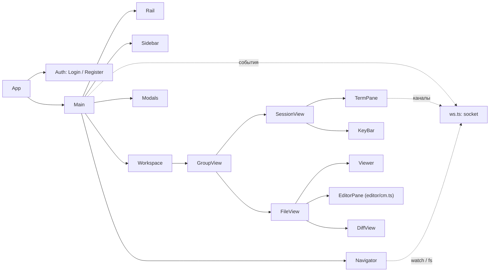

# Архитектура клиента

Как устроен веб-клиент Laavu в коде, который лежит в `web/`. Протокол со стороны сервера — в [`arch-daemon.md`](arch-daemon.md), здесь только то, что клиент из него использует.

## Стек и сборка

SPA на Preact 11 и TypeScript, сборка Vite 8 (`@preact/preset-vite`). Библиотеки состояния и роутера нет: состояние — маленькое хранилище в `web/src/store.ts`, «маршрут» один — `/register` для регистрации по ссылке, остальное решает `App`.

| Зависимость | Зачем |
|---|---|
| `@xterm/xterm`, `addon-fit`, `addon-unicode11`, `addon-web-links`, `addon-webgl` | терминал сессии и окно истории |
| `@codemirror/*`, `@lezer/highlight` | редактор файлов (`editor/cm.ts`), сравнение — `@codemirror/merge` |
| `markdown-it`, `@vscode/markdown-it-katex`, `katex` | просмотр Markdown с формулами |
| `mermaid` | диаграммы в Markdown |
| `highlight.js` | подсветка в режиме «Исходник» и в блоках кода Markdown |
| `pdfjs-dist` | PDF |
| `@fontsource/inter`, `@fontsource/jetbrains-mono` | шрифты отдаёт сам клиент, без Google Fonts |

`web/vite.config.ts`: цель `es2022`, `assetsInlineLimit: 0` — ассеты не встраиваются в `data:`, потому что CSP разрешает `data:` только картинкам и шрифтам. В режиме `vite` dev-сервер проксирует `/api` (вместе с WebSocket) на `laavud dev` на `:7700`.

**Как клиент попадает в бинарник.** `make web` делает `npm ci && npm run build` (`tsc --noEmit` и `vite build` в `web/dist`), затем `web-copy` копирует `web/dist` в `internal/webui/dist`. `internal/webui/webui.go` вшивает каталог через `//go:embed all:dist`; `FS()` возвращает `nil`, если `index.html` нет, и демон тогда отвечает «клиент не собран».

**Чанки.** В `index.html` подключается только основной бандл; всё тяжёлое грузится динамическим `import()` при первом использовании. Размеры — из текущей сборки `web/dist/assets`, без сжатия и в gzip.

| Чанк | Когда грузится | Размер |
|---|---|---|
| `index-*.js` + `index-*.css` | сразу: Preact, хранилище, все компоненты, xterm | 443 КБ (122 КБ) + 39 КБ (8 КБ) |
| `addon-webgl` | после открытия терминала, только не на сенсорных экранах | 113 КБ (31 КБ) |
| `cm` | первый вход в режим «Правка»; описания языков — отдельными мелкими чанками по имени файла | 131 КБ (42 КБ) |
| `markdown` + `katex` + CSS | первый просмотр Markdown | 369 КБ (120 КБ) + 259 КБ (77 КБ) |
| `highlight` + общий `common` (highlight.js) | первый «Исходник» | 155 КБ (52 КБ) |
| `mermaid.core` и десятки чанков диаграмм | первый блок ```` ```mermaid ```` на странице | от 85 КБ; крупнейшие — `elk` 1,46 МБ, `cytoscape` 434 КБ |
| `pdf` + `pdf.worker.min.mjs` | первый PDF | 429 КБ + 1,26 МБ |

Всего в `web/dist` около 12 МБ (9,5 МБ JS, остальное — шрифты KaTeX, Inter, JetBrains Mono). Обычная работа с терминалом и деревом файлов обходится основным бандлом.

## Карта компонентов

Точка входа — `web/src/main.tsx`: подключает шрифты и `style.css`, вызывает `initTheme()`, рисует `App` и регистрирует service worker `/sw.js` (только на https или `localhost`).



`App` (`components/App.tsx`) при старте зовёт `GET /api/me` и `GET /api/agents`. `401` — экран входа, другая ошибка — тост и повтор через 3 с. Дальше рисуется `Main`: он подписывает сокет на события, держит раскладку, ресайзеры, нижнее меню телефона и тост.

## Состояние

`store.ts` — один объект `State`, `setState(patch)` и хук `useStore(selector)`: компонент перерисовывается, только если выбранное значение сменилось по ссылке. Мутаций нет, каждое изменение — новый объект.

| Поле | Что хранит |
|---|---|
| `me`, `agents`, `agent` | кто вошёл, доступные агенты, агент в списке сессий |
| `connected` | связь WebSocket, точка у меню пользователя в рейке |
| `workdirs`, `sessions`, `context` | папки (с веткой и числом изменений), сессии и заполненность контекста по агентам; ключ контекста — `агент/сессия` |
| `groups`, `focus` | группы вкладок и группа с фокусом |
| `lastSession` | последняя активная сессия: туда уходят «в сессию» и загрузки перетаскиванием |
| `fileModes`, `dirty` | режим файла и признак несохранённых правок по `tabId` |
| `nav`, `navTab`, `showHidden` | папка навигатора, его вкладка («Файлы» / «Изменения»), показ скрытых |
| `sideOpen`, `navOpen` | свёрнуты ли список сессий и навигатор |
| `mobileScreen` | экран телефона: `sessions`, `work`, `files`, `changes` |
| `toast`, `modal` | всплывающее сообщение на 4 с; модальное окно `history`, `device`, `newSession`, `menu` |

**Вкладки.** `Tab = SessTab | FileTab`. У `SessTab` — `agent` и `session`. У `FileTab` — `agent`, `folder`, `path`, флаг `preview` (временная) и `since` (с какого момента показывать изменения; нет — с последнего коммита). `tabId` даёт ключ `s:агент/сессия` или `f:агент/папка/путь`, `tabKey` — `агент/сессия` для сессий.

**Группы.** `Group = { tabs, active }`, групп от 1 до `MAX_GROUPS = 4`. Операции: `openTab` (открыть или перейти к уже открытой), `focusTab`, `closeTab` (пустая группа исчезает, если она не последняя), `moveTab` (в другую группу или новую справа), `mergeGroups` (всё в одну), `pinTab`, `closeSessionTabs`. Активация вкладки переводит телефон на экран `work`, запоминает `lastSession` и переводит навигатор на папку вкладки (`folderOf`: у файла — его папка, у сессии — её рабочая папка).

**Временная вкладка.** Файл, открытый без `pin`, получает `preview: true` и встаёт на место прежней временной вкладки в той же группе, если у той нет несохранённых правок. Закрепляют двойной щелчок по вкладке или по файлу в дереве и первая правка (`pinTab` из `FileView.onChange`). Временная вкладка выделена стилем `.tab.preview`.

**localStorage.** Чтение и запись — через `lsGet`/`lsSet` из `api.ts`, исключения глотаются.

| Ключ | Что | Где пишется |
|---|---|---|
| `laavu.groups` | группы вкладок целиком | `setState`, при каждом изменении `groups` |
| `laavu.agent` | выбранный агент | `setState` |
| `laavu.side`, `laavu.nav` | `1`/`0`: открыты ли боковые панели | `setState` |
| `laavu.sideW`, `laavu.navW` | ширины панелей в пикселях | `useWidth` в `App.tsx` |
| `laavu.theme` | `dark` / `light`; нет ключа — по системе | `theme.ts` |
| `laavu.mode.<вид>` | `view` или `source` для вида файла (markdown, html, svg) | `FileView.setMode` |
| `laavu.collapsed.<агент>` | свёрнутые папки в списке сессий | `Sidebar` |
| `laavu.seen.<агент>/<папка>` | отметка «просмотрено» для «Изменений», unix-секунды | `Navigator` |

**Миграции.** `loadGroups` проверяет каждую вкладку (`validTab`), выкидывает пустые группы, обрезает до четырёх и поправляет `active`. Если `laavu.groups` нет, читает старый формат — `laavu.tabs`, список сессий — и делает из него одну группу. Старый ключ не удаляется.

Не сохраняются: черновики правок (`drafts` в `FileView.tsx` — `Map` в памяти), режимы конкретных вкладок, `focus`, экран телефона. Уход со страницы с несохранёнными правками ловит `beforeunload`.

## Раскладка

Десктоп — четыре колонки (`Main` в `App.tsx`):

| Часть | Компонент | Что в ней |
|---|---|---|
| Рейка | `Rail.tsx` | логотип, агенты кнопками с инициалами и счётчиком «ждут ответа», переключатели панелей, внизу меню пользователя с точкой связи |
| Список сессий | `Sidebar.tsx` | поиск, «Ждут тебя», папки с сессиями, «Новая сессия», «Новая папка» |
| Рабочая область | `Workspace.tsx` | группы вкладок в колонках (`.groups.n1`–`n4`), у каждой своя полоса вкладок |
| Навигатор | `Navigator.tsx` | «Файлы» (дерево) и «Изменения» для папки `nav` |

Ширины боковых панелей перетаскиваются за `.resizer` (`useWidth`): список сессий 220–460 px, по умолчанию 290; навигатор 220–560 px, по умолчанию 300. Обе панели сворачиваются кнопками в рейке, навигатор — ещё и кнопкой в своей шапке.

Вкладки перетаскиваются между группами (тип данных `application/x-laavu-tab`). На полосе группы — «Открыть рядом» (активная вкладка уходит в новую группу справа, если групп меньше четырёх) и у последней группы «Все вкладки в одну группу». Средняя кнопка мыши закрывает вкладку. В пустой группе — кнопка «Новая сессия».

**Телефон** — ширина до 760 px (`useMobile`, тот же порог в `@media` в `style.css`). Рейка скрыта, на экране одна часть, выбор — по классу `.screen-<экран>` на корне и нижнему меню `.mobile-nav`:

| Кнопка | Экран |
|---|---|
| Сессии (со счётчиком «ждут ответа» по всем агентам) | список сессий |
| Открыто | активная вкладка группы с фокусом; неактивна, если вкладок нет |
| Файлы, Изменения | навигатор на нужной вкладке |
| Ещё | меню пользователя модальным окном |

На экране вкладки сверху `MobileHead`: «назад» к списку, имя, статус и процент контекста или путь файла, номер вкладки «2/5», меню сессии или крестик файла. Горизонтальный свайп больше 80 px (и вдвое длиннее вертикального) по экрану вкладки переключает соседнюю вкладку группы — обработчик `onTouchEnd` на корне в `App.tsx`. Агент на телефоне сменить нечем: рейки нет, а в «Ещё» агентов нет.

## Связь с сервером

`ws.ts` — один `Socket` на вкладку браузера (`/api/ws`). Бинарный кадр — два байта номера канала (big-endian) и байты терминала; номера каналов идут с 1 по кругу до 65000. Переподключение с экспоненциальной задержкой от 0,5 до 30 с со случайным разбросом; после него клиент заново шлёт `subscribe`, `focus`, все `watch` и `open` всех открытых каналов.

| Клиент → сервер | Сервер → клиент |
|---|---|
| `subscribe` (агенты), `focus` (ключи сессий на экране и видимость страницы), `watch`/`unwatch` (папка, со счётчиком ссылок), `open`/`close`/`resize` канала, бинарный ввод | `opened`, `winsize`, `closed` по каналу; `sessions`, `status`, `action`, `context`, `fs`; бинарный вывод |

`focus` уходит при смене видимых сессий (`Workspace`) и при `visibilitychange`: демон по нему не шлёт пуш о том, что и так на экране. Список сессий клиент получает только событием `sessions`, отдельного HTTP-запроса нет.

HTTP (`api.ts`): `GET /api/me`, `/api/agents`, `…/workdirs`; `POST …/sessions`, `…/workdirs`; у сессии — `input`, `keys`, `scroll`, `kill`, `respawn`, `GET context`, `GET history`; у папки — `tree`, `text`, `PUT file`, `diff`, `changes`, `view`, `upload` (через `XMLHttpRequest` ради прогресса), ссылка `download`; `POST …/ports/{порт}/open`; вход и пуш — ниже. Ошибка — `ApiError` со статусом и текстом из поля `error`.

## Терминал

`TermPane.tsx`. Каждая вкладка сессии держит свой `Terminal` (xterm 6): JetBrains Mono 13 px, `scrollback: 1000`, `lineHeight: 1.15`, `macOptionIsMeta`, тема из `termTheme()`. Аддоны: Fit, Unicode 11 (ширина эмодзи и CJK), WebLinks (ссылки открываются в новом окне). WebGL подгружается отдельно и только на устройствах без сенсорного указателя (`pointer: coarse` не совпадает): на Pixel с дробным `devicePixelRatio` холст рисовался пустым. Потеря контекста WebGL возвращает DOM-рендер.

**Открытие только при ненулевом размере.** xterm в скрытом контейнере измерит символ нулём и останется пустым. Поэтому `term.open` зовёт `openNow` из `ResizeObserver`, когда у элемента появилась ширина; тот же наблюдатель дальше делает `fit()`.

**Каналы.** Вкладка стала видимой — `fit()`, `reset()` и `socket.open` с текущим размером; tmux при подключении перерисовывает экран целиком. Вкладка ушла с экрана — канал закрывается через 30 с (`DETACH_AFTER`), при быстром возврате таймер отменяется. `closed` с ошибкой пишет её в терминал и в тост, без ошибки — «[сессия закрыта]». Размер xterm (`onResize`) уходит `resize`.

**Ввод прямо в xterm.** `term.onData` отправляет байты в канал. Если сессию перед этим прокрутили вверх (`scrolled`), ввод сначала копится в `pending`, клиент выводит панель из просмотра истории (`leaveHistory` → `POST keys ["CancelMode"]`) и только потом отправляет накопленное. Отчёты мыши и фокуса (`notInput`) идут сразу. Колесо вверх на десктопе тоже помечает сессию прокрученной.

**Прокрутка свайпом** — `touchScroll`. Вертикальный жест (после 8 px) превращается в строки по высоте ячейки: палец вниз — к началу истории. Строки копятся и уходят пачкой раз в 40 мс через `scrollBy` (`POST scroll {lines}`). После отпускания — инерция: скорость затухает в 0,95 раза за кадр 16 мс, пока не станет меньше 0,05 px/мс. `stoppers` гасит инерцию перед выходом из истории, иначе она вернула бы панель обратно.

**Очередь.** Прокрутка и выход из истории идут через `enqueue` — одна цепочка промисов на сессию, так tmux получает их в том порядке, в каком они случились. Как сервер выбирает между copy-mode и событиями колеса для программ с мышью — в [`arch-worker.md`](arch-worker.md).

**Окно tmux одно на всех.** У окна один размер, он следует за последним активным клиентом. Если ширина и высота из `winsize` дольше секунды не совпадают с размером своего xterm, ставится `elsewhere`: терминал прячется (`visibility: hidden`) и теряет фокус, на его месте надпись «Сессия открыта на другом устройстве» и кнопка «Вернуть сюда». Забирает окно `claim` — `resize` того же размера: на возврат к видимой вкладке, `focus` окна, `pointerdown`, `wheel` и `touchstart` по терминалу, не чаще раза в 500 мс; «Вернуть сюда» — без ограничения.

**Окно истории.** `Modals.tsx` → `History`: `GET history` (вывод `capture-pane`) в отдельном xterm только для чтения, `scrollback: 50000`.

Для e2e все терминалы лежат в `window.__laavuTerms` по ключу сессии; через него же `termOf` находит терминал для полосы клавиш.

## Вокруг терминала

**Шапка сессии** (`SessionView.tsx`): папка, статус, полоска контекста (жёлтая от 65%), загрузка файла, история, меню. В меню у сессий Claude — «Сжать контекст» (`/compact`) и «Сбросить контекст» (`/clear` после подтверждения), оба только в статусе «ждёт ответа»; у всех — «История», «Открыть порт» (номер спрашивается `prompt`), «Закрыть сессию». Контекст запрашивается `GET context` при показе вкладки и дальше приходит событием `context`. Завершившийся процесс — полоса с «Продолжить» (`respawn`) и «Закрыть».

**Полоса клавиш** (`KeyBar.tsx`) — только на телефоне, под терминалом: файл, камера (`capture="environment"`) и клавиши PgUp, PgDn, Esc, Tab, ⇧Tab, ^C, стрелки, ⏎. Клавиши уходят `POST keys` с именами tmux после `leaveHistory`. PgUp и PgDn — не клавиши, а `scrollBy` на высоту терминала без двух строк. `onMouseDown` с `preventDefault` не даёт кнопкам забрать фокус и спрятать экранную клавиатуру.

**Вставка в сессию** — `insertText`: `POST input {text, enter: false}`, то есть в терминал без Enter. Если сессии нет на экране, её вкладка открывается. Так работают:

- загрузка — `uploadTo` грузит файлы по одному с прогрессом в тосте и вставляет путь, который вернул сервер;
- «в сессию» из просмотрщика — `папка/путь:строка` и цитата с `> `;
- перетаскивание файлов в окно — загрузка в папку `lastSession`, путь в неё; на папку в дереве — в эту папку.

Без выбранной папки (кнопка, камера, окно) клиент передаёт пустой `dir`, куда положить файл, решает сервер.

## Список сессий

`Sidebar.tsx`. Сверху поиск по сессиям и папкам (`Ctrl+K` / `Cmd+K` открывает список и ставит фокус). Дальше блок «Ждут тебя» — карточки сессий в статусе `waiting`, затем папки агента (`GET workdirs`) с сессиями внутри и группа «прочее» для сессий без папки.

| Что видно | Откуда |
|---|---|
| Точка статуса (`Status.tsx`: `starting`, `working`, `waiting`, `sleeping`, `exited`, `error`, у не-Claude `active`, `quiet`) | событие `status` |
| Процент контекста, предупреждение от 65% | событие `context` |
| Последнее действие: «работает · Edit src/app.ts» | событие `action`, `actionLabel` |
| «спит, поднимется при открытии» | поле `sleeping` из `sessions` |
| Ветка и «±N» незакоммиченных у папки | `GET workdirs` |

Папки перечитываются (`refreshWorkdirs`, не чаще раза в 2 с на агента) после перехода сессии в «ждёт ответа» и на `focus` окна. «±N» открывает «Изменения». У папки при наведении — новая сессия агента, новый терминал, «что изменилось». Новая сессия создаётся `POST sessions` с размером 120×36, сразу добавляется в список и открывается вкладкой. Модальное окно «Новая сессия» даёт выбрать вид и папку или завести новую.

## Файлы

**Навигатор** (`Navigator.tsx`) показывает папку `nav`, она следует за активной вкладкой. «Файлы» — дерево: каталоги грузятся по раскрытию (`GET tree`, со скрытыми — `&hidden=1`), по событию `fs` перечитываются только уже загруженные каталоги из `m.dirs`. У файлов — буква статуса git из незакоммиченного (`??` показывается как `U`). Щелчок открывает временную вкладку, двойной — закреплённую. На папку можно бросить файлы.

«Изменения» — `GET changes?since=…`. `since` — отметка `laavu.seen.<агент>/<папка>`, без неё — сутки назад. С git: «Не закоммичено» и коммиты с файлами; файл открывается в режиме «Изменения» с этим `since`. Без git — список файлов по времени. Отметку ставит только кнопка «Отметить как просмотренное». Изменения грузятся всегда, не только на этой вкладке: из них счётчик на вкладке и буквы в дереве. По `fs` список перечитывается с задержкой 1,5 с.

**Вкладка файла** (`FileView.tsx`) загружает `GET text` и перечитывает его, когда путь есть в `m.files` события `fs`. Режимы зависят от вида файла (`meta.kind` от сервера):

| Вид | Режимы |
|---|---|
| markdown, html, svg | Просмотр, Исходник, Правка, Изменения |
| code, text | Текст, Правка, Изменения |
| image, pdf, binary | Просмотр |

«Правка» есть, только если сервер вернул `version` (текст в пределах лимита), «Изменения» — только в git-папке. Выбор «Просмотр/Исходник» запоминается для вида на устройстве.

**Просмотрщик** (`Viewer.tsx`):

| Вид | Как показывается |
|---|---|
| Markdown | `render/markdown.ts`: markdown-it без сырого HTML, KaTeX, highlight.js в блоках кода, mermaid с `securityLevel: 'strict'`; относительные ссылки открывают файл во вкладке, картинки берутся с origin просмотра; у блоков `data-source-line` |
| Код, текст, исходник | `render/highlight.ts`: highlight.js по расширению, номера строк; больше 400 000 символов — без подсветки |
| HTML | `iframe` с origin просмотра, `sandbox="allow-scripts allow-forms allow-popups"`, `referrerpolicy="no-referrer"` |
| SVG, картинки | `` с origin просмотра |
| PDF | `render/pdf.ts`: pdf.js по URL просмотра, воркер с origin приложения, не больше 200 страниц, ширина по панели |
| Бинарный | имя, размер, дата и «Скачать» |

Обрезанный сервером файл (`truncated`) — с плашкой «Показано начало файла».

**Origin просмотра.** `viewBase` просит `POST …/view` и получает базовый адрес с токеном на папку. Ответ кешируется на 45 минут (токен живёт час), при ошибке забывается. С этого адреса идут HTML, SVG, картинки, картинки из Markdown и PDF. Markdown и исходники рендерятся на origin приложения.

**«В сессию».** Отпускание выделения в просмотрщике ищет ближайший `data-source-line` (Markdown) или `data-line` (исходник) и показывает кнопку «в сессию». Нажатие вставляет `папка/путь:строка` и цитату в `lastSession`; если сессий не открывали — тост «Сначала откройте сессию».

**Правка** — `EditorPane` грузит `editor/cm.ts` при первом входе. CodeMirror 6: номера строк, история, поиск сверху, подсветка совпадений, перенос строк, `Tab` для отступа, `Mod-s` — сохранить. Язык выбирается по имени файла через `@codemirror/language-data` (грузится по требованию), для Markdown — `lang-markdown` с подсветкой языков в блоках кода. Тема и подсветка — на CSS-переменных страницы, поэтому смена темы не пересоздаёт редактор.

**Версия и конфликт.** `base` — версия и текст, от которых идёт правка; пока правок нет, `base` следует за диском, и редактор подтягивает новый текст сам. Текст правки лежит в `drafts`, `dirty` ставится, когда текст отличается от `base`; на вкладке появляется точка. Сохранение — `PUT …/file {content, base: версия}`.

- `409` — тост «Файл изменился на диске», файл перечитывается.
- Файл на диске сменился при `dirty` — полоса конфликта: «Сравнить» (`unifiedMergeView`: зелёное — ваше, красное — с диска, у фрагментов кнопки «Оставить моё» и «Взять с диска»), «Взять с диска» (черновик выбрасывается) и «Сохранить моё» (сохранение от версии на диске). `Ctrl+S` в конфликте не сохраняет, а просит сначала сравнить.
- Закрытие вкладки с правками спрашивает подтверждение (`confirmClose`). В «Просмотре» при несохранённых правках показывается черновик, а не диск.

**Изменения файла** (`DiffView`) — `GET diff?since=…` и построчная раскраска. Без `since` у вкладки клиент передаёт текущее время, и экран подписан «изменений с последнего коммита нет»; как сервер трактует такой `since` — в [`arch-daemon.md`](arch-daemon.md).

## Вход

`Auth.tsx`. Без сессии `App` показывает `Login`: `POST /api/auth/login/begin` → `navigator.credentials.get` → `POST /api/auth/login/finish?cid=…`. Опции WebAuthn и ответ перекодируются из base64url и обратно в `api.ts` (`creationOptions`, `requestOptions`, `credentialJSON`).

`Register` открывается по пути `/register`, токен берётся из `#` ссылки. `register/check` говорит, новый ли это пользователь и роль; новому нужно ввести имя. Дальше `register/begin` → `navigator.credentials.create` → `register/finish` с подписью устройства вида «iOS Safari» (`deviceLabel`).

- `InvalidStateError` при создании значит, что passkey этого пользователя на устройстве уже есть (например, приехал через связку ключей iCloud). Клиент пишет об этом и предлагает перейти ко входу.
- `NotAllowedError` браузер отдаёт и на отмену, и на недоверенный сертификат, и на отсутствие аутентификатора — `webauthnError` перечисляет все три причины и добавляет текст браузера.

Ссылку для второго устройства даёт пункт меню «Добавить устройство» (`POST /api/auth/device-link`), «Выйти» — `POST /api/auth/logout` и перезагрузка. В режиме без входа (`me.no_auth`) этих пунктов нет.

## Тема и иконки

Цвета — токены на `:root[data-theme='dark']` и `:root[data-theme='light']` в начале `style.css`: фоны `--bg0`–`--bg3`, `--line`, `--fg`, `--muted`, `--faint`, акцент `--ember` (он же «ждёт ответа»), `--work` («работает»), `--ok`, `--bad`, `--term-bg`, `--term-fg`, `--term-sel`, `--type`. Без атрибута действует тёмная.

`theme.ts`: предпочтение `system`/`dark`/`light` в `laavu.theme`, итог ставится в `data-theme` на `<html>` и в `meta theme-color`; при «по системе» следит за `prefers-color-scheme`. Переключатель по кругу — в меню пользователя. `termTheme()` собирает тему xterm из тех же переменных через `getComputedStyle`; часть цветов ANSI (жёлтый, пурпурный, циан, чёрный, белый) задана в коде отдельно для тёмной и светлой. Открытые терминалы меняют тему по `onThemeChange`, редактор — сам через переменные.

Иконки — `icons.tsx`: штриховые SVG 24×24 со `stroke="currentColor"`, компонент `Icon` по имени. Иконки `send` и `message` в коде остались, но нигде не используются — похоже, от убранного поля ввода.

## Пуш и PWA

`web/public/manifest.webmanifest`: `display: standalone`, иконки SVG, 192 и 512 px. `index.html` добавляет `apple-touch-icon` и `apple-mobile-web-app-capable`. Цвета в манифесте (`#101216`, `#1f2328`) не совпадают с токенами темы — остались от первой версии клиента.

`web/public/sw.js` — только пуш, офлайн-кеша нет. На `push` показывает уведомление с `tag` из сообщения и `renotify`. На щелчок фокусирует открытое окно приложения и шлёт ему `{type: 'open', agent, session}`, а если окна нет — открывает `/#/агент/сессия`. `App` открывает вкладку сессии и по сообщению, и по такому адресу.

Подписка — `push.ts`, пункт меню «Уведомления на этом устройстве» (виден, если на сервере пуш включён и вход не отключён): разрешение `Notification`, `GET /api/push/key`, `pushManager.subscribe` с VAPID-ключом, `POST /api/push/subscribe`. Без `PushManager` клиент подсказывает, что на iPhone сначала нужно «На экран Домой».

## Что проверяют e2e

`test/e2e/tests/`, Playwright против `laavud dev` с заглушкой `fakeclaude`; профили `desktop` (Chrome 1500×900) и `mobile` (Pixel 7).

| Тест | Что гарантирует |
|---|---|
| `app.spec.ts`: сессия агента | статус и «Ждут тебя», поля ввода нет, контекст, файл агента в дереве по inotify, последнее действие, ветка и «±1», временная вкладка заменяется и закрепляется, KaTeX, mermaid, картинка и HTML с `:7701`, PDF, «в сессию», загрузка, «Изменения» без git, история; ни ошибок консоли, ни нарушений CSP |
| `app.spec.ts`: терминал | ввод в xterm, «Открыть рядом» и обратно в одну группу, путь загрузки без Enter, «Продолжить» у завершённой сессии |
| `app.spec.ts`: правка | точка «не сохранено», закрепление, `Ctrl+S`, подтягивание правки агента, конфликт со сравнением и «Сохранить моё», «Взять с диска» |
| `auth.spec.ts` | регистрация passkey по ссылке (виртуальный аутентификатор), одноразовость ссылки, выход и вход, ссылка для второго устройства |
| `mobile.spec.ts`: экраны | нижнее меню, ввод в терминал, полоса клавиш, свайп по истории и ввод после него, PgUp/PgDn, файл на весь экран, правка и сохранение |
| `mobile.spec.ts`: одна сессия на двух устройствах | окно tmux сжимается под телефон, в браузере плашка, «Вернуть сюда», касание на телефоне забирает окно |

Не покрыты: пуш и service worker, тема, ресайзеры, перенос вкладок перетаскиванием, свайп между вкладками, восстановление групп после перезагрузки и миграция `laavu.tabs`.
