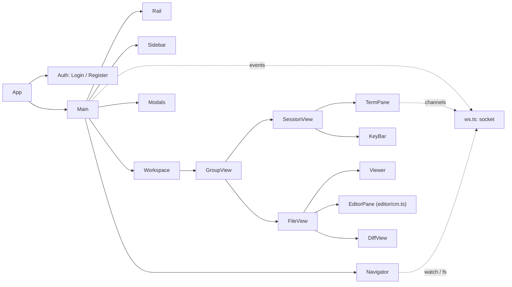

# Client architecture

How the Laavu web client in `web/` is put together. The server side of the protocol is in [`arch-daemon.md`](arch-daemon.md). This file covers only what the client uses.

Terms. A **workspace** is a top-level folder in the agent's home where sessions run (`workdir` on the server, `folder` in client code and the API). Folders are what lies inside a workspace, in the navigator tree.

## Stack and build

It's a Preact 11 + TypeScript SPA built with Vite 8 (`@preact/preset-vite`). No state library, no router. State is a small store in `web/src/store.ts`. There is one "route", `/register`, for signing up by link, and `App` decides everything else.

| Dependency | Why |
|---|---|
| `@xterm/xterm`, `addon-fit`, `addon-unicode11`, `addon-web-links`, `addon-webgl` | session terminal and history window |
| `@codemirror/*`, `@lezer/highlight` | file editor (`editor/cm.ts`), comparison via `@codemirror/merge` |
| `markdown-it`, `@vscode/markdown-it-katex`, `katex` | Markdown view with formulas |
| `mermaid` | diagrams in Markdown |
| `highlight.js` | highlighting in "Source" mode and in Markdown code blocks |
| `pdfjs-dist` | PDF |
| `@fontsource/inter`, `@fontsource/jetbrains-mono`, `@fontsource/outfit` | fonts are served by the client itself, no Google Fonts (Outfit only for the sign-in and empty-screen headings) |

`web/vite.config.ts` sets target `es2022` and `assetsInlineLimit: 0`. Assets aren't inlined as `data:` because the CSP allows `data:` only for images and fonts. Under `vite` the dev server proxies `/api` (WebSocket included) to `laavud dev` on `:7700`.

**How the client ends up in the binary.** `make web` runs `npm ci && npm run build` (`tsc --noEmit`, then `vite build` into `web/dist`). Then `web-copy` copies `web/dist` to `internal/webui/dist`. `internal/webui/webui.go` embeds that directory with `//go:embed all:dist`. If there is no `index.html`, `FS()` returns `nil` and the daemon answers "client is not built".

**Chunks.** `index.html` loads only the main bundle. Anything heavy comes in through a dynamic `import()` the first time it's needed. Sizes below are from the current build in `web/dist/assets`, raw and gzipped.

| Chunk | When it loads | Size |
|---|---|---|
| `index-*.js` + `index-*.css` | immediately: Preact, store, all components, xterm | 441 KB (121 KB) + 41 KB (8 KB) |
| `addon-webgl` | after a terminal opens, only on non-touch screens | 113 KB (31 KB) |
| `cm` | first entry into "Edit" mode; language definitions are separate small chunks chosen by file name | 131 KB (42 KB) |
| `markdown` + `katex` + CSS | first Markdown view | 369 KB (120 KB) + 259 KB (77 KB) |
| `highlight` + shared `common` (highlight.js) | first "Source" | 155 KB (52 KB) |
| `mermaid.core` and dozens of diagram chunks | first ```` ```mermaid ```` block on a page | from 85 KB; the largest are `elk` 1.46 MB, `cytoscape` 434 KB |
| `pdf` + `pdf.worker.min.mjs` | first PDF | 429 KB + 1.26 MB |

All of `web/dist` comes to about 12 MB: 9.5 MB of JS, and the rest is KaTeX, Inter, JetBrains Mono and Outfit fonts. Day-to-day work with the terminal and the file tree only needs the main bundle.

## Component map

Everything starts in `web/src/main.tsx`. It loads the fonts and `style.css`, calls `initTheme()`, sets the page title to `<host> · Laavu`, renders `App` and registers the service worker `/sw.js` (only over https or on `localhost`). Menus (the session menu, the user menu) are drawn by `Popover.tsx` (`usePopover`).



On start, `App` (`components/App.tsx`) calls `GET /api/me` and `GET /api/agents`. A `401` shows the sign-in screen. Any other error shows a toast and retries after 3 s. After that `Main` renders. Until then the splash from `index.html` is on screen: the logo draws itself, the ember lights up, the server address sits below. Its styles are inline in `index.html` and its script is `public/splash.js` (the CSP allows only `'self'` scripts), which sets the theme before the first paint. `App` adds `gone` to `#splash` when it leaves the `loading` phase, and the splash fades out. It subscribes the socket to events and owns the layout, the resizers, the bottom menu on phones and the toast.

## State

`store.ts` holds a single `State` object, `setState(patch)` and the hook `useStore(selector)`. A component re-renders only when the value it selected changes by reference. Nothing is mutated in place, every change produces a new object.

| Field | What it holds |
|---|---|
| `me`, `agents`, `agent` | who is signed in, available agents, the agent shown in the session list |
| `connected` | WebSocket connection, the dot by the user menu in the rail |
| `workdirs`, `sessions`, `context` | workspaces (with branch and number of changes), sessions and context fill per agent; the context key is `agent/session` |
| `groups`, `focus` | tab groups and the focused group |
| `lastSession` | the last active session: "send to session" and drag-and-drop uploads go there |
| `fileModes`, `dirty` | file mode and the unsaved-edits flag by `tabId` |
| `nav`, `navTab`, `showHidden` | navigator workspace, its tab ("Files" / "Changes"), showing hidden files |
| `sideOpen`, `navOpen` | whether the session list and the navigator are collapsed |
| `mobileScreen` | phone screen: `sessions`, `work`, `files`, `changes` |
| `toast`, `modal` | a popup message for 4 s; modal window `history`, `device`, `newSession`, `menu` |

**Tabs.** `Tab = SessTab | FileTab`. A `SessTab` has `agent` and `session`. A `FileTab` has `agent`, `folder`, `path`, and the `preview` flag (temporary tab). `tabId` returns `s:agent/session` or `f:agent/folder/path`. For sessions, `tabKey` returns `agent/session`.

**Groups.** `Group = { tabs, active }`. There can be 1 to `MAX_GROUPS = 4` of them. The operations are `openTab` (open, or switch to the tab if it's already open), `focusTab`, `closeTab` (an empty group goes away unless it's the last one), `moveTab` (to another group or to a new one on the right), `mergeGroups` (everything into one group), `pinTab` and `closeSessionTabs`. When a tab becomes active, the phone switches to the `work` screen, `lastSession` is updated and the navigator jumps to that tab's workspace (`folderOf` returns it for both files and sessions).

**Temporary tab.** A file opened without `pin` gets `preview: true`. It replaces the previous temporary tab in the same group, as long as that tab has no unsaved edits. Double-clicking the tab or the file in the tree pins it, and so does the first edit (`pinTab` from `FileView.onChange`). Temporary tabs are styled with `.tab.preview`.

**localStorage.** Reads and writes go through `lsGet`/`lsSet` in `api.ts`, which swallow exceptions.

| Key | What | Where it is written |
|---|---|---|
| `laavu.groups` | all tab groups | `setState`, on every change of `groups` |
| `laavu.agent` | the selected agent | `setState` |
| `laavu.side`, `laavu.nav` | `1`/`0`: whether the side panels are open | `setState` |
| `laavu.sideW`, `laavu.navW` | panel widths in pixels | `useWidth` in `App.tsx` |
| `laavu.theme` | `dark` / `light`; no key means follow the system | `theme.ts` |
| `laavu.mode.<kind>` | `view` or `source` for a file kind (markdown, html, svg) | `FileView.setMode` |
| `laavu.collapsed.<agent>` | collapsed workspaces in the session list | `Sidebar` |
| `laavu.seen.<agent>/<folder>` | "seen" mark for "Changes", unix seconds | `Navigator` |

**Migrations.** `loadGroups` runs each tab through `validTab`, drops empty groups, trims the list to four and fixes `active`. If `laavu.groups` is missing, it reads the old `laavu.tabs` format (a list of sessions) and builds one group out of it. The old key stays.

Some things are not saved at all: edit drafts (`drafts` in `FileView.tsx`, an in-memory `Map`), per-tab modes, `focus` and the phone screen. If you leave the page with unsaved edits, `beforeunload` catches it.

## Layout

On desktop `Main` in `App.tsx` lays out four columns:

| Part | Component | What it contains |
|---|---|---|
| Rail | `Rail.tsx` | logo, agents as buttons with initials and a "waiting" counter, panel toggles, the user menu with the connection dot at the bottom |
| Session list | `Sidebar.tsx` | agent settings button, search, "Waiting for you", workspaces with sessions, "New session", "New workspace" |
| Workspace | `Workspace.tsx` | tab groups in columns (`.groups.n1`–`n4`), each with its own tab strip |
| Navigator | `Navigator.tsx` | "Files" (tree) and "Changes" for the `nav` workspace |

You resize the side panels by dragging `.resizer` (`useWidth`). The session list goes from 220 to 460 px and starts at 290. The navigator goes from 220 to 560 px and starts at 300. Rail buttons collapse both panels.

Tabs can be dragged between groups (data type `application/x-laavu-tab`). Each group's strip has "Open to the side", which moves the active tab into a new group on the right when the group has more than one tab and there are fewer than four groups. The last group also gets "Merge all tabs into one group". Middle-click closes a tab. An empty group shows a "New session" button.

**Phone** means a width of 760 px or less (`useMobile`, the same breakpoint as the `@media` in `style.css`). The rail is hidden and only one part is on screen at a time. Which one is decided by the `.screen-<screen>` class on the root and the bottom menu `.mobile-nav`:

| Button | Screen |
|---|---|
| Sessions (with a "waiting" counter across all agents) | session list |
| Open | the active tab of the focused group; disabled if there are no tabs |
| Files, Changes | navigator on the matching tab |
| More | the user menu as a modal |

On a tab screen `MobileHead` sits at the top. It has "back" to the list, the name, then either the status and context percentage or the file path, the tab position like "2/5", and the session menu (or a close cross for a file). A horizontal swipe on the tab screen switches to the neighboring tab in the group if it's longer than 80 px and at least twice the vertical movement. The handler is `onTouchEnd` on the root in `App.tsx`. You can't change the agent on a phone. There's no rail, and "More" doesn't list agents.

## Talking to the server

`ws.ts` keeps one `Socket` per browser tab (`/api/ws`). A binary frame is a two-byte channel number (big-endian) followed by terminal bytes. Channel numbers start at 1 and wrap around at 65000. Reconnects use exponential backoff from 0.5 to 30 s with random jitter. After reconnecting the client sends `subscribe`, `focus`, every `watch`, and `open` for each open channel again.

| Client → server | Server → client |
|---|---|
| `subscribe` (agents), `focus` (keys of on-screen sessions and page visibility), `watch`/`unwatch` (folder, reference-counted), channel `open`/`close`/`resize`, binary input | `opened`, `winsize`, `closed` per channel; `sessions`, `status`, `action`, `context`, `fs`; binary output |

`focus` goes out when the set of visible sessions changes (`Workspace`) and on `visibilitychange`. The daemon uses it to skip push notifications about things already on screen. The session list only ever arrives through the `sessions` event. There's no HTTP request for it.

HTTP (`api.ts`): `GET /api/me`, `/api/agents`, `…/workdirs`; `POST …/sessions`, `…/workdirs`; per session `input`, `keys`, `scroll`, `kill`, `respawn`, `GET context`, `GET history`; per folder `tree`, `text`, `PUT file`, `diff`, `changes`, `view`, `upload` (through `XMLHttpRequest` to get progress), the `download` link; `POST …/ports/{port}/open`. Sign-in and push are covered further down. Errors come back as `ApiError` with the status and the text of the `error` field.

## Terminal

This is `TermPane.tsx`. Every session tab owns its own `Terminal` (xterm 6) with JetBrains Mono 13 px, `scrollback: 1000`, `lineHeight: 1.15`, `macOptionIsMeta` and the theme from `termTheme()`. Addons are Fit, Unicode 11 (emoji and CJK width) and WebLinks, which opens links in a new window. WebGL is loaded separately, and only on devices without a touch pointer (when `pointer: coarse` doesn't match). On a Pixel with a fractional `devicePixelRatio` the WebGL canvas came out blank. If the WebGL context is lost, xterm falls back to the DOM renderer.

**Open only at a non-zero size.** In a hidden container xterm measures a character as zero wide and stays blank. So `openNow` calls `term.open` from a `ResizeObserver` once the element has a width, and the same observer runs `fit()` after that.

**Channels.** When a tab becomes visible the client does `fit()`, `reset()` and `socket.open` with the current size. tmux redraws the whole screen on attach. When a tab goes off screen its channel is closed after 30 s (`DETACH_AFTER`), and coming back sooner cancels the timer. If `closed` carries an error, it's written to the terminal and shown in a toast. Without an error the terminal gets "[session closed]". Size changes from xterm (`onResize`) go out as `resize`.

**Typing goes straight into xterm.** `term.onData` sends bytes to the channel. If the session had been scrolled up (`scrolled`), the input is first collected in `pending`. The client takes the pane out of history view (`leaveHistory` → `POST keys ["CancelMode"]`) and then sends what it collected. Mouse and focus reports (`notInput`) are sent right away. Scrolling the wheel up on desktop also marks the session as scrolled.

**Swipe scrolling** lives in `touchScroll`. After 8 px a vertical gesture is turned into lines using the cell height. Moving the finger down scrolls toward the start of history. Lines are batched and sent every 40 ms through `scrollBy` (`POST scroll {lines}`). After the finger lifts there's inertia: velocity is multiplied by 0.95 every 16 ms frame until it falls below 0.05 px/ms. `stoppers` kills the inertia before leaving history. If it didn't, the inertia would scroll the pane back.

**Queue.** Scroll and leave-history requests go through `enqueue`, which is one promise chain per session, so tmux gets them in the order they happened. How the server picks between copy-mode and wheel events for mouse-aware programs is in [`arch-worker.md`](arch-worker.md).

**One tmux window for everyone.** The window has a single size and follows whichever client was active last. If the width and height from `winsize` don't match the local xterm for over a second, `elsewhere` is set. The terminal gets `visibility: hidden` and loses focus, and in its place you see "Session is open on another device" with a "Bring it here" button. The client takes the window back with `claim`, which is just a `resize` with the same size. It fires when you return to a visible tab, on window `focus`, and on `pointerdown`, `wheel` or `touchstart` on the terminal, at most once per 500 ms. "Bring it here" isn't rate-limited.

**History window.** `Modals.tsx` → `History` shows `GET history` (the output of `capture-pane`) in a separate read-only xterm with `scrollback: 50000`.

For e2e every terminal is stored in `window.__laavuTerms` by session key. `termOf` uses the same map to find the terminal for the key strip.

## Around the terminal

**Session header** (`SessionView.tsx`) shows the folder, status, a context bar that turns yellow at 65%, file upload, history and a menu. Claude sessions get "Compact context" (`/compact`) and "Clear context" (`/clear`, after a confirmation) in the menu, and both work only in the "waiting" status. Every session has "History", "Open port" (it asks for the number with `prompt`) and "Close session". Context is fetched with `GET context` when the tab is shown, and after that it comes in as the `context` event. When the process has exited, a strip with "Resume" (`respawn`) and "Close" appears.

**Key strip** (`KeyBar.tsx`) is only on phones, under the terminal. It has file, camera (`capture="environment"`) and the keys PgUp, PgDn, Esc, Tab, ⇧Tab, ^C, arrows and ⏎. Keys go out as `POST keys` with tmux key names, after `leaveHistory`. PgUp and PgDn aren't sent as keys at all. They call `scrollBy` by the terminal height minus two lines. `onMouseDown` calls `preventDefault` so the buttons don't steal focus and close the on-screen keyboard.

**Inserting into a session** is done by `insertText`, which sends `POST input {text, enter: false}`, so the text lands in the terminal without Enter. If the session isn't on screen, its tab is opened first. Three things use it:

- upload: `uploadTo` uploads files one at a time with progress in a toast and inserts the path the server returned;
- "Send to session" from the viewer: `folder/path:line` and a quote with `> `;
- dragging files onto the window: upload into the `lastSession` folder and insert the path; onto a folder in the tree: into that folder.

When no folder was picked (the button, the camera, a drop on the window), the client sends an empty `dir` and the server decides where the file goes.

## Session list

`Sidebar.tsx`. Search over sessions and workspaces is at the top, and `Ctrl+K` / `Cmd+K` opens the list and focuses it. Below it is the "Waiting for you" block with cards for sessions in the `waiting` status. Then come the agent's workspaces (`GET workdirs`) with their sessions, and an "other" group for sessions that have no workspace.

| What is shown | Source |
|---|---|
| Status dot (`Status.tsx`: `starting`, `working`, `waiting`, `sleeping`, `exited`, `error`, and for non-Claude `active`, `quiet`) | `status` event |
| Context percentage, warning from 65% | `context` event |
| Last action: "working · Edit src/app.ts" | `action` event, `actionLabel` |
| "sleeping, wakes on open" | the `sleeping` field from `sessions` |
| Branch and "±N" uncommitted for a workspace | `GET workdirs` |

Workspaces are reloaded (`refreshWorkdirs`, no more than once per 2 s per agent) when a session moves to "waiting" and on window `focus`. Clicking "±N" opens "Changes". Hovering a workspace shows three buttons: new agent session, new terminal, and "What changed". A new session is created with `POST sessions` at 120×36. It shows up in the list immediately and opens in a tab. In the "New session" modal you pick the kind, then either a workspace (existing or new) or "Clone from git": a repository address and a workspace name, which follows the address (`folderFromURL`) until you edit it. The clone goes through `POST clone`, and the session starts in the new workspace. A git error is shown in the modal; when it looks like a missing key (`Permission denied (publickey)`, host key, "Could not read from remote repository") it links to agent settings.

**Agent settings.** The settings button in the session list header opens `Modals.tsx` → `AgentSettings`. For now it holds the agent's ssh key: the public key with "Copy" and the fingerprint, or "Create key" when there is none.

## Files

The **navigator** (`Navigator.tsx`) shows the `nav` workspace, which follows the active tab. "Files" is the tree. Directories load when you expand them (`GET tree`, plus `&hidden=1` for hidden files). On an `fs` event only directories that are already loaded and listed in `m.dirs` get reloaded. Folders get a filled folder icon and a heavier name. Files get an outline icon by type (code, data and config, documents, images, archives, other; `fileType` matches the name), tinted quietly per type. Each file carries a git status letter from the uncommitted state, and `??` is shown as `U`. A click opens a temporary tab and a double-click opens a pinned one. You can drop files onto a folder.

"Changes" calls `GET changes?since=…`. In a git workspace it shows only the working tree against the last commit (`uncommitted`), the same thing the "±N" badge counts, and a file opens in "Changes" mode, a diff against `HEAD`. Commits from the answer are not shown. Without git it's a list of files by time since the `laavu.seen.<agent>/<folder>` mark, or one day ago if there's no mark. Only the "Mark as seen" button, shown only without git, sets the mark. Changes are loaded even when this tab isn't open, because the tab counter and the letters in the tree come from them. On `fs` the list reloads after 1.5 s.

The **file tab** (`FileView.tsx`) loads `GET text` and reloads it when its path shows up in `m.files` of an `fs` event. Which modes you get depends on the file kind (`meta.kind` from the server):

| Kind | Modes |
|---|---|
| markdown, html, svg | Preview, Source, Edit, Changes |
| code, text | Text, Edit, Changes |
| image, pdf, binary | Preview |

"Edit" shows up only when the server returned `version`, which it does for text under the size limit. "Changes" needs a git workspace. The Preview/Source choice is remembered per kind on the device.

**Viewer** (`Viewer.tsx`):

| Kind | How it is shown |
|---|---|
| Markdown | `render/markdown.ts`: markdown-it without raw HTML, KaTeX, highlight.js in code blocks, mermaid with `securityLevel: 'strict'`; headings get GitHub-style ids (`slug`); relative links open the file in a tab, and a `#anchor` scrolls to the heading, in the same file or after opening the other one (`pendingAnchors` in `Viewer.tsx`); images come from the view origin; blocks carry `data-source-line` |
| Code, text, source | `render/highlight.ts`: highlight.js by extension, line numbers; over 400,000 characters, no highlighting |
| HTML | `iframe` from the view origin, `sandbox="allow-scripts allow-forms allow-popups"`, `referrerpolicy="no-referrer"` |
| SVG, images | `` from the view origin |
| PDF | `render/pdf.ts`: pdf.js from the view URL, worker from the app origin, at most 200 pages, width fitted to the panel |
| Binary | name, size, date and "Download" |

If the server truncated the file (`truncated`), a "Showing the start of the file" banner appears.

**View origin.** `viewBase` calls `POST …/view` and gets back a base URL with a per-folder token. The client caches it for 45 minutes (the token is valid for an hour) and drops it on error. HTML, SVG, images, images inside Markdown, and PDFs are all loaded from this URL. Markdown itself and source view are rendered on the app origin.

**"Send to session".** When you release a selection in the viewer, the client finds the nearest `data-source-line` (Markdown) or `data-line` (source) and shows a "Send to session" button. Clicking it inserts `folder/path:line` and the quote into `lastSession`. If no session has been opened yet, a toast says "Open a session first".

**Edit.** `EditorPane` loads `editor/cm.ts` the first time you enter the mode. It's CodeMirror 6 with line numbers, history, search at the top, match highlighting, line wrapping, `Tab` for indent and `Mod-s` to save. The language is picked by file name through `@codemirror/language-data`, loaded on demand. Markdown uses `lang-markdown` and highlights languages inside code blocks. Theme and highlighting read the page's CSS variables, so switching the theme doesn't recreate the editor.

**Version and conflict.** `base` is the version and text the edit started from. Until you make an edit, `base` tracks the disk and the editor picks up new text on its own. The edited text lives in `drafts`. `dirty` is set when the text differs from `base`, and the tab gets a dot. Saving sends `PUT …/file {content, base: version}`.

- `409`: a toast "File changed on disk: compare and save again", and the file is reloaded.
- If the file changes on disk while `dirty` is set, a conflict strip appears. "Compare" turns on `unifiedMergeView`, where green is yours and red is from disk, and each chunk has "Keep mine" and "Take from disk". "Take from disk" on the strip throws the draft away. "Save mine" saves against the version now on disk. `Ctrl+S` during a conflict doesn't save and shows "File changed on disk: compare first".
- Closing a tab with edits asks for confirmation (`confirmClose`). With unsaved edits, "Preview" shows the draft, not what's on disk.

**File changes** (`DiffView`) come from `GET diff?since=…` and are colored line by line. If the tab has no `since`, the client passes the current time and the screen says "No changes since the last commit." How the server reads that `since` is in [`arch-daemon.md`](arch-daemon.md).

## Sign-in

`Auth.tsx`. With no session, `App` shows `Login`: `POST /api/auth/login/begin` → `navigator.credentials.get` → `POST /api/auth/login/finish?cid=…`. WebAuthn options and responses are converted to and from base64url in `api.ts` (`creationOptions`, `requestOptions`, `credentialJSON`).

`Register` opens at `/register` and takes the token from the `#` part of the link. `register/check` tells the client whether this is a new user and which role they get. A new user has to enter a name. Then it's `register/begin` → `navigator.credentials.create` → `register/finish` with a device label such as "iOS Safari" (`deviceLabel`).

- `InvalidStateError` on create means the device already has this user's passkey, for example synced through iCloud Keychain. The client says so and offers to go to sign-in.
- The browser returns `NotAllowedError` when the user cancels, when the certificate isn't trusted, and when there's no authenticator. `webauthnError` lists all three causes and appends the browser's own message.

A link for a second device comes from the "Add device" menu item (`POST /api/auth/device-link`). "Sign out" calls `POST /api/auth/logout` and reloads. In no-sign-in mode (`me.no_auth`) neither item is shown.

## Theme and icons

Colors are tokens on `:root[data-theme='dark']` and `:root[data-theme='light']` at the top of `style.css`: backgrounds `--bg0`–`--bg3`, `--line`, `--fg`, `--muted`, `--faint`, the accent `--ember` (also used for "waiting"), `--work` ("working"), `--ok`, `--bad`, `--term-bg`, `--term-fg`, `--term-sel`, `--type`. If the attribute is missing, dark applies.

`theme.ts` stores the preference (`system`, `dark` or `light`) in `laavu.theme`. The resolved theme goes into `data-theme` on `<html>` and into `meta theme-color`. In "follow the system" mode it tracks `prefers-color-scheme`. The toggle cycles through the options and lives in the user menu. `termTheme()` builds the xterm theme from the same variables via `getComputedStyle`. A few ANSI colors (yellow, magenta, cyan, black, white) are set in code, separately for dark and light. Open terminals switch theme on `onThemeChange`. The editor picks it up from the variables by itself.

Icons are in `icons.tsx`. They're stroked 24×24 SVGs with `stroke="currentColor"`, rendered by name through an `Icon` component. The `send` and `message` icons are still defined but unused. They're probably left over from the input field that was removed.

## Push and PWA

`web/public/manifest.webmanifest` has `display: standalone` and SVG, 192 px and 512 px icons. `index.html` adds `apple-touch-icon` and `apple-mobile-web-app-capable`. The manifest colors (`#101216`, `#1f2328`) don't match the theme tokens. They date back to the first version of the client.

`web/public/sw.js` only handles push. There's no offline cache. On `push` it shows a notification with the `tag` from the message and `renotify`. On click it focuses an open app window and posts it `{type: 'open', agent, session}`. If no window is open, it opens `/#/agent/session`. `App` opens the session tab in both cases.

Subscribing is in `push.ts`, behind the "Notifications on this device" menu item. The item is visible when push is enabled on the server and sign-in isn't disabled. The flow is `Notification` permission, `GET /api/push/key`, `pushManager.subscribe` with the VAPID key, then `POST /api/push/subscribe`. If there's no `PushManager`, the client tells you that on an iPhone you need "Add to Home Screen" first.

## What e2e checks

The tests are in `test/e2e/tests/`. Playwright runs against `laavud dev` with the `fakeclaude` stub, in two profiles: `desktop` (Chrome 1500×900) and `mobile` (Pixel 7).

| Test | What it guarantees |
|---|---|
| `app.spec.ts`: agent session | status and "Waiting for you", no input field, context, the agent's file in the tree via inotify, last action, branch and "±1", temporary tab is replaced and pinned, KaTeX, mermaid, image and HTML from `:7701`, PDF, "Send to session", upload, "Changes" without git, history; no console errors and no CSP violations |
| `app.spec.ts`: terminal | input in xterm, "Open to the side" and back into one group, upload path without Enter, "Resume" on a finished session |
| `app.spec.ts`: edit | "unsaved" dot, pinning, `Ctrl+S`, pulling in the agent's edit, conflict with comparison and "Save mine", "Take from disk" |
| `app.spec.ts`: Origin and sign-in | a foreign `Origin` gets 403, the API without a sign-in session on `:7800` gets 401 |
| `auth.spec.ts` | passkey registration by link (virtual authenticator), single-use link, sign-out and sign-in, link for a second device |
| `mobile.spec.ts`: screens | bottom menu, input into the terminal, key strip, swipe through history and input after it, PgUp/PgDn, full-screen file, edit and save |
| `mobile.spec.ts`: one session on two devices | the tmux window shrinks to the phone, a banner in the browser, "Bring it here", a tap on the phone takes the window |

`test/e2e/vm/vm.spec.ts` (config `playwright.vm.config.ts`) checks a server installed on the test VM through Caddy and TLS.

Not covered yet: push and the service worker, theme, resizers, dragging tabs between groups, swiping between tabs, restoring groups after a reload, and the `laavu.tabs` migration.
