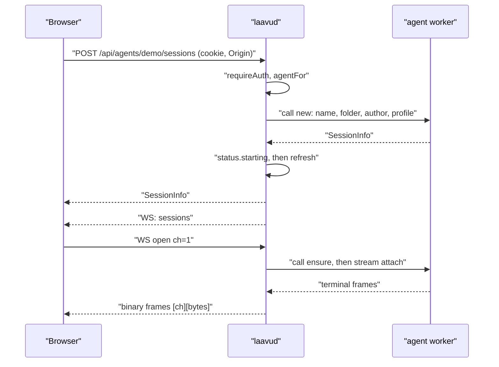
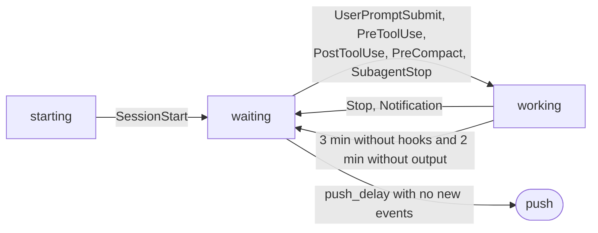

# The laavud daemon

How the daemon is built in code as of 2026-10-25. The agent worker, the `wire` protocol, hooks and `safepath` are described in [`arch-worker.md`](arch-worker.md), the client in [`arch-client.md`](arch-client.md), the `laavu` utility, installation, `priv` and isolation in [`arch-laavu.md`](arch-laavu.md).

## What it is and where it runs

`laavud serve` is one process per server. It handles sign-in, access, session statuses, push, serving the client, the HTML view origin and the dev-server proxy. It never touches agent files or tmux itself: anything that concerns an agent it asks of that agent's worker over a unix socket.

It runs as the system user `laavud` under the unit `deploy/systemd/laavud.service`. The unit has `ProtectHome=yes`, `InaccessiblePaths=-/srv/laavu/agents`, write access only to `/run/laavu/http`, `/run/laavu/hooks` and `StateDirectory=laavu` (`/var/lib/laavu`), no capabilities, `MemoryMax=512M`, `TasksMax=512`. Agent homes are physically unreachable for the daemon.

The daemon does not listen on the network. `serve` in `cmd/laavud/main.go` opens three sockets via `daemon.Listen`:

| Socket | What is on it | Who connects |
|---|---|---|
| `listen`, default `unix:/run/laavu/http/app.sock` | the application: API, WebSocket, client (`Handler`) | Caddy, directory `laavud:caddy 0750` |
| `aux_listen`, default `unix:/run/laavu/http/aux.sock` | view origin and dev servers (`AuxHandler`) | Caddy |
| `/run/laavu/hooks/hook.sock` (`config.Daemon.HookSocket`) | hook events (`serveHooks`) | agent hooks, directory `laavud:laavu-agents 0750` |

The sockets themselves are created with mode 0666. Access is restricted by directory permissions from `deploy/tmpfiles.conf`. Caddy terminates TLS and proxies both sites to these sockets (`deploy/Caddyfile.tmpl`).

`Serve` in `internal/daemon/daemon.go` starts two `http.Server`s (both with a 10 s `ReadHeaderTimeout`), the hook listener, the status polling loop and an hourly `Store.CleanupExpired`. On a signal it gives the servers 3 seconds to shut down.

### Config and agents

`internal/config/config.go` reads `/etc/laavu/laavud.toml` on top of `Defaults()`:

| Key | Default | Purpose |
|---|---|---|
| `public_url` | `https://localhost:8443` | application origin: `Origin` is checked against it, the passkey RP ID and link addresses come from it |
| `view_url` | `https://localhost:8444` | HTML view origin |
| `dev_mode` | `ports` | dev servers on separate external ports (`ports`) or subdomains (`subdomain`) |
| `dev_ports` | `[8450, 8459]` | pool of external ports for `ports` mode |
| `dev_domain` | — | domain for `p<port>-<agent>.<dev_domain>` |
| `listen`, `aux_listen` | sockets above | `unix:/path` or `host:port` |
| `state_dir`, `run_dir` | `/var/lib/laavu`, `/run/laavu` | database and profiles, hook socket |
| `push_delay` | `5s` | how long to wait after `Stop` before sending a push |
| `upload_limit_mb` | `200` | upload limit |
| `no_auth` | `false` | no sign-in, `serve` refuses to start with it |

Agents are files `/etc/laavu/agents/<name>.toml` (`LoadAgents`): name, user (default `lv-<name>`), home, port range, the `claude` command, tmux socket name (`laavu`) and the worker socket path (default `/run/laavu/workers/<user>.sock`). The uid is looked up from the system at load time. The agent list is read once at startup: a new agent shows up in the daemon only after a restart.

### Development mode

`laavud dev --home DIR` (function `dev` in `main.go`) runs the worker and the daemon in one process as the current user. There is one agent (`dev`, ports 20000–20999), the application on `127.0.0.1:7700`, view on `:7701`, dev servers on `:7710–7719`, all over TCP. Worker and hook sockets live in a temporary directory, the database in `DIR/.local/state/laavu-dev-daemon`. Sign-in is off (`no_auth`). `--auth` turns it on and prints an admin registration link. Push delay is 3 seconds. How to use it is in [`dev.md`](dev.md).

### laavud subcommands

| Command | What it does |
|---|---|
| `serve` | the daemon |
| `worker` | agent worker, see [`arch-worker.md`](arch-worker.md) |
| `hook claude\|guard\|statusline\|tmux` | hooks, same place. Errors are silent, exit code 0 |
| `reset-auth` | wipes all passkeys, sign-in sessions and links, then prints an admin registration link (if there was an admin, the link is bound to them) |
| `invite [--admin] [--name] [-q] [--if-no-admin]` | one-time registration link valid for a day |
| `admin add NAME` | admin role |
| `priv ...` | root operations, see [`arch-laavu.md`](arch-laavu.md) |
| `call AGENT OP [JSON]` | direct request to a worker for diagnostics |
| `dev`, `version` | see above |

`reset-auth`, `invite` and `admin`, when run as root, re-exec themselves as `laavud` via `runuser` (`asLaavud`): otherwise the SQLite journal files would end up owned by root and the daemon could no longer write to the database.

## File map

| File | Contents |
|---|---|
| `internal/daemon/daemon.go` | `Daemon`, `New`, `Listen`, `Serve`, `call` and `stream` to the worker, `canAccess`, `usersWithAccess`, `profileFor` |
| `internal/daemon/http.go` | API routes, middleware (`originGuard`, `securityHeaders`, `requireAuth`), client serving, handlers for sign-in, sessions, files, push |
| `internal/daemon/ws.go` | WebSocket: `hub`, `wsClient`, terminal channels, subscriptions, folder watching |
| `internal/daemon/status.go` | session statuses, tmux polling, the "waiting" push, hook event parsing, last action, context |
| `internal/daemon/hooks.go` | hook socket listener: `SO_PEERCRED`, limits |
| `internal/daemon/aux.go` | view origin (tokens, `serveView`) and dev-server proxy (`portMap`, `serveDevPort`, `checkPortOwner`) |
| `internal/auth/auth.go` | passkeys via go-webauthn, ceremonies, cookie |
| `internal/store/store.go` | SQLite: schema and queries |
| `internal/push/push.go` | Web Push: VAPID, push service allowlist, sending |
| `internal/config/config.go` | `laavud.toml` and agents |
| `internal/webui/webui.go` | the client, embedded via `embed` from `internal/webui/dist` (filled by `make web`) |
| `cmd/laavud/main.go` | subcommands and daemon assembly |

## HTTP API

All API responses are JSON with `Cache-Control: no-store`. The `api` wrapper turns a `nil` return into `{"ok":true}` and an error into `{"error": "..."}`: the code comes from `apiError`, a worker error (`wire.RemoteError`) gives 422, anything else 400.

Routes from `Handler`. The "Worker" column is the operation the daemon sends to the agent's worker.

| Method and path | What it does | Worker |
|---|---|---|
| `POST /api/auth/register/check` | check a registration link without consuming it | — |
| `POST /api/auth/register/begin` | start passkey registration, return `options` and `cid` | — |
| `POST /api/auth/register/finish?cid=&label=` | finish registration, set the cookie | — |
| `POST /api/auth/login/begin` | start a username-less (discoverable) sign-in | — |
| `POST /api/auth/login/finish?cid=` | verify the signature, set the cookie | — |
| `GET /api/me` | name, role, `no_auth`, `view_url`, whether push is available, for an admin also the `isolation-check.json` result | — |
| `POST /api/auth/logout` | delete the sign-in session, close its WebSocket, clear the cookie | — |
| `POST /api/auth/device-link` | 15-minute link to add a passkey from another device | — |
| `GET /api/agents` | accessible agents with their port ranges | — |
| `GET /api/agents/{agent}/workdirs` | folders | `workdirs` |
| `POST /api/agents/{agent}/workdirs` | new folder `{name}` | `mkdir` |
| `POST /api/agents/{agent}/clone` | `git clone` `{url, folder}` into a new folder, waits up to 10.5 minutes | `clone` |
| `GET /api/agents/{agent}/sshkey` | the agent's public ssh key, empty without one | `sshkey` |
| `POST /api/agents/{agent}/sshkey` | create the key; 422 if there is one | `sshkey-new` |
| `GET /api/agents/{agent}/sessions` | session list with statuses | `sessions` |
| `POST /api/agents/{agent}/sessions` | new session `{name, folder, kind, cols, rows, create}`. With `create`, the folder is made first | `mkdir`, `new` |
| `POST …/sessions/{name}/input` | text into the session `{text, enter}`, Enter by default | `input` |
| `POST …/sessions/{name}/keys` | keys `{keys}` | `keys` |
| `POST …/sessions/{name}/scroll` | scroll `{lines}` | `scroll` |
| `POST …/sessions/{name}/kill` | close the session | `kill` |
| `POST …/sessions/{name}/rename` | rename `{to}` | `rename` |
| `POST …/sessions/{name}/respawn` | restart the process in the session | `respawn` |
| `GET …/sessions/{name}/history` | pane history | `history` |
| `GET …/sessions/{name}/context` | context usage. A worker error gives an empty response instead of 422 | `context` |
| `GET /api/agents/{agent}/files/{folder}/tree?path=&hidden=1` | tree | `tree` |
| `GET …/files/{folder}/text?path=` | first 2 MB of a file, kind, `truncated` and a version for editing | `read` (stream) |
| `GET …/files/{folder}/download?path=` | whole file, `attachment` and `Content-Security-Policy: sandbox` | `read` (stream) |
| `PUT …/files/{folder}/file?path=` | save `{content, base}`. A different version on disk gives 409 with the current version | `write` |
| `POST …/files/{folder}/upload?dir=&name=` | upload, body is raw bytes | `upload` (stream) |
| `GET …/files/{folder}/changes?since=` | what changed since a point in time | `changes` |
| `GET …/files/{folder}/diff?path=&since=` | file diff | `diff` |
| `POST …/files/{folder}/view` | view origin token for the folder, see below | — |
| `POST /api/agents/{agent}/ports/{port}/open` | link to a dev server | — (checked against `/proc/net/tcp`) |
| `GET /api/push/key` | public VAPID key | — |
| `POST /api/push/subscribe` | store a browser subscription | — |
| `POST /api/push/unsubscribe` | delete your own subscription `{endpoint}` | — |
| `GET /api/ws` | WebSocket | see below |
| anything else under `/api/` | 404 JSON | — |
| `/` | client from `webui.FS()`, an unknown path serves `index.html` | — |

Agent access is checked by `agentFor` on every call: someone else's agent and a nonexistent agent give the same 404. The session name is checked by `names.Session`. The folder name is checked against a built-in reserved list (`names.NewReserved`), so `.ssh` gives 404. The worker checks again against `/etc/laavu/reserved`.

When a session is created, the user's name is recorded as the author, and the worker receives their profile (`profileFor`): `state_dir/profiles/<name>.json` with an `append_prompt` field and, if present, the path to `state_dir/profiles/<name>.settings.json` for `--settings`. For `input`, `respawn` and opening a terminal, the profile is taken from the session author in the last list (`sessionAuthor`). Nothing in the code creates profile files: for now they are set up by hand.

### Middleware

Wrapping order: `securityHeaders(originGuard(mux))`, and the API behind sign-in is additionally wrapped in `requireAuth`.

- **`originGuard`.** For all requests except `GET` and `HEAD`, and for any request with `Upgrade: websocket`, the `Origin` header must exactly match the origin from `public_url`. An empty `Origin` is also rejected (403). This applies to sign-in calls too.
- **`requireAuth`.** User from the `__Host-laavu` cookie (`Auth.UserFromRequest`), otherwise 401. In `no_auth` mode, `devUser` with the admin role is substituted.
- **`securityHeaders`.** CSP: `default-src 'self'`, scripts `'self' 'wasm-unsafe-eval'`, styles `'self' 'unsafe-inline'`, images, media, `connect-src` and `frame-src` additionally allow the view origin, `object-src 'none'`, `base-uri 'none'`, `frame-ancestors 'none'`. Plus `nosniff`, `X-Frame-Options: DENY`, `Referrer-Policy: same-origin`, `Cross-Origin-Opener-Policy: same-origin`.
- **Static files.** `assets/` is cached for a year as immutable, everything else `no-cache`. `sw.js` is served with `Service-Worker-Allowed: /`.

### Size limits

| Where | Limit |
|---|---|
| JSON body (`readJSON`) | 1 MB |
| File save (`apiWrite`) | `2 × worker.MaxWrite + 4 KB`, where `MaxWrite` = 2 MB (escaped JSON is longer than the content) |
| Text for viewing (`maxText`) | 2 MB, beyond that `truncated` |
| Upload | `upload_limit_mb`: checked via `Content-Length` and `MaxBytesReader` |
| Push subscription | 8 KB |
| Passkey label (`label`) | 64 bytes |
| WebSocket message | 1 MB |
| Hook event | 8 KB, 16 connections per agent |

## WebSocket

One socket per browser tab (`handleWS` in `ws.go`), compression off, the library's own `Origin` check disabled because `originGuard` already did it. A single writer per connection keeps frame order and sends a ping every 25 seconds. While the socket is open, the daemon checks once a minute whether the sign-in session is still alive (`Store.LoginUser`) and closes the socket if not. Signing out on a device closes all sockets of that sign-in session (`hub.dropLogin`).

**Binary frames** carry the terminal in both directions: 2 bytes of channel number (big-endian) followed by terminal bytes. The client picks the channel number. A frame for an unknown channel is silently dropped.

**Text frames** are JSON with a `t` field.

From the client (`wsMsg`, `wsClient.handle`):

| `t` | Fields | What it does |
|---|---|---|
| `subscribe` | `agents` | replaces the set of agents to send events about. Agents without access are dropped. Sends the cached `sessions` and triggers a refresh |
| `focus` | `focus` (list of `agent/session`), `visible` | which sessions are on screen and whether the tab is visible. Used to avoid pushing about what the person already sees |
| `open` | `ch`, `agent`, `session`, `cols`, `rows` | open a terminal channel |
| `resize` | `ch`, `cols`, `rows` | window size to the worker; ignored if `cols` or `rows` isn't positive. A resize that arrives while the channel is still attaching is kept (the last one wins) and applied right after attach if it differs from the size in `open` |
| `close` | `ch` | close the channel |
| `watch`, `unwatch` | `agent`, `folder` | folder watching |

From the daemon:

| `t` | Fields | When |
|---|---|---|
| `hello` | — | right after connecting |
| `sessions` | `agent`, `list` | the agent's session list changed (or on `subscribe`) |
| `status` | `agent`, `session`, `status` | status from a hook changed |
| `action` | `agent`, `session`, `action` | the agent's last action: tool and path from `PreToolUse`, `null` after `/clear` |
| `context` | `agent`, `session`, `context` | context usage after `Stop` and `SessionStart` |
| `opened` | `ch`, `agent`, `session` | terminal channel opened |
| `closed` | `ch`, sometimes `error` | channel closed by the worker or failed to open |
| `winsize` | `ch`, `cols`, `rows` | the worker reported the tmux window size |
| `fs` | `agent`, `folder`, `dirs`, `files` | something changed in the folder |

`sessions`, `status`, `action`, `context` go through `hub.broadcastAgent` only to sockets subscribed to the agent, and access is rechecked on every broadcast. `fs` goes to folder subscribers, also with an access check.

**Terminal channel** (`openTerm`). Access check, then `ensure` on the worker: if the session is sleeping, the worker wakes it up and the daemon sets the status to "starting". Then a streaming `attach`. Both calls carry `cols` and `rows` from `open`, and a resize received during attach goes to the worker right after it, before `opened`. Terminal input sent before `opened` is dropped. After that the daemon relays frames: worker data into binary frames with the channel number, the window-size JSON into `winsize`. A repeated `open` on a busy number closes the old channel. On close, the daemon sends the worker end-of-stream and drops the connection after 2 seconds: only this `tmux attach` client is killed, the session keeps running. Access is checked only when the channel is opened. An already open channel is closed by signing out or by the sign-in session expiring.

**Folder watching.** Per "agent/folder" pair there is one `watch` stream to the worker shared by all subscribers (`Daemon.watches`). The last `unwatch` or socket close closes the stream. The daemon does not check the folder name here, the worker does (`openRoot`).

## How the daemon talks to the worker

The worker socket is `Agent.WorkerSocket`. `d.call` opens a connection for a single request with a 30-second deadline. `d.stream` keeps the connection open after the response for streams: `read` and `upload` with a 10-minute deadline (so a FIFO in the folder or a hung worker can't hold a request forever), `attach` and `watch` with no deadline. Every request is a new connection, there is no pool. The frame format and the list of operations are in [`arch-worker.md`](arch-worker.md).

## Session statuses

Statuses are held by `statuses` in `status.go`, in memory, keyed by `agent/session`. There are three sources: the session list from the worker, hook events, timers.

| Status | Source |
|---|---|
| `starting` | new `claude` session, `respawn`, or waking a sleeping one when a channel is opened (`starting`). If a hook arrived before the worker's response, the hook status stays |
| `waiting` | hooks `SessionStart`, `Stop`, `Notification`, or reset of a stuck "working" |
| `working` | hooks `UserPromptSubmit`, `PreToolUse`, `PostToolUse`, `PreCompact`, `SubagentStop` (the last two only if the agent's settings register them; the default template doesn't) |
| `sleeping` | worker: the session is in the snapshot but not in tmux |
| `exited` | worker: the process in the pane died |
| `active`, `quiet` | sessions without hooks (`kind` is not `claude`): whether there was output in the last 10 seconds, based on tmux activity time |
| `error` | the constant is declared but never set |

Other hook events do not change the status.

**Merge** (`merge`). The worker's list is laid over memory: for sleeping and dead sessions the in-memory entry is deleted and the worker's status is kept. If there is no entry (the daemon restarted), the status is taken from what the worker read from the tmux option. Empty means "starting". The silence reset also lives here: "working" becomes "waiting" if more than 3 minutes have passed since the last hook (`staleWorking`) and there has been no output for more than 2 minutes (`staleActivity`). This covers the API error case where `Stop` never arrives. The reset lives only in memory and is not written to the tmux option.

**Refresh** (`refresh`). A `sessions` request to the worker, merge, removal of entries for vanished sessions with their timers stopped, and a `sessions` broadcast if the list changed. The comparison (`sameSessions`) ignores activity time and the current command, otherwise the list would be broadcast constantly. Called on a tmux hook, after API actions, on `subscribe` and from the `loop`: at startup for all agents, then every 3 seconds for agents someone is subscribed to. Polling catches sessions created outside the client and stuck statuses.

**Writing to tmux.** When the hook status changes, the daemon sends the worker a background `meta` with the status, and on `SessionStart` also the conversation ID and the transcript path. These options are what the status is restored from after a restart.

**Last action** (`hookAction`). On `PreToolUse` the tool (up to 64 bytes) and target (up to 240 bytes) are remembered, with control characters stripped from the strings (`clip`). `SessionStart` with `source=clear` erases the action. The action lives only in memory and arrives in the session list as the `action` field and as the `action` event.

**Context.** After `Stop` and `SessionStart`, the daemon waits 300 ms (the transcript is written after the hook), asks the worker for `context` and broadcasts a `context` event.

## Hook socket

`serveHooks` and `handleHookConn` in `hooks.go`. The daemon identifies the agent by the sender's uid (`SO_PEERCRED`) and the `byUID` table, never by what the message says. A connection from a uid that is not an agent is closed without a response. Each connection gets 2 seconds, one JSON line of at most 8 KB, and at most 16 concurrent connections per agent (`slots`).

A `kind: "tmux"` event only triggers a `refresh` of the agent. A `kind: "claude"` event passes two checks: the session name against the `names.Session` rules, and that the session exists (`sessionExists`: first against the last list, otherwise against a fresh one, where sleeping sessions don't count). Made-up names are dropped, otherwise an agent could send pushes with arbitrary text and grow the daemon's memory. An agent can still fake the status of its own session. The design allows that.

## Push

`internal/push/push.go`. VAPID keys are created on first start and stored in the `kv` table (`vapid_public`, `vapid_private`), and `Subscriber` is `public_url`. The browser hands its subscription to `POST /api/push/subscribe`. Only `https` addresses of known push services are accepted: FCM, Mozilla, Apple, `*.notify.windows.com` (`AllowedEndpoint`). Without that check the daemon could be used to send POSTs anywhere. Someone else's subscription can be neither reassigned nor deleted.

When it is sent. On `Stop` or `Notification` a timer is set for `push_delay`. If any other event for this session arrives in that time (for example, a `Stop` hook from the agent's rules prevented stopping and the turn continued), the timer is reset. If not, and the status is still "waiting", `notifyWaiting` is called. At most one push per session per 30 seconds (`pushGap`).

To whom. All users with access to the agent (admins and entries in `access`), except those who have the session on screen right now: on at least one device the tab is visible and the session is in its `focus` (`hub.isWatching`). The push has the title "Laavu", the text "Session X is waiting for you", the agent and session names, and a `Topic` from the `agent/session` tag so a new push replaces the old one. TTL 600 seconds, high urgency. Subscriptions for which the service answered 404 or 410 are deleted. The behavior is covered by `TestPushAfterStop`.

## Sign-in

`internal/auth/auth.go` on go-webauthn. The RP ID is the host from `public_url` without the port, and `RPOrigins` is exactly `public_url`. Both registration and sign-in require a resident key and user verification (`UserVerification: required`). Sign-in is username-less: the browser offers the site's passkey itself (`BeginDiscoverableLogin`), and the user is found by user handle. If the signature counter went backwards (`CloneWarning`), sign-in is rejected.

Ceremonies (data between `begin` and `finish`) live in memory for 5 minutes and are consumed by a single `finish`. The table is purged of expired entries when it has more than 256 entries and never grows beyond 10,000: extra ones are evicted.

**One-time links.** `/register#<token>`. The database stores only the token's SHA-256. They are either for a new user (with a role and possibly a preset name, if there is none the user picks a name of up to 64 characters) or for a new device of an existing user. The link is checked without being consumed on `check` and `begin`, and consumed only after the passkey is accepted in `finish`. The user is added to the database only then as well. Links are issued by `laavud invite` and `reset-auth` (one day, `InviteTTL`) and by `POST /api/auth/device-link` (15 minutes).

**Sign-in sessions.** After registration or sign-in (`Daemon.login`), a `login_sessions` row is created for 30 days (`LoginTTL`) with the token hash and user agent. Cookie `__Host-laavu`: `HttpOnly`, `Secure`, `SameSite=Strict`, `Path=/`, no `Domain`, so it is not sent to the view and dev-server subdomains. There is no renewal: after 30 days you have to sign in again.

**Roles.** `admin` and `member` (`CHECK` in the schema). An admin sees all agents. A member sees an agent only if there is an entry in `access`. The admin role can be granted only with `laavud admin add`. There is no API for managing users and access, and nothing calls `Store.GrantAccess`: a member registered via `laavud invite` currently sees no agents at all. In the design this is "later" for the MVP.

### Database

`internal/store/store.go`, SQLite (`modernc.org/sqlite`, no cgo) in `state_dir/laavud.db`, WAL, foreign keys, a single connection.

| Table | Contents |
|---|---|
| `users` | name, random WebAuthn user handle, role, creation time |
| `credentials` | passkey: serialized `webauthn.Credential`, device label, last sign-in time |
| `login_sessions` | cookie token hash, user, expiry, user agent |
| `invites` | link token hash, user (empty means new), role, name, expiry |
| `access` | user/agent pairs |
| `push_subs` | endpoint, user, subscription JSON |
| `kv` | VAPID keys |

tmux sessions and agent files are not in the database. If it is lost, passkeys have to be registered again, but agent work is unaffected.

## View origin and dev servers

`aux.go`. One server on `aux_listen`. `AuxHandler` routes by `Host`: the host from `view_url` is the view, the host of an open port is the proxy, anything else is 404. The application cookie never gets here.

**View.** `POST …/files/{folder}/view` returns the address `view_url/t/<token>/`. The token is bound to the agent, folder and user and lives for an hour. A repeated request for the same folder by the same user extends the same token (so links on an open page don't break). `serveView` accepts only `GET` and `HEAD`, rechecks the user's access to the agent on every request and reads the file from the worker with the `visible` flag: the worker does not serve hidden files or anything outside the folder. An empty path means `index.html`. The type is taken from the extension, otherwise from the file contents. Headers: `Referrer-Policy: no-referrer` (the token won't leak to a CDN), `nosniff`, `Access-Control-Allow-Origin: *` and `Cross-Origin-Resource-Policy: cross-origin`. CORS is open because the client shows HTML in an iframe without `allow-same-origin`, so the page's requests to neighboring files arrive with `Origin: null`. Access is still granted by the token.

**Dev servers.** `POST /api/agents/{agent}/ports/{port}/open` checks that the port is in the agent's range and that it is the agent's user who listens on it (`checkPortOwner` reads `/proc/net/tcp` and `tcp6`, which are visible even with `hidepid`). Then `portMap.open` allocates an origin for 12 hours (`portLinkTTL`): in `subdomain` mode `p<port>-<agent>.<dev_domain>`, in `ports` mode the first free external port from `dev_ports` on the application host. The same port of the same agent for the same user gets the same external port. When the pool runs out, the error is "all external dev-server ports are in use, close old ones". There is no API to close a port, though: a slot frees up only when it expires.

The link is `/__laavu/auth?t=<one-time token>`. The first visit sets a `laavu-port` cookie with the link secret (`HttpOnly`, `SameSite=Lax`, `Secure` over https) and redirects to `/`. A repeat visit gives 403. After that every request requires this cookie, rechecks the user's access and the port owner, and goes through `httputil.ReverseProxy` to `127.0.0.1:<port>` with the original `Host` and `X-Forwarded-*` (`X-Forwarded-Proto` is always `https`). WebSockets go through the same proxy. `laavu-port` and `__Host-laavu` are stripped from the request (the browser sends cookies by host regardless of port), and attempts to set `laavu-port`, `__Host-*` and `__Secure-laavu*` are stripped from the response. Covered by `TestDevPortProxy`.

## What is stored where

| Where | What | After a daemon restart |
|---|---|---|
| `laavud.db` | users, passkeys, sign-in sessions, links, access, subscriptions, VAPID | kept |
| `state_dir/profiles/` | author profiles, the daemon only reads them | kept |
| `state_dir/isolation-check.json` | result of `laavud priv check-isolation`, written by root, served by the daemon in `/api/me` | kept |
| the agent's tmux options | hook status, conversation ID, transcript (written by the worker on `meta`) | kept: statuses are restored from them |
| memory: `statuses` | statuses, last hook time, push timers, last push time, last action, last session list | statuses come back from tmux. Timers, a not-yet-sent push and the last action are lost |
| memory: `viewTokens` | view tokens | lost, open view pages get 403 "view link expired, open the file again" |
| memory: `portMap` | open dev ports and their cookies | lost, the port has to be opened again |
| memory: `Auth.ceremonies` | unfinished registrations and sign-ins | lost |
| memory: `hub`, `watches` | WebSockets, subscriptions, focus, channels, watches | the client reconnects and resubscribes |

The sessions themselves live in the agents' tmux and don't notice a daemon restart.
