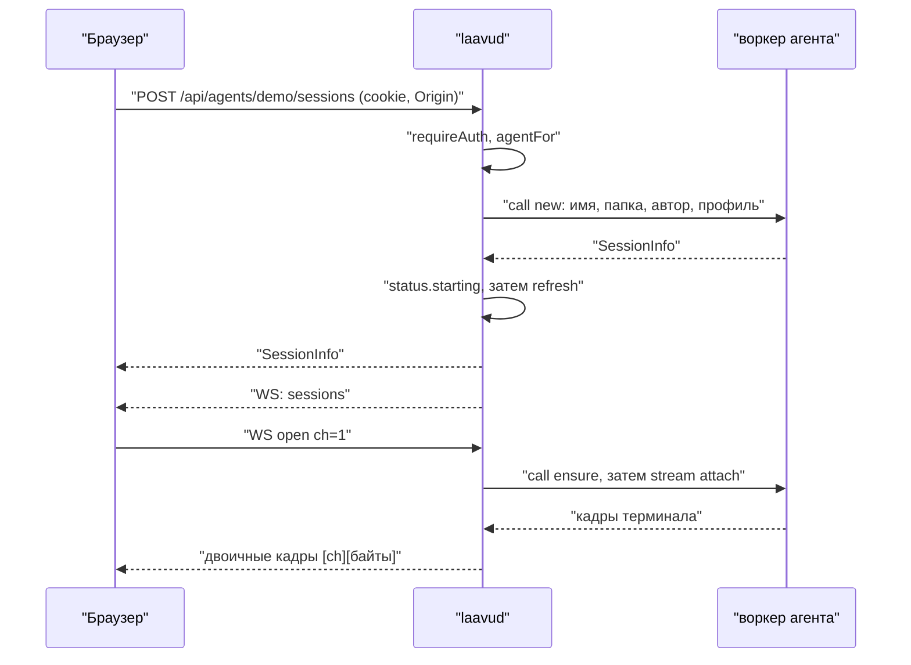
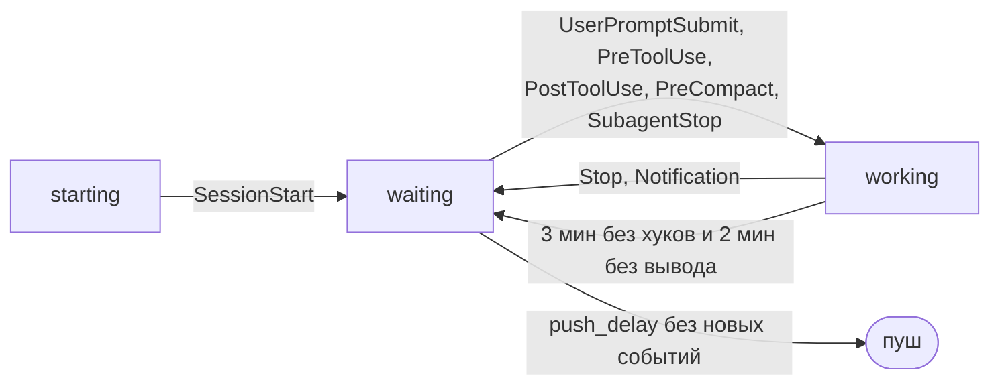

# Демон laavud

Как устроен демон в коде на 2026-10-25. Воркер агента, протокол `wire`, хуки и `safepath` описаны в [`arch-worker.md`](arch-worker.md), клиент — в [`arch-client.md`](arch-client.md), утилита `laavu`, установка, `priv` и изоляция — в [`arch-laavu.md`](arch-laavu.md).

## Что это и где работает

`laavud serve` — один процесс на сервер. Он отвечает за вход, доступы, статусы сессий, пуш, раздачу клиента, origin просмотра HTML и прокси dev-серверов. К файлам и tmux агентов сам не ходит: всё, что касается агента, он просит у его воркера через unix-сокет.

Работает от системного пользователя `laavud` под юнитом `deploy/systemd/laavud.service`. В юните `ProtectHome=yes`, `InaccessiblePaths=-/srv/laavu/agents`, запись разрешена только в `/run/laavu/http` и `/run/laavu/hooks` и в `StateDirectory=laavu` (`/var/lib/laavu`), без capabilities, `MemoryMax=512M`, `TasksMax=512`. Дома агентов демону физически недоступны.

Наружу демон не слушает. Три сокета открывает `serve` в `cmd/laavud/main.go` через `daemon.Listen`:

| Сокет | Что на нём | Кто подключается |
|---|---|---|
| `listen`, по умолчанию `unix:/run/laavu/http/app.sock` | приложение: API, WebSocket, клиент (`Handler`) | Caddy, каталог `laavud:caddy 0750` |
| `aux_listen`, по умолчанию `unix:/run/laavu/http/aux.sock` | origin просмотра и dev-серверы (`AuxHandler`) | Caddy |
| `/run/laavu/hooks/hook.sock` (`config.Daemon.HookSocket`) | события хуков (`serveHooks`) | хуки агентов, каталог `laavud:laavu-agents 0750` |

Сами сокеты создаются с режимом 0666, доступ режут права каталогов из `deploy/tmpfiles.conf`. Caddy снимает TLS и проксирует оба сайта на эти сокеты (`deploy/Caddyfile.tmpl`).

`Serve` в `internal/daemon/daemon.go` запускает два `http.Server` (у обоих `ReadHeaderTimeout` 10 с), приём хуков, цикл опроса статусов и раз в час `Store.CleanupExpired`. По сигналу даёт серверам 3 секунды на завершение.

### Конфиг и агенты

`internal/config/config.go` читает `/etc/laavu/laavud.toml` поверх `Defaults()`:

| Ключ | По умолчанию | Зачем |
|---|---|---|
| `public_url` | `https://localhost:8443` | origin приложения: по нему сверяется `Origin`, из него RP ID passkey и адрес в ссылках |
| `view_url` | `https://localhost:8444` | origin просмотра HTML |
| `dev_mode` | `ports` | dev-серверы на отдельных внешних портах (`ports`) или поддоменах (`subdomain`) |
| `dev_ports` | `[8450, 8459]` | пул внешних портов для режима `ports` |
| `dev_domain` | — | домен для `p<порт>-<агент>.<dev_domain>` |
| `listen`, `aux_listen` | сокеты выше | `unix:/путь` или `host:port` |
| `state_dir`, `run_dir` | `/var/lib/laavu`, `/run/laavu` | база, профили; сокет хуков |
| `push_delay` | `5s` | сколько ждать после `Stop`, прежде чем слать пуш |
| `upload_limit_mb` | `200` | предел загрузки |
| `no_auth` | `false` | без входа; `serve` с ним не стартует |

Агенты — файлы `/etc/laavu/agents/<имя>.toml` (`LoadAgents`): имя, пользователь (по умолчанию `lv-<имя>`), дом, диапазон портов, команда `claude`, имя сокета tmux (`laavu`) и путь к сокету воркера (по умолчанию `/run/laavu/workers/<пользователь>.sock`). Uid берётся из системы при загрузке. Список агентов читается один раз при старте: новый агент появится в демоне только после перезапуска.

### Режим разработки

`laavud dev --home DIR` (функция `dev` в `main.go`) поднимает в одном процессе воркер и демон от текущего пользователя. Агент один (`dev`, порты 20000–20999), приложение на `127.0.0.1:7700`, просмотр на `:7701`, dev-серверы на `:7710–7719`, всё по TCP. Сокеты воркера и хуков — во временном каталоге, база — в `DIR/.local/state/laavu-dev-daemon`. Вход выключен (`no_auth`), с `--auth` включается и печатается ссылка регистрации администратора. Задержка пуша 3 секунды. Как этим пользоваться — в [`dev.md`](dev.md).

### Подкоманды laavud

| Команда | Что делает |
|---|---|
| `serve` | демон |
| `worker` | воркер агента, см. [`arch-worker.md`](arch-worker.md) |
| `hook claude\|guard\|statusline\|tmux` | хуки, там же; ошибки молча, код выхода 0 |
| `reset-auth` | стирает все passkey, сессии входа и ссылки; печатает ссылку регистрации администратора (если администратор был, ссылка привязана к нему) |
| `invite [--admin] [--name] [-q] [--if-no-admin]` | одноразовая ссылка регистрации на сутки |
| `admin add ИМЯ` | роль администратора |
| `priv ...` | операции от root, см. [`arch-laavu.md`](arch-laavu.md) |
| `call АГЕНТ ОП [JSON]` | прямой запрос к воркеру для диагностики |
| `dev`, `version` | см. выше |

`reset-auth`, `invite` и `admin`, запущенные от root, перезапускают себя от `laavud` через `runuser` (`asLaavud`): иначе файлы журнала SQLite достались бы root и демон перестал бы писать в базу.

## Карта файлов

| Файл | Что в нём |
|---|---|
| `internal/daemon/daemon.go` | `Daemon`, `New`, `Listen`, `Serve`; `call` и `stream` к воркеру; `canAccess`, `usersWithAccess`, `profileFor` |
| `internal/daemon/http.go` | маршруты API, middleware (`originGuard`, `securityHeaders`, `requireAuth`), раздача клиента, обработчики входа, сессий, файлов, пуша |
| `internal/daemon/ws.go` | WebSocket: `hub`, `wsClient`, каналы терминала, подписки, наблюдение за папками |
| `internal/daemon/status.go` | статусы сессий, опрос tmux, пуш «ждёт ответа», разбор событий хуков, последнее действие, контекст |
| `internal/daemon/hooks.go` | приём сокета хуков: `SO_PEERCRED`, пределы |
| `internal/daemon/aux.go` | origin просмотра (токены, `serveView`) и прокси dev-серверов (`portMap`, `serveDevPort`, `checkPortOwner`) |
| `internal/auth/auth.go` | passkey через go-webauthn, церемонии, cookie |
| `internal/store/store.go` | SQLite: схема и запросы |
| `internal/push/push.go` | Web Push: VAPID, список push-сервисов, отправка |
| `internal/config/config.go` | `laavud.toml` и агенты |
| `internal/webui/webui.go` | клиент, вшитый через `embed` из `internal/webui/dist` (наполняет `make web`) |
| `cmd/laavud/main.go` | подкоманды и сборка демона |

## HTTP API

Все ответы API — JSON с `Cache-Control: no-store`. Обёртка `api` превращает возврат `nil` в `{"ok":true}`, ошибку — в `{"error": "..."}`: код из `apiError`, ошибка воркера (`wire.RemoteError`) даёт 422, остальное 400.

Маршруты из `Handler`. Колонка «Воркер» — операция, с которой демон идёт к воркеру агента.

| Метод и путь | Что делает | Воркер |
|---|---|---|
| `POST /api/auth/register/check` | проверить ссылку регистрации, не расходуя её | — |
| `POST /api/auth/register/begin` | начать регистрацию passkey, вернуть `options` и `cid` | — |
| `POST /api/auth/register/finish?cid=&label=` | закончить регистрацию, поставить cookie | — |
| `POST /api/auth/login/begin` | начать вход без имени (discoverable) | — |
| `POST /api/auth/login/finish?cid=` | проверить подпись, поставить cookie | — |
| `GET /api/me` | имя, роль, `no_auth`, `view_url`, есть ли пуш; администратору — итог `isolation-check.json` | — |
| `POST /api/auth/logout` | удалить сессию входа, закрыть её WebSocket, стереть cookie | — |
| `POST /api/auth/device-link` | ссылка на 15 минут, чтобы добавить passkey с другого устройства | — |
| `GET /api/agents` | доступные агенты с диапазоном портов | — |
| `GET /api/agents/{agent}/workdirs` | рабочие папки | `workdirs` |
| `POST /api/agents/{agent}/workdirs` | новая папка `{name}` | `mkdir` |
| `GET /api/agents/{agent}/sessions` | список сессий со статусами | `sessions` |
| `POST /api/agents/{agent}/sessions` | новая сессия `{name, folder, kind, cols, rows, create}`; при `create` сначала папка | `mkdir`, `new` |
| `POST …/sessions/{name}/input` | текст в сессию `{text, enter}`, Enter по умолчанию | `input` |
| `POST …/sessions/{name}/keys` | клавиши `{keys}` | `keys` |
| `POST …/sessions/{name}/scroll` | прокрутка `{lines}` | `scroll` |
| `POST …/sessions/{name}/kill` | закрыть сессию | `kill` |
| `POST …/sessions/{name}/rename` | переименовать `{to}` | `rename` |
| `POST …/sessions/{name}/respawn` | перезапустить процесс в сессии | `respawn` |
| `GET …/sessions/{name}/history` | история панели | `history` |
| `GET …/sessions/{name}/context` | заполненность контекста; ошибка воркера даёт пустой ответ, а не 422 | `context` |
| `GET /api/agents/{agent}/files/{folder}/tree?path=&hidden=1` | дерево | `tree` |
| `GET …/files/{folder}/text?path=` | первые 2 МБ файла, тип, `truncated` и версия для правки | `read` (поток) |
| `GET …/files/{folder}/download?path=` | файл целиком, `attachment` и `Content-Security-Policy: sandbox` | `read` (поток) |
| `PUT …/files/{folder}/file?path=` | сохранить `{content, base}`; другая версия на диске — 409 с текущей версией | `write` |
| `POST …/files/{folder}/upload?dir=&name=` | загрузка, тело — сырые байты | `upload` (поток) |
| `GET …/files/{folder}/changes?since=` | что изменилось с момента | `changes` |
| `GET …/files/{folder}/diff?path=&since=` | дифф файла | `diff` |
| `POST …/files/{folder}/view` | токен origin просмотра на папку, см. ниже | — |
| `POST /api/agents/{agent}/ports/{port}/open` | ссылка на dev-сервер | — (сверка по `/proc/net/tcp`) |
| `GET /api/push/key` | открытый VAPID-ключ | — |
| `POST /api/push/subscribe` | сохранить подписку браузера | — |
| `POST /api/push/unsubscribe` | удалить свою подписку `{endpoint}` | — |
| `GET /api/ws` | WebSocket | см. ниже |
| остальное под `/api/` | 404 JSON | — |
| `/` | клиент из `webui.FS()`; неизвестный путь отдаёт `index.html` | — |

Доступ к агенту проверяет `agentFor` на каждом вызове: чужой или несуществующий агент — одинаковый 404. Имя сессии проверяет `names.Session`. Имя папки сверяется со встроенным списком зарезервированных (`names.NewReserved`), например `.ssh` даёт 404; воркер проверяет ещё раз по `/etc/laavu/reserved`.

При создании сессии автором записывается имя пользователя, а в воркер уходит его профиль (`profileFor`): `state_dir/profiles/<имя>.json` с полем `append_prompt` и, если есть, путь к `state_dir/profiles/<имя>.settings.json` для `--settings`. Для `input`, `respawn` и открытия терминала профиль берётся по автору сессии из последнего списка (`sessionAuthor`). Кто и как кладёт файлы профилей, в коде нет: их пока заводят руками.

### Middleware

Порядок обёрток: `securityHeaders(originGuard(mux))`, а API за входом дополнительно в `requireAuth`.

- **`originGuard`.** У всех запросов, кроме `GET` и `HEAD`, и у любого запроса с `Upgrade: websocket` заголовок `Origin` должен точно совпасть с origin из `public_url`. Пустой `Origin` тоже отказ (403). Это касается и вызовов входа.
- **`requireAuth`.** Пользователь по cookie `__Host-laavu` (`Auth.UserFromRequest`), иначе 401. В режиме `no_auth` подставляется `devUser` с ролью администратора.
- **`securityHeaders`.** CSP: `default-src 'self'`, скрипты `'self' 'wasm-unsafe-eval'`, стили `'self' 'unsafe-inline'`, картинки, медиа, `connect-src` и `frame-src` дополнительно с origin просмотра, `object-src 'none'`, `base-uri 'none'`, `frame-ancestors 'none'`. Плюс `nosniff`, `X-Frame-Options: DENY`, `Referrer-Policy: same-origin`, `Cross-Origin-Opener-Policy: same-origin`.
- **Статика.** `assets/` кешируется на год как неизменяемая, остальное `no-cache`; `sw.js` с `Service-Worker-Allowed: /`.

### Пределы размеров

| Где | Предел |
|---|---|
| JSON в теле (`readJSON`) | 1 МБ |
| Сохранение файла (`apiWrite`) | `2 × worker.MaxWrite + 4 КБ`, где `MaxWrite` = 2 МБ (JSON с экранированием длиннее содержимого) |
| Текст для просмотра (`maxText`) | 2 МБ, дальше `truncated` |
| Загрузка | `upload_limit_mb`: проверка по `Content-Length` и `MaxBytesReader` |
| Подписка на пуш | 8 КБ |
| Подпись passkey (`label`) | 64 байта |
| Сообщение WebSocket | 1 МБ |
| Событие хука | 8 КБ, 16 соединений на агента |

## WebSocket

Один сокет на вкладку браузера (`handleWS` в `ws.go`), сжатие выключено, своя проверка `Origin` у библиотеки отключена, потому что её уже сделал `originGuard`. Один писатель на соединение держит порядок кадров и раз в 25 секунд шлёт ping. Пока сокет открыт, демон раз в минуту проверяет, жива ли сессия входа (`Store.LoginUser`), и закрывает сокет, если нет. Выход на устройстве закрывает все сокеты этой сессии входа (`hub.dropLogin`).

**Двоичные кадры** — терминал в обе стороны: 2 байта номера канала (big-endian) и байты терминала. Номер канала выбирает клиент. Кадр на неизвестный канал молча отбрасывается.

**Текстовые кадры** — JSON с полем `t`.

От клиента (`wsMsg`, `wsClient.handle`):

| `t` | Поля | Что делает |
|---|---|---|
| `subscribe` | `agents` | заменяет набор агентов, о которых слать события; агенты без доступа отбрасываются; сразу шлёт кешированный `sessions` и запускает обновление |
| `focus` | `focus` (список `агент/сессия`), `visible` | какие сессии на экране и видна ли вкладка; нужно, чтобы не слать пуш о том, что человек и так видит |
| `open` | `ch`, `agent`, `session`, `cols`, `rows` | открыть канал терминала |
| `resize` | `ch`, `cols`, `rows` | размер окна в воркер |
| `close` | `ch` | закрыть канал |
| `watch`, `unwatch` | `agent`, `folder` | наблюдение за папкой |

От демона:

| `t` | Поля | Когда |
|---|---|---|
| `hello` | — | сразу после подключения |
| `sessions` | `agent`, `list` | список сессий агента изменился (или по `subscribe`) |
| `status` | `agent`, `session`, `status` | статус из хука изменился |
| `action` | `agent`, `session`, `action` | последнее действие агента: инструмент и путь из `PreToolUse`, `null` после `/clear` |
| `context` | `agent`, `session`, `context` | заполненность контекста после `Stop` и `SessionStart` |
| `opened` | `ch`, `agent`, `session` | канал терминала открыт |
| `closed` | `ch`, иногда `error` | канал закрылся со стороны воркера или не открылся |
| `winsize` | `ch`, `cols`, `rows` | воркер сообщил размер окна tmux |
| `fs` | `agent`, `folder`, `dirs`, `files` | в папке что-то поменялось |

`sessions`, `status`, `action`, `context` идут через `hub.broadcastAgent` только тем сокетам, что подписаны на агента, и доступ перепроверяется на каждой рассылке. `fs` получают подписчики папки, тоже с проверкой доступа.

**Канал терминала** (`openTerm`). Проверка доступа, затем `ensure` у воркера: если сессия спит, воркер её поднимает, и демон ставит статус «запускается». Потом потоковый `attach`, и дальше демон перекладывает кадры: данные воркера в двоичные кадры с номером канала, JSON с размером окна — в `winsize`. Повторный `open` на занятый номер закрывает старый канал. При закрытии демон шлёт воркеру конец потока и через 2 секунды рвёт соединение: убивается только этот клиент `tmux attach`, сессия живёт. Доступ проверяется только при открытии канала; уже открытый канал закрывается выходом из аккаунта или истечением сессии входа.

**Наблюдение за папкой.** На пару «агент/папка» один поток `watch` к воркеру на всех подписчиков (`Daemon.watches`). Последний `unwatch` или закрытие сокета закрывает поток. Имя папки здесь демон не проверяет, это делает воркер (`openRoot`).

## Как демон говорит с воркером

Сокет воркера — `Agent.WorkerSocket`. `d.call` открывает соединение на один запрос с дедлайном 30 секунд. `d.stream` оставляет соединение открытым после ответа для потоков: `read` и `upload` с дедлайном 10 минут (чтобы FIFO в папке или зависший воркер не держали запрос вечно), `attach` и `watch` без дедлайна. Каждый запрос — новое соединение, пула нет. Формат кадров и список операций — в [`arch-worker.md`](arch-worker.md).

## Статусы сессий

Статусы держит `statuses` в `status.go`, в памяти, ключ `агент/сессия`. Источники три: список сессий от воркера, события хуков, таймеры.

| Статус | Откуда |
|---|---|
| `starting` | новая сессия, `respawn` или подъём спящей при открытии канала (`starting`); если хук пришёл раньше ответа воркера, остаётся статус хука |
| `waiting` | хуки `SessionStart`, `Stop`, `Notification`; сброс зависшего «работает» |
| `working` | хуки `UserPromptSubmit`, `PreToolUse`, `PostToolUse`, `PreCompact`, `SubagentStop` |
| `sleeping` | воркер: сессия есть в снимке, нет в tmux |
| `exited` | воркер: процесс в панели умер |
| `active`, `quiet` | сессии без хуков (`kind` не `claude`): вывод был за последние 10 секунд или нет, по времени активности из tmux |
| `error` | константа объявлена, но нигде не выставляется |

Другие события хуков статус не меняют.

**Слияние** (`merge`). Список от воркера накладывается на память: у спящих и умерших запись в памяти удаляется и остаётся статус воркера. Если записи нет (демон перезапустился), статус берётся из того, что воркер прочитал из опции tmux, пустой — «запускается». Здесь же сброс по тишине: «работает», если с последнего хука прошло больше 3 минут (`staleWorking`), а вывода не было больше 2 минут (`staleActivity`), становится «ждёт ответа». Так закрывается случай ошибки API, когда `Stop` не приходит. Сброс живёт только в памяти, в опцию tmux не пишется.

**Обновление** (`refresh`). Запрос `sessions` к воркеру, слияние, удаление записей исчезнувших сессий с остановкой их таймеров, рассылка `sessions`, если список изменился. Сравнение (`sameSessions`) не учитывает время активности и текущую команду, иначе список рассылался бы постоянно. Вызывается на хук tmux, после действий из API, по `subscribe` и из цикла `loop`: при старте по всем агентам, дальше раз в 3 секунды по тем агентам, на которых кто-то подписан. Опрос ловит сессии, заведённые мимо клиента, и зависшие статусы.

**Запись в tmux.** Когда статус из хука изменился, демон фоном шлёт воркеру `meta` со статусом; на `SessionStart` — ещё идентификатор разговора и путь к транскрипту. По этим опциям статус и восстанавливается после перезапуска.

**Последнее действие** (`hookAction`). На `PreToolUse` запоминается инструмент (до 64 байт) и цель (до 240 байт), из строк вычищаются управляющие символы (`clip`). `SessionStart` с `source=clear` стирает действие. Действие хранится только в памяти и приходит в списке сессий полем `action` и событием `action`.

**Контекст.** После `Stop` и `SessionStart` демон через 300 мс (транскрипт дописывается позже хука) спрашивает у воркера `context` и рассылает событие `context`.

## Сокет хуков

`serveHooks` и `handleHookConn` в `hooks.go`. Агента демон определяет не по содержимому, а по uid отправителя (`SO_PEERCRED`) и таблице `byUID`; соединение от uid, который не агент, закрывается без ответа. На соединение 2 секунды, одна строка JSON не длиннее 8 КБ, не больше 16 одновременных соединений от одного агента (`slots`).

Событие `kind: "tmux"` только запускает `refresh` агента. Событие `kind: "claude"` проходит две проверки: имя сессии по правилам `names.Session` и существование сессии (`sessionExists`: сначала по последнему списку, иначе по свежему, где спящие не считаются). Выдуманные имена отбрасываются, иначе агент мог бы слать пуши с произвольным текстом и растить память демона. Подделать статус своей сессии агент по-прежнему может, это допущено замыслом.

## Пуш

`internal/push/push.go`. VAPID-ключи создаются при первом старте и лежат в таблице `kv` (`vapid_public`, `vapid_private`); `Subscriber` — `public_url`. Подписку браузер отдаёт в `POST /api/push/subscribe`. Принимаются только `https`-адреса известных push-сервисов: FCM, Mozilla, Apple, `*.notify.windows.com` (`AllowedEndpoint`), иначе демон стал бы отправителем POST куда угодно. Чужую подписку нельзя ни переназначить, ни удалить.

Когда шлётся. На `Stop` или `Notification` ставится таймер на `push_delay`. Если за это время пришло любое другое событие этой сессии (например, хук `Stop` из правил агента не дал остановиться и ход продолжился), таймер сбрасывается. Если нет и статус всё ещё «ждёт ответа», вызывается `notifyWaiting`. На одну сессию не чаще одного пуша за 30 секунд (`pushGap`).

Кому. Всем пользователям с доступом к агенту (администраторы и записи в `access`), кроме тех, у кого сессия сейчас на экране: хотя бы на одном устройстве вкладка видима и сессия в её `focus` (`hub.isWatching`). В пуше заголовок «Laavu», текст «Сессия X ждёт ответа», имена агента и сессии, `Topic` из тега `агент/сессия`, чтобы новый пуш заменял старый. TTL 600 секунд, срочность высокая. Подписки, на которые сервис ответил 404 или 410, удаляются. Поведение проверяет `TestPushAfterStop`.

## Вход

`internal/auth/auth.go` на go-webauthn. RP ID — хост из `public_url` без порта, `RPOrigins` — ровно `public_url`. И при регистрации, и при входе требуются резидентный ключ и проверка пользователя (`UserVerification: required`). Вход без имени: браузер сам предлагает passkey сайта (`BeginDiscoverableLogin`), пользователь находится по user handle. Если счётчик подписей откатился (`CloneWarning`), вход отклоняется.

Церемонии (данные между `begin` и `finish`) лежат в памяти, живут 5 минут, расходуются одним `finish`. Таблица чистится от устаревших, когда в ней больше 256 записей, и не растёт больше 10 000: лишние вытесняются.

**Одноразовые ссылки.** `/register#<токен>`, в базе только SHA-256 токена. Бывают на нового пользователя (с ролью и, возможно, заданным именем, иначе имя до 64 символов выбирает он сам) и на новое устройство существующего пользователя. Ссылка проверяется без расхода на `check` и `begin` и расходуется только после принятого passkey в `finish`; пользователь попадает в базу тоже только тогда. Ссылки выдают `laavud invite` и `reset-auth` (сутки, `InviteTTL`) и `POST /api/auth/device-link` (15 минут).

**Сессии входа.** После регистрации или входа (`Daemon.login`) создаётся запись в `login_sessions` на 30 дней (`LoginTTL`) с хешем токена и user agent. Cookie `__Host-laavu`: `HttpOnly`, `Secure`, `SameSite=Strict`, `Path=/`, без `Domain`, поэтому на поддомены просмотра и dev-серверов она не уходит. Продления нет: через 30 дней нужен новый вход.

**Роли.** `admin` и `member` (`CHECK` в схеме). Администратор видит всех агентов. Участник видит агента, только если есть запись в `access`. Назначить роль администратора можно только командой `laavud admin add`. API для управления пользователями и доступами нет, и `Store.GrantAccess` никто не вызывает: участник, зарегистрированный по `laavud invite`, сейчас не увидит ни одного агента. В замысле это «позже» для MVP.

### База

`internal/store/store.go`, SQLite (`modernc.org/sqlite`, без cgo) в `state_dir/laavud.db`, WAL, внешние ключи, одно соединение.

| Таблица | Что |
|---|---|
| `users` | имя, случайный user handle WebAuthn, роль, время создания |
| `credentials` | passkey: сериализованный `webauthn.Credential`, подпись устройства, время последнего входа |
| `login_sessions` | хеш токена cookie, пользователь, срок, user agent |
| `invites` | хеш токена ссылки, пользователь (пусто — новый), роль, имя, срок |
| `access` | пары «пользователь — агент» |
| `push_subs` | endpoint, пользователь, JSON подписки |
| `kv` | VAPID-ключи |

Сессий tmux и файлов агентов в базе нет. Если её потерять, passkey придётся регистрировать заново, а работа агентов не пострадает.

## Origin просмотра и dev-серверы

`aux.go`. Один сервер на `aux_listen`, `AuxHandler` различает назначение по `Host`: хост из `view_url` — просмотр, хост открытого порта — прокси, остальное 404. Cookie приложения сюда не попадает ни в каком виде.

**Просмотр.** `POST …/files/{folder}/view` выдаёт адрес `view_url/t/<токен>/`. Токен привязан к агенту, папке и пользователю, живёт час, повторный запрос той же папки тем же пользователем продлевает тот же токен (чтобы ссылки на открытой странице не ломались). `serveView` принимает только `GET` и `HEAD`, на каждом запросе перепроверяет доступ пользователя к агенту и читает файл у воркера с флагом `visible`: скрытые файлы и выход за папку воркер не отдаёт. Пустой путь — `index.html`. Тип по расширению, иначе по виду файла. Заголовки: `Referrer-Policy: no-referrer` (токен не утечёт на CDN), `nosniff`, `Access-Control-Allow-Origin: *` и `Cross-Origin-Resource-Policy: cross-origin`. CORS открыт потому, что клиент показывает HTML в iframe без `allow-same-origin`, и запросы страницы к соседним файлам приходят с `Origin: null`; доступ всё равно даёт токен.

**Dev-серверы.** `POST /api/agents/{agent}/ports/{port}/open` проверяет, что порт в диапазоне агента и что его слушает именно пользователь агента (`checkPortOwner` читает `/proc/net/tcp` и `tcp6`, они видны и при `hidepid`). Затем `portMap.open` выделяет origin на 12 часов (`portLinkTTL`): в режиме `subdomain` — `p<порт>-<агент>.<dev_domain>`, в режиме `ports` — первый свободный внешний порт из `dev_ports` на хосте приложения. Тот же порт того же агента тому же пользователю получает тот же внешний порт. Пул кончился — ошибка «закройте старые», но закрыть порт из API нельзя: место освобождается только по истечении срока.

Ссылка — `/__laavu/auth?t=<одноразовый токен>`. Первый переход ставит cookie `laavu-port` с секретом ссылки (`HttpOnly`, `SameSite=Lax`, `Secure` при https) и перенаправляет на `/`; повторный — 403. Дальше каждый запрос требует эту cookie, перепроверяет доступ пользователя и владельца порта и идёт через `httputil.ReverseProxy` на `127.0.0.1:<порт>` с исходным `Host` и `X-Forwarded-*`. WebSocket проходит тем же прокси. Из запроса вырезаются `laavu-port` и `__Host-laavu` (браузер шлёт cookie по хосту без учёта порта), из ответа — попытки поставить `laavu-port`, `__Host-*` и `__Secure-laavu*`. Проверяет `TestDevPortProxy`.

## Что где хранится

| Где | Что | После перезапуска демона |
|---|---|---|
| `laavud.db` | пользователи, passkey, сессии входа, ссылки, доступы, подписки, VAPID | на месте |
| `state_dir/profiles/` | профили авторов, демон только читает | на месте |
| `state_dir/isolation-check.json` | итог `laavud priv check-isolation`, пишет root, демон отдаёт в `/api/me` | на месте |
| опции tmux у агента | статус из хука, идентификатор разговора, транскрипт (пишет воркер по `meta`) | на месте: статусы восстанавливаются из них |
| память: `statuses` | статусы, время последнего хука, таймеры пуша, время последнего пуша, последнее действие, последний список сессий | статусы из tmux; таймеры, ещё не отправленный пуш и последнее действие теряются |
| память: `viewTokens` | токены просмотра | теряются, открытые страницы просмотра получат 403 «ссылка устарела» |
| память: `portMap` | открытые dev-порты и их cookie | теряются, порт нужно открыть заново |
| память: `Auth.ceremonies` | незаконченные регистрации и входы | теряются |
| память: `hub`, `watches` | WebSocket, подписки, фокус, каналы, наблюдения | клиент переподключается и подписывается заново |

Сами сессии живут в tmux агентов и перезапуск демона не замечают.
