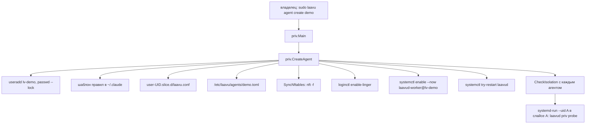

# Установка, изоляция и релизы

Как в коде устроены `laavu install`, утилита `laavu`, привилегированные операции `laavud priv`, изоляция агентов и релизы. Демон описан в [`arch-daemon.md`](arch-daemon.md), воркер — в [`arch-worker.md`](arch-worker.md), клиент — в [`arch-client.md`](arch-client.md). Сборка и тестовая ВМ — в [`dev.md`](dev.md).

## Два бинарника

`laavu` — утилита владельца сервера, `laavud` — демон, воркер, хуки и привилегированные операции. Оба собираются из одного модуля (`Makefile`, `CGO_ENABLED=0`, версия через `-X main.Version`). Привилегированный код лежит в `internal/priv` и вызывается из обоих: `laavu agent …` и `laavud priv …` приходят в одну функцию `priv.Main`.

## Команды `laavu`

Разбор аргументов — `cmd/laavu/main.go`. Почти все команды требуют root и проверяют это сами (`os.Geteuid() != 0`).

| Команда | Что делает | Где код |
|---|---|---|
| `install [--domain Д --email П \| --host ИМЯ] [--agent ИМЯ] [--install-claude] [--owner-key …] [--harden-ssh] [--skip-apt] [--release-key …]` | ставит Laavu на этот сервер, см. ниже | `install.Run`, `internal/install/install.go` |
| `install --ssh ПОЛЬЗОВАТЕЛЬ@IP[:ПОРТ] [--release …] [--identity …] [--owner-pubkey …]` | ставит с ноутбука на удалённый сервер | `install.RemoteInstall`, `internal/install/remote.go` |
| `agent create ИМЯ [--memory 2G] [--install-claude]` | новый агент со всеми мерами изоляции | `priv.CreateAgent` |
| `agent delete ИМЯ [--keep-home]` | удаляет агента | `priv.DeleteAgent` |
| `agent list` | агенты: имя, пользователь, uid, порты, дом | `priv.listAgents` |
| `agent limits ИМЯ [--memory] [--tasks] [--cpu-weight]` | без флагов показывает лимиты слайса, с флагами меняет | `priv.limitsCmd` |
| `check-isolation [A B] [--json]` | пробы изоляции для пары или всех пар | `priv.checkIsolationCmd`, `internal/priv/isolation.go` |
| `check [--json]` | отчёт о состоянии сервера; при проблемах код выхода 1 | `install.Check`, `internal/install/maint.go` |
| `firewall status\|allow ПОРТ\|deny ПОРТ` | обёртка над `ufw` с проверкой, что порт — число | `install.Firewall` |
| `tailscale enable\|disable\|status` | Tailscale как опция | `internal/install/tailscale.go` |
| `update laavud\|templates\|os\|claude` | обновления | `internal/install/update.go` |
| `restart laavud` | `systemctl restart laavud.service`, воркеры не трогает | `cmd/laavu/main.go`, `restart` |
| `cleanup` | журналы старше 30 дней, кеш apt, `~/tmp` агентов старше недели | `install.Cleanup` |
| `diag` | статус служб, журналы, таблица nftables, UFW, `/run/laavu`, `/proc`, конфиг, хвост `priv.log` | `install.Diag` |
| `harden-ssh --owner-key … [--owner-user …]` | только шаг ssh с запретом пароля | `install.HardenSSH` |
| `release keygen\|manifest\|sign\|verify` | ключ проекта и подпись релиза | `cmd/laavu/main.go`, `internal/release` |
| `version` | версия сборки | — |

Подкоманды `laavud`, которые относятся к этому документу (`cmd/laavud/main.go`):

| Команда | Что делает |
|---|---|
| `laavud priv create-agent\|delete-agent\|list\|limits\|check-isolation` | то же, что `laavu agent …`; нужен root |
| `laavud priv nft-sync` | переписать и загрузить правила nftables; в справке не показана |
| `laavud priv probe JSON` | проба изоляции от имени агента; root не нужен, вызывается из `CheckIsolation` |
| `laavud reset-auth` | стереть все passkey и входы, напечатать ссылку регистрации администратора |
| `laavud invite [--admin] [--name] [-q] [--if-no-admin]` | одноразовая ссылка регистрации; `--if-no-admin` — ничего, если администратор уже есть |
| `laavud admin add ИМЯ` | выдать роль администратора |

`reset-auth`, `invite` и `admin`, запущенные от root, перезапускают себя от пользователя `laavud` через `runuser` (`asLaavud`): база принадлежит `laavud`, и файлы журнала SQLite от root сломали бы демон.

## `laavu install`

`install.Run` проверяет root и ОС (`/etc/os-release`: Ubuntu, версия 24 и выше) и идёт по шагам. Каждый шаг печатается как `[N/11] …`. Пользователь владельца берётся из `--owner-user` или `SUDO_USER`.

| № | Шаг | Что делает | Функция |
|---|---|---|---|
| 1 | пакеты | ставит недостающие из `tmux git caddy nftables ufw curl ca-certificates` (`dpkg-query`, потом `apt-get install --no-install-recommends`); `--skip-apt` пропускает | `stepPackages` |
| 2 | бинарники | копирует `laavu` и `laavud` из каталога запущенного `laavu` в `/usr/local/bin` | `stepBinaries` |
| 3 | пользователи и группы | системные группы `laavu-agents` и `procview`, системный пользователь `laavud` (дом `/var/lib/laavu`, `nologin`); владелец добавляется в `procview`; создаёт `/srv/laavu/agents` и `/var/log/laavu` | `stepUsers` |
| 4 | hidepid | строка `proc /proc proc defaults,hidepid=invisible,gid=<procview>` в `/etc/fstab`, если там ещё нет `hidepid=`, и `mount -o remount` сразу | `stepHidepid` |
| 5 | ssh | ключ владельца в `authorized_keys` (если передан), `/etc/ssh/sshd_config.d/01-laavu.conf` с `DenyGroups laavu-agents`, с `--harden-ssh` — ещё запрет пароля и `PermitRootLogin prohibit-password` | `stepSSH` |
| 6 | конфигурация | `/etc/laavu/{agents,agent-template}`, закреплённый ключ релизов, `laavud.toml`, `reserved`, `tmux.conf`, `/etc/tmpfiles.d/laavu.conf`, шаблоны правил агента; `systemd-tmpfiles --create` | `stepConfig` |
| 7 | nftables | юнит `laavu-nftables.service`, правила по текущим агентам, `enable --now` | `stepNftables` |
| 8 | брандмауэр | UFW: ssh и порты режима, `ufw --force enable` | `stepFirewall` |
| 9 | Caddy | `/etc/caddy/Caddyfile` из шаблона, `caddy validate`, рестарт при изменении | `stepCaddy` |
| 10 | laavud | юниты `laavud.service`, `laavud-worker@.socket`, `laavud-worker@.service`; рестарт демона, `try-restart` воркеров; ждёт `/run/laavu/http/app.sock` до 10 секунд, иначе печатает журнал | `stepDaemon` |
| 11 | первый агент | `priv.CreateAgent`, если `--agent` задан и пользователя `lv-<имя>` ещё нет | `Run` |

В конце `printLink` вызывает `laavud invite --admin -q --if-no-admin` от пользователя `laavud` и печатает ссылку регистрации первого passkey. Если администратор уже есть, пишет, что новую ссылку даёт `laavud reset-auth`.

**ssh.** Файл называется `01-laavu.conf` намеренно: в `sshd_config.d` действует первое значение, а хостеры включают пароль в `50-cloud-init.conf`. Старое имя `50-laavu.conf` удаляется. После записи — `sshd -t` (при ошибке файл удаляется) и `systemctl reload ssh`. Запрет пароля без ключа владельца в `authorized_keys` не ставится: шаг падает с ошибкой, чтобы не закрыть доступ к серверу. После применения `sshd -T` проверяет, что `passwordauthentication no` и `denygroups laavu-agents` действительно в силе.

**Режимы адреса.** От `--domain` и `--host` зависят `laavud.toml`, Caddy и UFW (`daemonConfig`, `caddyData`, `stepFirewall`):

| | С доменом | Без домена (тестовая ВМ, `--host` или `localhost`) |
|---|---|---|
| Приложение | `https://ДОМЕН` | `https://ИМЯ:8443` |
| Origin просмотра | `https://view.ДОМЕН` | `https://ИМЯ:8444` |
| Dev-серверы | порты `8450–8459` домена (`DevMode = "ports"`) | порты `8450–8459` |
| Сертификат | Let's Encrypt, почта из `--email` | внутренний CA Caddy, `tls internal { on_demand }` |
| UFW | ssh, 80, 443, `8450:8459` | ssh, `8443:8444`, `8450:8459` |

В Caddyfile два сайта: приложение проксируется на `unix//run/laavu/http/app.sock`, origin просмотра и порты dev-серверов — на `aux.sock`. `admin off`: API Caddy на `localhost:2019` позволил бы агенту перенастроить прокси. Поэтому конфиг применяется только рестартом Caddy.

Повторный `install --host НОВОЕ_ИМЯ` в режиме ВМ переписывает адреса в существующем `laavud.toml` и предупреждает, что passkey нужно регистрировать заново: они привязаны к имени.

**VAPID.** В установщике шага нет: ключи создаёт сам демон при первом старте и хранит в базе (`push.New` в `internal/push/push.go`).

**logind.** Drop-in для logind установщик не ставит: на стенде `hidepid` уживается с logind, linger и `user@.service` без него ([`stand-vm.md`](stand-vm.md)).

**Идемпотентность.** Файлы пишутся через `writeIfChanged` (сравнение содержимого, запись во временный файл и `rename`), группы и пользователи создаются, только если их нет. `laavud.toml`, `reserved` и шаблоны в `agent-template/` пишутся, только если их ещё нет: их правит владелец. `release.pub` тоже не перезаписывается. Рестарт Caddy — только при изменении Caddyfile, а `laavud` перезапускается всегда. Повторная установка проверена в `test/vm/e2e-server.sh`: второй `install` проходит и снова печатает ссылку, пока администратор не зарегистрирован.

## Установка с ноутбука: `install --ssh`

`install.RemoteInstall` работает на ноутбуке владельца. CI собирает `laavu` под Linux, macOS (amd64, arm64) и Windows.

1. **Подпись до подключения.** С `--release КАТАЛОГ|https-АДРЕС` манифест проверяется ключом проекта (`release.PinnedKey`: `/etc/laavu/release.pub`, если есть, иначе вшитый `ProjectKey`). Без `--release` ставится локальная сборка рядом с `laavu` с предупреждением «без подписи релиза», и только если она под ту же linux-архитектуру.
2. **ssh.** Встроенный клиент `golang.org/x/crypto/ssh`, системный `ssh` не нужен. Вход — ключом (`--identity`, по умолчанию `~/.ssh/id_ed25519`; `none` — только пароль), паролем или keyboard-interactive. Пароль спрашивается один раз без эха (`term.ReadPassword`) и живёт только в памяти процесса; если stdin не терминал, читается строка (для автотестов).
3. **Отпечаток хоста** (`hostKeyCallback`). При первом подключении печатается SHA256-отпечаток и вопрос `[y/N]` (`--yes` — без вопроса, для тестов), строка `хост отпечаток` дописывается в `known_hosts` в каталоге конфигурации пользователя (`os.UserConfigDir()/laavu/known_hosts`). Если ключ потом сменился, подключение отклоняется с подсказкой, какую строку удалить.
4. **Права.** Не root — нужен `sudo -n` без пароля, иначе ошибка. Архитектура — по `uname -m` (`x86_64` → amd64, `aarch64` → arm64).
5. **Копирование.** Бинарники `laavu` и `laavud` из релиза (хеш сверяется с манифестом в `Verified.Fetch`) уходят через `cat >` в каталог `mktemp -d /tmp/laavu-install.XXXXXX`, который в конце удаляется.
6. **Вторая проверка подписи** — на сервере его собственным `laavu release verify` с ключом и `--file` для обоих бинарников.
7. **Установка.** `sudo -n …/laavu install` с флагами установки, `--owner-key` и `--release-key` (ключ проекта закрепляется в `/etc/laavu/release.pub`). Вывод идёт в терминал ноутбука.
8. **Ключ владельца.** Из `--owner-pubkey`, иначе `~/.ssh/id_ed25519.pub`, иначе новый ed25519-ключ `~/.ssh/laavu_<хост>` (0600).
9. **Запрет пароля.** Вход по ключу проверяется новым соединением, и только после этого вызывается `laavu harden-ssh`. Если закрытый ключ защищён паролем или вход по ключу не прошёл, вход по паролю остаётся, и утилита об этом пишет. В конце печатается команда `ssh -i КЛЮЧ пользователь@хост`; ссылка регистрации уже была в выводе установки.

## Привилегии: кто вызывает `priv`

Демон `priv` не вызывает. Юнит `laavud.service` идёт с `NoNewPrivileges=yes` и пустым `CapabilityBoundingSet`, так что sudo из демона невозможен, а sudoers и polkit в коде нет. Агентов заводит и удаляет только root командой `laavu agent …` или `laavud priv …` (путь из клиента пока не сделан). Каждая операция пишется в `/var/log/laavu/priv.log` (`priv.Log`: время, `SUDO_USER` или `root`, операция).

## Создание агента: `CreateAgent`

`internal/priv/priv.go`. Имя проверяет `names.Agent`. Повторное создание — ошибка: пользователь или агент уже есть (идемпотентность есть только в `install`, который пропускает существующего агента).

| Мера | Как сделано |
|---|---|
| Пользователь | `lv-<имя>`, оболочка `/bin/bash`, дополнительная группа `laavu-agents` (по ней `DenyGroups` в sshd и доступ к сокету хуков), пароль заблокирован `passwd --lock`. Других групп не даётся |
| Дом | `/srv/laavu/agents/<имя>`, `chmod 0700`, внутри `tmp`, `.claude`, `.local/state/laavu`, `.ssh` с 0700; всё отдаётся агенту `chownR` (через `Lchown`, по симлинкам не ходит) |
| umask | `umask=077` в поле GECOS (`--comment`) для `pam_umask` и `UMASK=077` (`useradd --key`); юниты и `systemd-run` дополнительно ставят `UMask=0077` |
| Порты | первый свободный блок по 1000 портов из `20000–59999` (`nextPorts`) |
| Ресурсы | drop-in `/etc/systemd/system/user-<uid>.slice.d/laavu.conf`: `MemoryMax` (по умолчанию 3/4 памяти сервера, `defaultMemory`), `TasksMax=1024`, `CPUWeight=100` |
| Сеть | правило nftables по uid, см. ниже. `SocketBindAllow` не пишется: в Ubuntu 24.04 он не работает |
| tmux вне cgroup воркера | `loginctl enable-linger`, ожидание `/run/user/<uid>/bus` до 10 секунд |
| Воркер | `systemctl enable --now laavud-worker@lv-<имя>.socket` и `.service` |
| Правила агента | `~/.claude/CLAUDE.md` и `~/.claude/settings.json` (0600) из шаблона; если владелец поправил шаблон в `/etc/laavu/agent-template/`, берётся он, иначе вшитый. Существующие файлы не перезаписываются |
| Claude Code | с `--install-claude` — официальный установщик от имени агента (`runuser -l … curl … \| bash`); ошибка установки не валит создание |

В конце — `try-restart laavud` (демон перечитывает список агентов только при старте) и `CheckIsolation` нового агента с каждым существующим в обе стороны. Результат печатается, но создание не отменяет.

Шаблон `deploy/agent/CLAUDE.md.tmpl` получает имя, пользователя, порты и путь к `laavud` и говорит агенту: работа — в папках первого уровня дома, зарезервированные имена, куда падают загрузки (`.laavu-uploads`), git и deploy key на репозиторий, порты из `LAAVU_PORTS` на `127.0.0.1`, долгие процессы — в сессиях `tmux -L laavu`, временное — в `~/tmp`. `settings.json.tmpl` вешает `laavud hook claude` и `laavud hook guard` на события Claude Code и `laavud hook statusline` на строку статуса (что они делают — в [`arch-daemon.md`](arch-daemon.md)).

**nftables** (`internal/priv/nft.go`). `NftRules` строит таблицу `inet laavu` с цепочкой `output`: для каждого агента `oif "lo" tcp dport <его диапазон> meta skuid { uid остальных агентов } reject with tcp reset`. Сам агент, `laavud` и root не перечислены, значит подключаются. Таблица пересоздаётся атомарно (`table … delete table … table {…}` в одном файле). `SyncNftables` пишет `/etc/laavu/nftables.nft`, грузит `nft -f` и включает `laavu-nftables.service`, который грузит тот же файл при загрузке (`Before=network-pre.target`, `After=ufw.service`). Штатный `nftables.service` не используется: он начинается с `flush ruleset` и снёс бы UFW. Тест `TestNftRules` проверяет правила для трёх агентов и то, что для одного агента правил нет.

**Удаление** (`DeleteAgent`): выключить сокет и сервис воркера, `disable-linger`, `terminate-user`, `pkill -KILL -u`, затем `userdel --remove` и удаление дома. С `--keep-home` дом переносится в `/srv/laavu/deleted/<имя>-<время>`. Удаляются drop-in слайса и `agents/<имя>.toml`, правила nftables пересобираются, `laavud` перезапускается.

**Лимиты** (`limitsCmd`): ключи сливаются с существующим drop-in, пишутся заново и применяются сразу через `systemctl set-property --runtime`.

## `check-isolation`

`CheckIsolation(a, b)` готовит цели от имени B и запускает пробу от имени A:

- root слушает первый свободный порт в диапазоне B и отвечает `laavu-probe` (правило nftables смотрит на того, кто подключается, поэтому слушать может и root);
- файл B в `/tmp` создаётся через `sudo -u B`, то есть через полный стек PAM, чтобы сработал `pam_umask` (у `runuser` его нет);
- процесс B — `runuser -u B sleep 60`;
- проба — `systemd-run --uid=A --slice=user-<uid A>.slice -p UMask=0077 laavud priv probe JSON`, в слайсе A, как его сессии.

| Проба (`probeMain`) | Закрыто, если |
|---|---|
| чтение дома | `ReadDir` дома B падает |
| файл в доме | `Stat` на `~/.claude/settings.json` B падает |
| процессы | в `/proc` нет ни одного процесса с uid B |
| порт агента | подключение не прошло или ответ не `laavu-probe`; если диапазон B занят целиком — «пропуск» |
| файл в `/tmp` | файл B не читается |
| сокет воркера | к `/run/laavu/workers/lv-B.sock` не подключиться |
| база laavud | `/var/lib/laavu/laavud.db` не читается |
| sudo | `sudo -n true` не проходит |

Без аргументов проверяются все упорядоченные пары. Итог (время, число пар, открытых проб) пишется в `/var/lib/laavu/isolation-check.json` для клиента и `laavu check`. Если хоть одна проба открыта, команда завершается с ошибкой.

## Карта файлов на сервере

Права — по коду и юнитам; где права задаёт не код, а umask или systemd, так и сказано.

| Путь | Владелец, права | Кто создаёт | Что в нём |
|---|---|---|---|
| `/usr/local/bin/laavu`, `laavud` | root, 0755 | `install`, `update` | бинарники; рядом `.prev` после обновления |
| `/etc/laavu/` | root, 0755 | `stepConfig` | `laavud.toml` (0644), `reserved`, `tmux.conf`, `nftables.nft`, `release.pub`, `tailscale.json` |
| `/etc/laavu/agents/<имя>.toml` | root, 0644 | `CreateAgent` | имя, пользователь, дом, порты, uid |
| `/etc/laavu/agent-template/` | root, 0644 | `stepConfig`, `update templates` | шаблоны правил агента для правки владельцем |
| `/etc/tmpfiles.d/laavu.conf` | root | `stepConfig` | каталоги в `/run/laavu` |
| `/run/laavu/`, `/run/laavu/workers/` | root:root, 0755 | tmpfiles | сокеты воркеров `<пользователь>.sock` — `laavud:laavud 0600`, создаёт systemd (`laavud-worker@.socket`) |
| `/run/laavu/http/` | laavud:caddy, 0750 | tmpfiles | `app.sock`, `aux.sock` для Caddy |
| `/run/laavu/hooks/` | laavud:laavu-agents, 0750 | tmpfiles | `hook.sock` для хуков агентов |
| `/var/lib/laavu/` | laavud, 0711 | systemd (`StateDirectory=laavu`) | `laavud.db` (права от `UMask=0077` юнита), `isolation-check.json` (0644, отдаётся владельцу каталога) |
| `/srv/laavu/agents/` | root, 0755 | `stepUsers` | дома агентов, каждый `lv-<имя>`, 0700 |
| `/srv/laavu/deleted/` | root, 0700 | `DeleteAgent --keep-home` | сохранённые дома удалённых агентов |
| `/var/log/laavu/` | root, 0750 | `stepUsers` | `priv.log` (0640) |
| `/etc/systemd/system/` | root | `install`, `CreateAgent` | `laavud.service`, `laavud-worker@.{socket,service}`, `laavu-nftables.service`, `user-<uid>.slice.d/laavu.conf` |
| `/etc/ssh/sshd_config.d/01-laavu.conf` | root, 0644 | `stepSSH` | `DenyGroups`, запрет пароля |
| `/etc/caddy/Caddyfile` | root, 0644 | `stepCaddy`, `tailscale` | сайты Laavu |

Юнит демона ограничен так, что к домам агентов он не ходит: `ProtectSystem=strict`, `ProtectHome=yes`, `InaccessiblePaths=-/srv/laavu/agents`, запись только в `/run/laavu/http` и `/run/laavu/hooks`, `PrivateTmp`, `NoNewPrivileges`, пустой набор capabilities, `MemoryMax=512M`. Юнит воркера — `User=%i`, `UMask=0077`, `NoNewPrivileges`, `MemoryMax=256M` на сам процесс воркера (подробнее — [`arch-worker.md`](arch-worker.md)).

## Релизы

`internal/release/release.go`. Релиз — каталог с бинарниками (`laavud-linux-amd64` и т. п.), `manifest.json` (версия, время, для каждого файла имя, sha256 и размер) и `manifest.json.sig` — подпись Ed25519 ровно байтов манифеста в base64. Источник релиза — каталог или https-адрес (`Source`), файлы скачиваются с лимитом 512 МБ.

| Команда | Что делает |
|---|---|
| `laavu release keygen --out ФАЙЛ` | пара ключей; закрытый в файл 0600 (base64), открытый печатается |
| `laavu release manifest --dir К --version В` | манифест по файлам каталога |
| `laavu release sign --dir К --key ФАЙЛ` | подпись манифеста |
| `laavu release verify --dir К [--key BASE64] [--file ИМЯ=ПУТЬ]` | проверка подписи и, по желанию, хешей файлов |

**Ключ проекта.** Открытый ключ вшивается при сборке (`-X …/internal/release.ProjectKey`) и при установке закрепляется в `/etc/laavu/release.pub`. Проверка (`PinnedKey`) берёт сначала закреплённый ключ, потом вшитый. Закрытый ключ хранится у владельца проекта, в CI его нет.

**CI** (`.github/workflows/release.yml`) по тегу `v*`: `go vet`, `go test`, сборка клиента, бинарники `laavu` и `laavud` под linux amd64 и arm64, `laavu` под darwin amd64, arm64 и windows amd64, ключ проекта из переменной `LAAVU_PROJECT_KEY`, неподписанный манифест и черновик релиза. Подпись ставится руками: скачать `manifest.json`, `laavu release sign`, загрузить `.sig` в тот же релиз и опубликовать.

**`laavu update laavud [--from …] [--force] [--timeout 20s]`** (`updateLaavud`). По умолчанию релиз берётся с `https://github.com/ilguzin/laavu/releases/latest/download`. Порядок: проверка подписи, сравнение версий (`release.Newer`, `x.y.z` с необязательной `v`; без `--force` старую или ту же версию не ставит), скачивание `laavud` и `laavu` во временные `.staged` с проверкой хеша, копии текущих в `.prev`, замена через `rename`, рестарт демона и `try-restart` воркеров. Дальше ждёт, пока демон ответит на `app.sock` (`GET /manifest.webmanifest` с кодом меньше 500). Не ответил за таймаут — возвращает `.prev`, перезапускает и выходит с ошибкой «обновление откатено».

Тесты: `TestSignVerifyFetch` (подменённый бинарник не проходит по хешу, подменённый манифест и чужой ключ — по подписи), `TestNewer`. На ВМ (`test/vm/e2e-ssh.sh`) — обновление 0.0.1 → 0.0.2, битый 0.0.3 откатывается на 0.0.2, релиз с чужой подписью отклонён.

## Обслуживание

| Команда | Подробности |
|---|---|
| `check` | версии `laavud`, `laavu`, tmux, Caddy, ядра; состояние `laavud`, `caddy`, `laavu-nftables`, `ufw`, `ssh`; диск (проблема — больше 90 %), память; сертификаты Caddy, кроме внутреннего CA (проблема — меньше 14 дней); воркеры и версия `claude` у агентов; итог последней `check-isolation` (сама проверка не запускается); число обновлений по `apt-get -s upgrade`, нужна ли перезагрузка; отвечает ли демон. `--json` — `Report`, схема пойдёт в контракт с консолью |
| `firewall` | `ufw status verbose`, `ufw allow\|deny ПОРТ[/tcp]` с записью в журнал |
| `cleanup` | `journalctl --vacuum-time=30d`, `apt-get clean`, `autoremove`; в `~/tmp` агентов — от имени агента (`AsAgent`, `systemd-run --uid` в его слайсе), `find -P -xdev`, чтобы симлинк `~/tmp → /` не превратил чистку в удаление системы. Проверено в `e2e-server.sh` |
| `diag` | диагностика без содержимого рабочих папок |
| `restart laavud` | только демон |
| `update os` | `apt-get upgrade` с `--force-confold`, сообщает о нужной перезагрузке, сам не перезагружает |
| `update claude` | `claude update` у каждого агента от его имени; агентов без `~/.local/bin/claude` пропускает |
| `update templates` | `tmux.conf` и шаблоны в `agent-template/` из вшитых, старый шаблон — в `.bak`; правила существующих агентов не трогает |

Не сделано: `backup snapshot` (снапшот через API провайдера) и `link`/`unlink` (консоль) — команд нет.

## Tailscale

`internal/install/tailscale.go`. `laavu tailscale enable [--mode extra|only] [--authkey КЛЮЧ] [--ssh-port 22]`:

1. ставит Tailscale официальным скриптом, если его нет;
2. `tailscale up --ssh=false` с ключом или без (тогда ссылка входа идёт в терминал);
3. в режиме `only` на сервере в режиме портов (ВМ, `--host`) переводит адрес на `https://<имя>.ts.net` (имя из `tailscale status --json`, нужны MagicDNS и HTTPS в tailnet), просмотр — на `:8444`, пишет Caddyfile без `tls internal` и даёт Caddy право брать сертификаты у tailscaled (`tailscale set --operator=caddy`); после этого passkey регистрируются заново;
4. меняет UFW (`FirewallRules`): в `extra` ssh только с `tailscale0`, в `only` — ещё и порты приложения;
5. сохраняет прежние адреса в `/etc/laavu/tailscale.json`.

`disable` возвращает адреса из `tailscale.json`, правила UFW как после `install`, делает `tailscale down`.

Проверено: `TestFirewallRules` (правила обоих режимов и выключения), `TestCaddyData`, `TestHostMode`. Сам `enable` на сервере не запускался: доступ к ВМ из tailnet сделан пробросом портов с хоста (`test/vm/tailnet.sh` и `laavu install --host`), живая проверка — на настоящем VPS.

Замечено при чтении: `disable` пересобирает Caddyfile через `caddyData(&Options{})`, то есть для `localhost`, даже если сервер ставился с `--host`, и правила UFW откатывает для порта ssh 22, не глядя на `--ssh-port` при включении. Для сервера с доменом режим `only` меняет только UFW, адрес и DNS не трогает.

## Тестовые скрипты ВМ

| Скрипт | Что проверяет |
|---|---|
| `test/vm/e2e-server.sh` | установка и повторная установка, два агента, `check-isolation`, сессии с заглушкой `claude` через хуки, tmux переживает рестарт воркера и живёт в `user@<uid>.service`, файл агента в `/tmp` с правами 600, `TMPDIR` и `LAAVU_PORTS`, перезагрузка ВМ (сессии спят и поднимаются, изоляция, nftables и `hidepid` на месте), `cleanup` не идёт по симлинку, удаление агента убирает пользователя и правило, браузер через Caddy |
| `test/vm/e2e-ssh.sh` | `install --ssh` по паролю с подписанным релизом: отпечаток, две проверки подписи, ссылка, вход только по ключу, `release.pub` закреплён; подменённый ключ хоста отклонён; `update`, откат битого релиза, чужая подпись |
| `test/vm/tailnet.sh` | не тест: открывает ВМ для tailnet пробросом портов и `install --host` |
| `test/vm/stand/*.sh` | эксперименты стенда перед началом разработки ([`stand-vm.md`](stand-vm.md)) |

Создание, откат и вход на ВМ — в [`dev.md`](dev.md).
