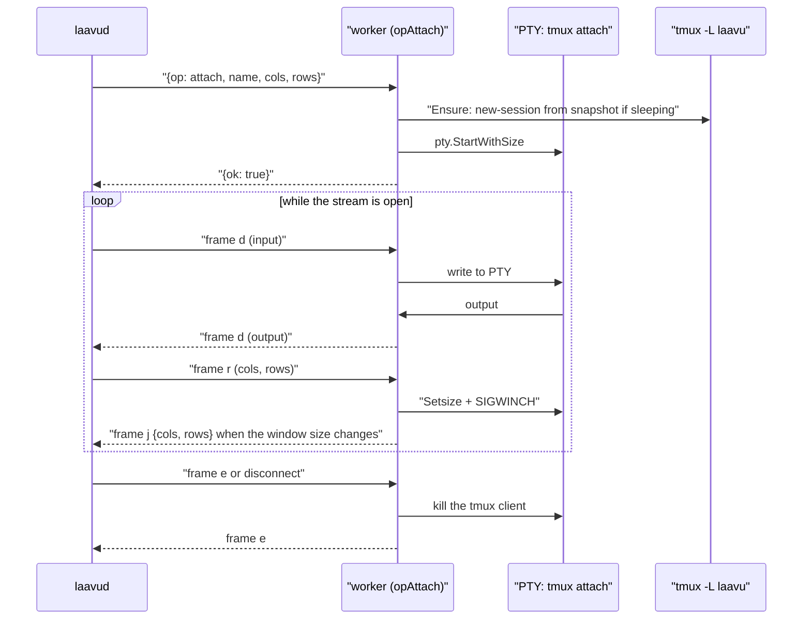

# Agent worker

How the worker is built in code as of 2026-10-25. The daemon that talks to the worker is described in [`arch-daemon.md`](arch-daemon.md), the client in [`arch-client.md`](arch-client.md), installation, `priv` and agent isolation in [`arch-laavu.md`](arch-laavu.md).

The worker is `laavud worker`: the same binary as the daemon, but run as the agent's system user. Everything the application does with the agent's files and tmux goes through it: the daemon runs as the `laavud` user and has no rights to the agent's home. The worker knows nothing about people or access. Who is allowed what is checked by the daemon before the request.

Code:

| Where | What |
|---|---|
| `cmd/laavud/main.go`, `runWorker` | entry into worker mode |
| `internal/worker/worker.go` | worker assembly, socket, the `handlers` operation map |
| `internal/worker/sessions.go`, `snapshot.go` | sessions, snapshot for recovery |
| `internal/worker/term.go` | terminal: PTY and `tmux attach` |
| `internal/worker/files.go`, `write.go`, `watch.go`, `changes.go` | files, writing, inotify, changes |
| `internal/worker/context.go` | context usage |
| `internal/worker/sshkey.go`, `clone.go` | the agent's ssh key, git clone into a new folder |
| `internal/wire/` | daemon ↔ worker protocol |
| `internal/tmuxctl/` | wrapper around `tmux -L laavu` |
| `internal/safepath/` | opening paths only inside a folder |
| `internal/names/` | agent, folder and session names |
| `internal/hook/` | `laavud hook`: Claude Code and tmux hooks, guard, status line |
| `deploy/tmux.conf.tmpl`, `deploy/agent/*.tmpl`, `deploy/systemd/laavud-worker@.*` | tmux config, agent settings and rules, units |

## Startup

The worker is started by the systemd unit `laavud-worker@<user>.service` with `User=%i`. The socket is created by the paired `laavud-worker@.socket`: `/run/laavu/workers/<user>.sock`, owner `laavud:laavud`, mode `0600`. Only the daemon (and root) can connect to the worker. The unit is enabled in `multi-user.target`, so the worker is always running and does not wait for the first connection. `Restart=always`.

`runWorker` looks in `/etc/laavu/agents/*.toml` for the agent whose `User` matches the current user and refuses to start without one. Then it reads `laavud.toml` (hook socket, upload limit) and `/etc/laavu/reserved`, builds `worker.New` with `Scope: true` and gets a listener via `worker.Listener`.

`worker.Listener` takes the socket from systemd (`LISTEN_PID`, `LISTEN_FDS=1`, descriptor 3). Without systemd, for example in `laavud dev`, it listens on the path itself under `umask 077`.

What else the worker does at startup:

- **umask.** The unit runs without PAM, so the agent's umask is set in it: `UMask=0077`. The worker creates directories and files with `0700` and `0600` anyway.
- **Environment for tmux** (`worker.New`): `HOME`, `USER`, `SHELL` (login shell from `/etc/passwd`, unless it is `nologin`), `PATH` with `~/.local/bin`, `LANG=C.UTF-8`, `TMPDIR=~/tmp`, `LAAVU_AGENT`, `LAAVU_PORTS`, `LAAVU_HOOK_SOCK`, `LAAVUD_BIN`, and if `/run/user/<uid>` exists, `XDG_RUNTIME_DIR` and the D-Bus bus address. It is needed by `systemd-run --user` and by hooks inside sessions.
- **Clearing systemd variables** (`Serve`, the `systemdEnv` list): `LISTEN_FDS`, `NOTIFY_SOCKET`, `INVOCATION_ID` and the like are removed so they don't leak into the agent's sessions.
- **Snapshot reconciliation** (`reconcile`): after a reboot, snapshot sessions become "sleeping" (see [Snapshot](#snapshot)).

### Why tmux is outside the worker's cgroup

If the tmux server were started directly from the worker, it would end up in the unit's cgroup, and `systemctl stop` or a worker restart would kill all sessions (`KillMode=control-group`). So `tmuxctl.New`, if the server is not running yet and `Scope` is on, starts the first `new-session` via `systemd-run --user --scope --quiet --collect -- tmux …`. The tmux server lives in the agent's user instance of systemd. For that, `priv` enables `loginctl enable-linger` for the agent. All subsequent tmux commands are plain calls to the already running server. The worker unit's memory limit (`MemoryMax=256M`) therefore applies only to the worker itself. The per-agent limit is on its slice, set by `priv`.

In `laavud dev` (`cmd/laavud/main.go`, `dev`) the worker runs in the same process as the daemon, without a scope, with the tmux socket `laavu-dev`.

## The wire protocol

One connection, one operation. The daemon opens the unix socket (`wire.Dial`, 3 s timeout) and writes a JSON line:

```
{"op": "tree", "args": {"folder": "Demo", "path": "days"}}
```

The worker replies with one line: `{"ok": true, "data": …}` or `{"ok": false, "error": "…"}`. The error text is passed to the daemon as is (`wire.RemoteError`). An unknown operation is an error naming it.

For streaming operations, after a successful response the connection switches to frame mode: `[type 1 byte][length 4 bytes BE][data]`, frames at most 1 MB (`wire.MaxFrame`). The caller is responsible for ordering frame writes from several goroutines: `opAttach` uses a mutex for that.

| Frame | Meaning |
|---|---|
| `d` (`FrameData`) | terminal or file bytes |
| `r` (`FrameResize`) | 4 bytes: cols and rows, `uint16` BE |
| `j` (`FrameJSON`) | event or result |
| `e` (`FrameEnd`) | end of stream from this side |

Frames in streaming operations:

| Operation | Daemon → worker | Worker → daemon |
|---|---|---|
| `attach` | `d` input, `r` size, `e` detach | `d` terminal output, `j` tmux window size `{cols, rows}`, `e` tmux client exited |
| `read` | — | response with `FileMeta`, then `d` with the content, `e` |
| `upload` | `d` with the content, `e` at the end | `j` with `{path, size}` or `{error}` |
| `watch` | any frame or disconnect ends watching | `j` with `{dirs, files}` |

A streaming operation handler sends the response and drives the frames itself and returns `errStreamed` so that `handle` does not write a second response.

## Operations

The `handlers` map in `internal/worker/worker.go`.

| Operation | Arguments | What it does | Response |
|---|---|---|---|
| `ping` | — | connectivity check | `{agent}` |
| `workdirs` | — | top-level folders of the home minus reserved ones, for git also branch and number of changes | `[]Workdir` |
| `mkdir` | `name` | new folder `0700`, name per `names.Reserved.Workdir` | `Workdir` |
| `sessions` | — | snapshot reconciliation, then live tmux sessions and sleeping ones from the snapshot | `[]SessionInfo` |
| `sync` | — | same as `sessions`, the daemon doesn't call it | `[]SessionInfo` |
| `new` | `name`, `folder`, `kind`, `author`, `profile`, `cols`, `rows` | new `claude` or `shell` session in a folder | `SessionInfo` |
| `ensure` | `name`, `profile`, `respawn`, `cols`, `rows` | wake a sleeping session from the snapshot, with `respawn` also a dead pane | `{started}` |
| `kill` | `name` | close a live session and remove its snapshot entry | — |
| `rename` | `name`, `to` | rename a live session | — |
| `respawn` | same as `ensure` | `ensure` with `respawn: true` | `{started}` |
| `meta` | `name`, `status`, `claude`, `transcript` | set `@laavu-*` options, reconcile the snapshot when `claude` changes | — |
| `input` | `name`, `text`, `enter`, `profile` | wake the session if needed and paste text | `{started}` |
| `keys` | `name`, `keys` | allowed keys, `CancelMode` may come first | — |
| `scroll` | `name`, `lines` (±1000) | history scrolling: mouse wheel or copy-mode | — |
| `history` | `name` | `capture-pane` of 20,000 lines with colors | `{text}` |
| `context` | `name` | context usage of the conversation | `ContextUsage` |
| `attach` | `name`, `cols`, `rows`, `profile` | terminal stream | stream |
| `tree` | `folder`, `path`, `hidden` | directory contents: directories first, by name | `[]Entry` |
| `read` | `folder`, `path`, `visible`, `max`, `meta_only` | file info and content stream | `FileMeta`, stream |
| `upload` | `folder`, `dir`, `name`, `size` | receive a file | stream |
| `watch` | `folder` | inotify on the folder | stream |
| `changes` | `folder`, `since` | commits and uncommitted changes, or files by time | `Changes` |
| `diff` | `folder`, `path`, `since` | diff of one file | `{diff, truncated}` |
| `write` | `folder`, `path`, `content`, `base` | write a file with a version check | `WriteResult` |
| `sshkey` | — | the agent's public key `~/.ssh/id_ed25519.pub` and its fingerprint, empty without a key | `SSHKey` |
| `sshkey-new` | — | create an ed25519 key; an existing key is an error | `SSHKey` |
| `clone` | `url`, `folder` | `git clone` into a new folder | `Workdir` |

The daemon currently does not pass `meta_only` to `read`. For manual debugging of any operation there is `laavud call AGENT OPERATION [JSON]`.

## Sessions

### A session is a tmux session

Each agent has its own `tmux -L laavu` server (the socket name is `tmux_socket` in the agent config, default `laavu`) with a shared config `-f /etc/laavu/tmux.conf`. The session list is `tmux list-sessions` (`tmuxctl.List`). The worker has no session table of its own. A session the agent created itself via `tmux -L laavu new-session` is visible just like one created from the client, with kind `other`.

Laavu state lives in user options of the session:

| Option | What |
|---|---|
| `@laavu-kind` | `claude` or `shell`, empty for sessions created outside the client |
| `@laavu-author` | who started the session, the profile depends on it |
| `@laavu-claude` | UUID of the current Claude Code conversation |
| `@laavu-status` | status from hooks |
| `@laavu-transcript` | path to the current conversation's transcript |

`List` reads them in one command together with `session_path`, `pane_dead`, `pane_start_command`, `pane_current_command`, `window_activity`, and the server's `pid` and `start_time`. The last two are the tmux server identity for the snapshot.

The session's folder is `session_path`. `folderOf` returns the first path component relative to the home unless it is a reserved name. For a reserved name the folder is empty and the client shows the session under "other". The session name is checked by `names.Session`: Latin letters, digits, hyphen, underscore, up to 64 characters. All tmux calls target `=name` or `=name:` so tmux doesn't match a session by prefix. Every tmux command except `new-session` and the attach client is limited to 10 seconds.

### New session

`NewSession` checks the folder name and that it is a real directory (`Lstat`, not a symlink). An empty name is replaced with `folder-N` (`freeName`, dots in the folder name become hyphens). Availability is checked against both tmux and the snapshot: the name of a sleeping session cannot be taken.

The command:

- `claude`: `$SHELL -lic 'exec "$@"' laavu claude [--resume UUID] [--append-system-prompt …] [--settings …]`. It goes through an interactive login shell so that `~/.profile` and `~/.bashrc` with the token are picked up (test `TestClaudeSeesBashrc`). The command itself is the `claude` field from the agent config. Command-line additions come from the author's profile, which the daemon passes in (`Profile`).
- `shell`: `$SHELL -l`.

The session is created with `new-session -d -s name -c folder -x -y` with variables `TMPDIR`, `LAAVU_PORTS`, `LAAVU_AGENT`, and the `@laavu-*` options are set in the same tmux command chain via `;`. Otherwise a fast `SessionStart` or `session-created` hook could read empty options. For `claude` the status is set to `starting` right away. The same variables are written to the server's global environment (`SetGlobalEnv`) so that sessions the agent creates itself get them too.

### Snapshot

tmux does not survive a reboot, so the worker maintains `~/.local/state/laavu/sessions.json` (`snapshot.go`). An entry holds: name, path (`session_path`, the folder is derived from it), kind, author, conversation UUID, `start_cmd` and the tmux server identity (`pid`, start time). The snapshot does not store a ready-made launch command: for `claude` and `shell` it is rebuilt on wake-up, with the author's current profile.

`Reconcile` builds a new snapshot from the old one and the list of live sessions:

- Live sessions are written from their options.
- Entries from the same server run that no longer exist are removed, since the session was closed or renamed.
- Entries from a previous run stay. These are the sleeping sessions.
- If there is no server (`pid` 0), nothing is removed.

Reconciliation runs at worker startup, on every `sessions` (the daemon calls it on any tmux hook), after `new`, `ensure`, `rename` and `meta` with a new UUID. Writes go through a temporary file and `rename`, under a mutex. Corrupted JSON is not an error: the snapshot starts over, and the conversations remain in Claude Code history. The guarantees are covered by `TestReconcile` and the "reboot" scenario in `TestWorkdirsAndSessions`.

### ensure, lazy resume, respawn

`Ensure` is called by `attach`, `input` and by the daemon before opening a terminal.

- The session exists in tmux and `respawn` was not requested: does nothing.
- The session exists, the pane is dead (`remain-on-exit`), `respawn`: `respawn-pane -k` in `session_path` with a command rebuilt as on wake-up (`restoreCmd`, the current author profile). For `claude` this is `--resume` of the current UUID, and the status goes back to `starting`. This is what the "Resume" button does.
- The session is not in tmux but is in the snapshot: `new-session` with the command from the snapshot (`restoreCmd`): `claude --resume UUID`, `shell`, and for sessions of kind `other`, `$SHELL -lic start_cmd`. If the folder no longer exists, the session is started in the home.

`input` and `attach` call `Ensure` without `respawn`: they don't restart a dead pane.

`kill` closes a live session and removes the snapshot entry in any case, which is also how a sleeping session gets closed. `rename` works only for a live session. The new name is checked against the rules and against live tmux sessions, and the snapshot entry moves on reconciliation. Unlike `new`, rename doesn't check the snapshot, so it can take a sleeping session's name.

### Input, keys, scrolling

`input` (`tmuxctl.Paste`) puts the text into a named buffer (`load-buffer -b laavu-<time> -`) and pastes it with `paste-buffer -p -d`: in bracketed mode multi-line text goes in as one message. Enter is sent separately 150 ms later, otherwise the TUI sometimes swallows it into the paste. Delays before pasting: 2 s if the session was just woken up, and padding up to 1.5 s from session creation if it is brand new (the shell hasn't finished reading its profile yet).

`keys` lets through only `Escape`, `Enter`, `Tab`, `BTab`, `C-c`, `C-d`, arrows, `PageUp`, `PageDown`. `CancelMode` is not a key: if it comes first, the worker takes the pane out of copy-mode (`send-keys -X cancel`, only if `pane_in_mode`). The client puts it before input when the user had been scrolling history.

`scroll` is swipe scrolling from a phone. How it scrolls depends on the program in the pane (`MouseApp`):

- If the program accepts mouse input itself (Claude Code on the alternate screen), the worker sends it wheel events via `send-keys -H`, in SGR or legacy encoding, with the pointer in the center of the pane. One event per 3 lines of swipe. The remainder accumulates per session and resets when the direction changes (`wheelSteps`). tmux copy-mode would show empty history here.
- Otherwise it uses copy-mode: up is `copy-mode -e` and `scroll-up -N`, down is `scroll-down -N`. At the bottom the pane leaves the mode on its own.

`history` is `capture-pane -p -e -J -S -20000`: history with colors for separate viewing.

## Terminal

`opAttach` (`term.go`) wakes the session via `Ensure`, then runs `tmux -L laavu attach-session -t =name` in a PTY (`creack/pty`) sized from the request, 80×24 by default, with `TERM=xterm-256color` and `COLORTERM=truecolor`. After the response, three goroutines:

- PTY output in chunks of up to 32 KB → `d` frames.
- Frames from the daemon: `d` is written to the PTY, `r` resizes the PTY, `e` or a disconnect kills the tmux client.
- `reportWindowSize` polls tmux for `window_width`/`window_height` every 700 ms and sends a `j` frame on change.

Each open pane in the client has its own PTY and its own `tmux attach`. When the stream closes, only that tmux client dies and the session keeps running (`TestAttach`). At the end the worker sends `e`.

A tmux session has one window shared by all attached clients, and with `window-size latest` it follows the most recently active client. So on `r`, after `Setsize`, the worker sends `SIGWINCH` to the tmux client itself: the kernel sends it only when the size changes, but a resize to the same size is how a client takes the window back when the user returns to the session from another device. The other side of this is `reportWindowSize`: if the session was opened on a phone, the laptop sees that the window is no longer its size and can offer to take it back.



## Files

### safepath

Every file operation starts with `openRoot`: the folder name is checked against the reserved list (anything starting with a dot, `tmp`, `bin`, `go`, `snap`, `node_modules` and the lines of `/etc/laavu/reserved`) on every request, then `safepath.Open`.

- The folder itself is opened with `openat2` from the home descriptor with `RESOLVE_BENEATH | RESOLVE_NO_SYMLINKS`: the folder cannot be a symlink.
- Paths inside it use `openat2` from the folder descriptor with `RESOLVE_BENEATH | RESOLVE_NO_MAGICLINKS`. Symlinks inside the folder work if they point inside it. Escaping is rejected by the kernel (`EXDEV` → `ErrOutside`). Before that, `Clean` strips the leading slash and refuses `..` above the root.
- `Open` for reading uses `O_NONBLOCK` so that a FIFO planted by the agent can't hang the worker.
- `OpenVisible` for the view origin additionally forbids hidden components both in the requested path and in the real path of the opened file (`/proc/self/fd`): neither `.env` nor a symlink to it is served.
- `MkdirAll` creates directories one at a time via `mkdirat` and after each one checks that the result is a directory inside the folder.
- `CreateExclusive` creates a file with `O_CREAT|O_EXCL|O_NOFOLLOW`, `0600`. A taken name gets a number (`photo-1.jpg`). Existing files and symlinks are never overwritten.

Tests are in `internal/safepath/safepath_test.go`: escapes via `..` and symlinks, a folder that is a symlink, hidden paths, creating over a symlink.

### tree and read

`tree` returns directory contents: type (`dir`, `file`, `link`, `other`), size, time, hidden flag and viewer kind by extension (`KindByExt`: `markdown`, `html`, `svg`, `image`, `pdf`, `code`, `text`, `binary`). Hidden entries and paths through hidden directories only with `hidden`.

`read` first responds with `FileMeta`: path, size, time, kind. A directory is returned as `kind: dir` with no stream. A non-regular file is an error. For an unknown extension, code, text and markdown, the kind is refined from the first 8 KB (`Sniff`): a null byte or invalid UTF-8 means `binary`. A character cut off at the boundary is not counted as an error. Then the content in frames of up to 256 KB, and `e`. `max` truncates the stream. The daemon sets it for text viewing (`maxText`) and reads without a limit for downloads. `visible` turns on `OpenVisible`.

### upload

The size from the request is checked against the limit (the daemon's `upload_limit_mb`, 200 MB by default) before receiving and again while receiving. The directory comes from `dir`, or if absent, from the first line of `.laavu-uploads` at the folder root. The path from that file goes through the same `Clean`, and on error or an empty line the root is used. Only the last component of the name is kept (backslashes count as separators). The directory is created with `MkdirAll`, the file with `CreateExclusive`. The response is "ready to receive", then `d` frames until `e`, and at the end a `j` frame with the final path. On error or disconnect, the partially written file is deleted.

### sshkey and clone

The agent's key is `~/.ssh/id_ed25519`, the one `git` and `ssh` pick up by default in its sessions. `sshkey-new` generates it in Go (`crypto/ed25519`, `ssh.MarshalPrivateKey`), without `ssh-keygen`. The private key is opened with `O_EXCL` and mode `0600`, `~/.ssh` is `0700`, and the comment is `user@host`. An existing key is never overwritten: repositories may already trust it. Only the public key leaves the worker.

`clone` (`clone.go`) takes `https://`, `ssh://` and `user@host:path` addresses (user and host start with a letter or digit, no whitespace), so `ext::`, `file://` and local paths are refused. Dev mode and tests set `LocalClone`, which also lets through absolute paths and `file://`. The folder goes through `names.Reserved.Workdir` and must not exist. The command is `git clone -- URL ~/FOLDER`, on a server under `systemd-run --user --scope` like tmux (the worker cgroup has `MemoryMax=256M`), with `GIT_TERMINAL_PROMPT=0` and `GIT_SSH_COMMAND=ssh -o BatchMode=yes -o StrictHostKeyChecking=accept-new`: nobody can answer a prompt, and a new host key is remembered in the agent's `known_hosts` as on the first ssh by hand. The limit is 10 minutes (`CloneTimeout`); after a timeout the half-cloned folder is deleted, on other errors git cleans up itself. The error is the last lines of git's stderr without "Cloning into".

### write

An edit from the client's editor (`write.go`). The file version is the first 16 bytes of the content's SHA-256 in hex (`Version`). The client sends the content and `base`, the version it edited from. An empty `base` means "new file".

1. The current file is read with `O_NOFOLLOW`: a symlink in place of the file is a refusal, otherwise `rename` would turn the link into a regular file. A non-regular file or a file larger than 2 MB (`MaxWrite`) is a refusal.
2. If the version on disk doesn't match `base`, the response is `{conflict: true, version}` and the file is untouched. This is not treated as an error.
3. `.<name>.laavu-save` is created next to it via `CreateExclusive`, written, given the old file's permissions (a new file gets `0600`), and `fsync`ed.
4. The version is checked a second time: the agent may have written the file while we were writing.
5. `renameat` over the original. A reader sees either the old or the new content, never half.

The response is the new version, size and time. The temporary file is deleted on any error. Test `TestWrite`: edit from its own version, a stale version, a new file twice, a symlink, `..`, a symlinked directory pointing outside, no leftover temporary files.

### watch

`opWatch` attaches `fsnotify` (inotify) to every directory of the folder except `.git`, `node_modules`, `__pycache__`, `.venv`, `venv`, `target`, `.next`, at most 4000 directories per folder. A new directory is added when it is created. Events are coalesced over 300 ms and sent as a `j` frame with the changed directories and files (relative paths). Watching continues until the daemon sends any frame or closes the connection.

### changes and diff

`changes` with a `since` mark (unix time, stored by the browser):

- **`.git` exists**: `git log --since=@since --no-merges -n 200 --name-status` (commits with files) and `git status --porcelain=v1 -uall` (uncommitted, at most 500 files).
- **no `.git`**: a walk of the folder by modification time, skipping hidden and heavy service directories, at most 500 files, newest first.

`diff` takes the last commit before `since` (`rev-list -1 --before`) and runs `git diff` from it to the working tree for a single file. If the repository is younger than the mark, the diff is from the empty tree. An untracked file uses `diff --no-index /dev/null`. The limit is 1 MB, beyond that `truncated`.

The worker only reads git: commands run with `GIT_OPTIONAL_LOCKS=0` (don't touch the index), `core.quotepath=off` and a 15 s timeout.

### workdirs

Top-level folders of the home minus reserved ones, sorted alphabetically case-insensitively. For a folder with `.git`: the branch and the number of lines of `git status --porcelain --branch`. In a new repository the branch is taken from `No commits yet on`. On a detached `HEAD` there is no branch.

## Context

`opContext` (`context.go`) computes context usage of the session's current conversation (`@laavu-claude`):

1. **Status line.** `statusLine` in the agent settings calls `laavud hook statusline`. Claude Code passes it the window size, percentage and token counters. The hook writes them to `~/.local/state/laavu/ctx/<session_id>.json` and prints "model · context N%" in the TUI. If the file exists and the window in it is non-zero, the response has `source: statusline`.
2. **Transcript.** Otherwise (the agent set its own status line), the path from `@laavu-transcript`. `LastUsage` reads the last 2 MB of the transcript and takes the sum `input + cache_creation + cache_read + output` of the last main-branch response (without `isSidechain`). The window comes from `WindowFor`: 200,000, or 1,000,000 if the model name contains `[1m]`, `-5-` or `-5.`, or if the counter is already above 200,000. The response has `source: table`. This is a rough guess at the window based on the model name.

## Hooks

`laavud hook …` (`internal/hook/`) runs as the agent's user from inside its sessions. The rule for all of them: nothing extra on stdout, errors are silent, exit code 0 (`runHook` even catches panics). The event goes to the daemon as one JSON line on `/run/laavu/hooks/hook.sock` (the path comes from `LAAVU_HOOK_SOCK`, which the worker put into the tmux environment), with a 500 ms connect timeout and a 1 s write timeout. If the daemon is down, the agent keeps working as usual.

What is called (`deploy/agent/settings.json.tmpl`, `deploy/tmux.conf.tmpl`):

| From | Event | Command |
|---|---|---|
| Claude Code | `SessionStart`, `UserPromptSubmit`, `PreToolUse`, `PostToolUse`, `Stop`, `Notification`, `SessionEnd` | `laavud hook claude` |
| Claude Code | `SessionStart`, `PostToolUse`, `Stop` | `laavud hook guard` |
| Claude Code | `statusLine` | `laavud hook statusline` |
| tmux | `session-created`, `session-closed`, `session-renamed`, `pane-died` | `laavud hook tmux <event>` via `run-shell -b` |

`hook claude` gets the tmux session name from tmux itself via `TMUX_PANE` (`tmux display-message -p -t $TMUX_PANE '#S'`, with the tmux socket taken from `TMUX`). Outside tmux the event is not sent. Only the event name, session name, `session_id`, `source`, `reason`, transcript path and notification type go to the daemon. From `PreToolUse` also the tool name and the path it works on (`ToolTarget`: `file_path`, `notebook_path` or `path`, relative to `cwd`, at most 200 characters). Prompt text, responses, Bash commands, search patterns and URLs are not sent. What the daemon does with the event is in [`arch-daemon.md`](arch-daemon.md). On `SessionStart` it calls the worker's `meta` with the new UUID and transcript, on a tmux hook it calls `sessions`.

`hook tmux` sends only the event name: it has no session name, and the daemon reconciles the whole list.

### guard

`hook guard` (`guard.go`) reminds the agent about unsaved work and a filling context. State is in `~/.local/state/laavu/guard/<session_id>.json`.

- `PostToolUse`: if the tool is `Edit`, `Write`, `MultiEdit` or `NotebookEdit`, the file's git repository is remembered. For `Bash` it is the repository of `cwd`.
- `Stop`: the turn counter increases. If one of the remembered repositories has a non-empty `git status` and there has been no unsaved-work reminder for 5 turns, the reason asks the agent to offer the user to commit and push. If the context (status line or transcript, as in `opContext`) is 65% full or more and there has been no reminder for 5 turns, the reason asks the agent to offer `/compact` or `/clear`. If there are reasons, `{"decision": "block", "reason": "Laavu: …"}` goes to stdout, and the agent appends the suggestion for the user. It does nothing without the user's consent: this is stated both in the reason and in `deploy/agent/CLAUDE.md.tmpl`.
- A second `Stop` in a row (`stop_hook_active`) is let through immediately to avoid a loop.
- `SessionStart` with `source: clear` deletes the conversation's state.

Tests are in `guard_test.go`: the reminder and the 5-turn pause, the exact status-line value taking priority over the table.

## tmux config

`deploy/tmux.conf.tmpl` is installed to `/etc/laavu/tmux.conf` and passed via `-f` when the server starts. The agent's `~/.tmux.conf` is not read.

| Option | Purpose |
|---|---|
| `status off`, `prefix None`, `prefix2 None` | tmux is invisible: tabs and statuses are drawn by the client, Ctrl-B goes to the agent |
| `default-terminal tmux-256color`, `terminal-features` RGB, usstyle, hyperlinks, sync, clipboard, plus `set-clipboard on` | truecolor, colored underlines, OSC 8 links, synchronized output, clipboard |
| `escape-time 10`, `extended-keys on` | Esc without delay, extended keys |
| `history-limit 50000` | history for `history` and copy-mode |
| `mouse on` | mouse wheel on a laptop, mouse events for programs |
| `aggressive-resize on`, `window-size latest` | one window for all clients, sized by the most recently active one |
| `remain-on-exit on` | a dead process leaves its pane: `exited` status and the "Resume" button |
| `monitor-activity on`, `visual-activity off` | activity flag without on-screen messages |
| `focus-events on` | programs know about focus |
| `set-hook` on four events | signal to the daemon that the session list changed |

## Names

`internal/names/names.go`: agent is `^[a-z][a-z0-9-]{0,23}$` (the user `lv-<name>` is derived from it), folder is `^[A-Za-z0-9_][A-Za-z0-9._-]{0,63}$` and not reserved, session is `^[A-Za-z0-9_-]{1,64}$`. Reserved names are read from `/etc/laavu/reserved` (one per line, `#` is a comment). The built-in ones always apply.

## Tests

Worker tests (`internal/worker/worker_test.go`, `internal/tmuxctl/tmuxctl_test.go`) run against real tmux with their own socket: sessions created outside the worker, multi-line paste, renaming, a tmux server "reboot", waking one sleeping session without losing the others, a dead pane and `respawn`, `CancelMode` in the right session, SGR wheel events for a mouse-aware program, attach, files, `.laavu-uploads`, watch, git changes, the ssh key and clone (`sshkey_test.go`, clone from a local repository with `LocalClone`). Instead of real Claude Code there is `test/fakeclaude`: it reads hooks from `~/.claude/settings.json` and `--settings`, calls them with the same fields, writes a transcript with token counters, understands `/clear`, `/compact`, `/exit`, and on `write:path` calls the hooks of the "Write tool". More in [`dev.md`](dev.md).
