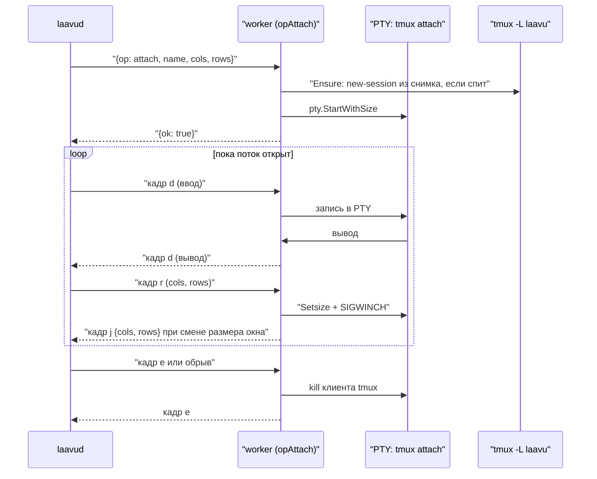

# Воркер агента

Как устроен воркер в коде на 2026-10-25. Демон, который ходит к воркеру, описан в [`arch-daemon.md`](arch-daemon.md), клиент — в [`arch-client.md`](arch-client.md), установка, `priv` и изоляция агентов — в [`arch-laavu.md`](arch-laavu.md).

Воркер — это `laavud worker`, тот же бинарник, что и демон, но запущенный от системного пользователя агента. Всё, что приложение делает с файлами и tmux агента, идёт через него: демон работает от пользователя `laavud` и прав на дом агента не имеет. Воркер не знает ни о людях, ни о доступах. Кто кому что разрешил, проверяет демон до запроса.

Код:

| Где | Что |
|---|---|
| `cmd/laavud/main.go`, `runWorker` | вход в режим воркера |
| `internal/worker/worker.go` | сборка воркера, сокет, карта операций `handlers` |
| `internal/worker/sessions.go`, `snapshot.go` | сессии, снимок для восстановления |
| `internal/worker/term.go` | терминал: PTY и `tmux attach` |
| `internal/worker/files.go`, `write.go`, `watch.go`, `changes.go` | файлы, запись, inotify, изменения |
| `internal/worker/context.go` | заполненность контекста |
| `internal/wire/` | протокол демон ↔ воркер |
| `internal/tmuxctl/` | обёртка над `tmux -L laavu` |
| `internal/safepath/` | открытие путей только внутри рабочей папки |
| `internal/names/` | имена агентов, папок, сессий |
| `internal/hook/` | `laavud hook`: хуки Claude Code и tmux, guard, строка статуса |
| `deploy/tmux.conf.tmpl`, `deploy/agent/*.tmpl`, `deploy/systemd/laavud-worker@.*` | конфиг tmux, настройки и правила агента, юниты |

## Запуск

Воркер стартует systemd-юнитом `laavud-worker@<пользователь>.service` с `User=%i`. Сокет создаёт парный `laavud-worker@.socket`: `/run/laavu/workers/<пользователь>.sock`, владелец `laavud:laavud`, режим `0600`. Подключиться к воркеру может только демон (и root). Юнит включён в `multi-user.target`, так что воркер живёт постоянно, а не поднимается по первому подключению; `Restart=always`.

`runWorker` ищет в `/etc/laavu/agents/*.toml` агента, у которого `User` совпадает с текущим пользователем, и без него не запускается. Дальше читает `laavud.toml` (сокет хуков, лимит загрузки) и `/etc/laavu/reserved`, собирает `worker.New` с `Scope: true` и получает слушатель через `worker.Listener`.

`worker.Listener` берёт сокет из systemd (`LISTEN_PID`, `LISTEN_FDS=1`, дескриптор 3). Без systemd, например в `laavud dev`, он сам слушает путь под `umask 077`.

Что ещё делает воркер при старте:

- **umask.** Юнит идёт без PAM, поэтому umask агента задан в нём: `UMask=0077`. Каталоги и файлы воркер и так создаёт с `0700` и `0600`.
- **Окружение для tmux** (`worker.New`): `HOME`, `USER`, `SHELL` (login-shell из `/etc/passwd`, кроме `nologin`), `PATH` с `~/.local/bin`, `LANG=C.UTF-8`, `TMPDIR=~/tmp`, `LAAVU_AGENT`, `LAAVU_PORTS`, `LAAVU_HOOK_SOCK`, `LAAVUD_BIN`, а если есть `/run/user/<uid>` — `XDG_RUNTIME_DIR` и адрес шины D-Bus. Оно нужно `systemd-run --user` и хукам внутри сессий.
- **Чистка переменных systemd** (`Serve`, список `systemdEnv`): `LISTEN_FDS`, `NOTIFY_SOCKET`, `INVOCATION_ID` и подобные убираются, чтобы не попасть в сессии агента.
- **Сверка снимка** (`reconcile`): после перезагрузки сессии снимка становятся «спит» (см. «Снимок»).

### Почему tmux вне cgroup воркера

Если запустить сервер tmux прямо из воркера, он окажется в cgroup юнита, и `systemctl stop` или перезапуск воркера убьют все сессии (`KillMode=control-group`). Поэтому `tmuxctl.New`, если сервер ещё не запущен и `Scope` включён, запускает первую `new-session` через `systemd-run --user --scope --quiet --collect -- tmux …`. Сервер tmux живёт в пользовательском экземпляре systemd агента, для этого `priv` включает агенту `loginctl enable-linger`. Все следующие команды tmux идут обычным вызовом к уже работающему серверу. Лимит памяти юнита воркера (`MemoryMax=256M`) поэтому касается только самого воркера; лимит на агента — у его слайса, его ставит `priv`.

В `laavud dev` (`cmd/laavud/main.go`, `dev`) воркер работает в одном процессе с демоном, без scope, с сокетом tmux `laavu-dev`.

## Протокол wire

Одно соединение — одна операция. Демон открывает unix-сокет (`wire.Dial`, таймаут 3 с) и пишет строку JSON:

```
{"op": "tree", "args": {"folder": "Demo", "path": "days"}}
```

Воркер отвечает одной строкой: `{"ok": true, "data": …}` или `{"ok": false, "error": "…"}`. Текст ошибки уходит демону как есть (`wire.RemoteError`). Неизвестная операция — ошибка с её именем.

У потоковых операций после успешного ответа соединение переходит в режим кадров: `[тип 1 байт][длина 4 байта BE][данные]`, кадр не больше 1 МБ (`wire.MaxFrame`). Порядок записи кадров с нескольких горутин обеспечивает вызывающий: в `opAttach` для этого мьютекс.

| Кадр | Смысл |
|---|---|
| `d` (`FrameData`) | байты терминала или файла |
| `r` (`FrameResize`) | 4 байта: cols и rows, `uint16` BE |
| `j` (`FrameJSON`) | событие или итог |
| `e` (`FrameEnd`) | конец потока с этой стороны |

Кадры в потоковых операциях:

| Операция | Демон → воркер | Воркер → демон |
|---|---|---|
| `attach` | `d` — ввод, `r` — размер, `e` — отключиться | `d` — вывод терминала, `j` — размер окна tmux `{cols, rows}`, `e` — клиент tmux завершился |
| `read` | — | ответ с `FileMeta`, затем `d` с содержимым, `e` |
| `upload` | `d` с содержимым, `e` в конце | `j` с `{path, size}` или `{error}` |
| `watch` | любой кадр или обрыв — конец наблюдения | `j` с `{dirs, files}` |

Обработчик потоковой операции сам отвечает и ведёт кадры и возвращает `errStreamed`, чтобы `handle` не писал второй ответ.

## Операции

Карта `handlers` в `internal/worker/worker.go`.

| Операция | Аргументы | Что делает | Ответ |
|---|---|---|---|
| `ping` | — | проверка связи | `{agent}` |
| `workdirs` | — | папки первого уровня дома без зарезервированных, для git — ветка и число изменений | `[]Workdir` |
| `mkdir` | `name` | новая рабочая папка `0700`, имя по `names.Reserved.Workdir` | `Workdir` |
| `sessions` | — | сверка снимка, затем живые сессии tmux и спящие из снимка | `[]SessionInfo` |
| `sync` | — | то же, что `sessions`; демон её не вызывает | `[]SessionInfo` |
| `new` | `name`, `folder`, `kind`, `author`, `profile`, `cols`, `rows` | новая сессия `claude` или `shell` в рабочей папке | `SessionInfo` |
| `ensure` | `name`, `profile`, `respawn`, `cols`, `rows` | поднять спящую сессию из снимка; с `respawn` — и умершую панель | `{started}` |
| `kill` | `name` | закрыть живую сессию и убрать запись из снимка | — |
| `rename` | `name`, `to` | переименовать живую сессию | — |
| `respawn` | как у `ensure` | `ensure` с `respawn: true` | `{started}` |
| `meta` | `name`, `status`, `claude`, `transcript` | поставить опции `@laavu-*`; при смене `claude` — сверка снимка | — |
| `input` | `name`, `text`, `enter`, `profile` | поднять сессию при необходимости и вставить текст | `{started}` |
| `keys` | `name`, `keys` | разрешённые клавиши, первой может идти `CancelMode` | — |
| `scroll` | `name`, `lines` (±1000) | прокрутка истории: колесо мыши или copy-mode | — |
| `history` | `name` | `capture-pane` на 20 000 строк с цветами | `{text}` |
| `context` | `name` | заполненность контекста разговора | `ContextUsage` |
| `attach` | `name`, `cols`, `rows`, `profile` | поток терминала | поток |
| `tree` | `folder`, `path`, `hidden` | содержимое каталога: каталоги первыми, по имени | `[]Entry` |
| `read` | `folder`, `path`, `visible`, `max`, `meta_only` | сведения о файле и поток содержимого | `FileMeta`, поток |
| `upload` | `folder`, `dir`, `name`, `size` | приём файла | поток |
| `watch` | `folder` | inotify по рабочей папке | поток |
| `changes` | `folder`, `since` | коммиты и незакоммиченное или файлы по времени | `Changes` |
| `diff` | `folder`, `path`, `since` | дифф одного файла | `{diff, truncated}` |
| `write` | `folder`, `path`, `content`, `base` | запись файла с проверкой версии | `WriteResult` |

`meta_only` у `read` демон сейчас не передаёт. Для ручной отладки любой операции есть `laavud call АГЕНТ ОПЕРАЦИЯ [JSON]`.

## Сессии

### Сессия — это tmux-сессия

У агента свой сервер `tmux -L laavu` (имя сокета — `tmux_socket` в конфиге агента, по умолчанию `laavu`) с общим конфигом `-f /etc/laavu/tmux.conf`. Список сессий — это `tmux list-sessions` (`tmuxctl.List`), своей таблицы сессий у воркера нет. Сессия, которую агент завёл сам через `tmux -L laavu new-session`, видна так же, как заведённая из клиента, с видом `other`.

Состояние Laavu лежит в пользовательских опциях сессии:

| Опция | Что |
|---|---|
| `@laavu-kind` | `claude` или `shell`; пусто у сессий мимо клиента |
| `@laavu-author` | кто начал сессию, от этого зависит профиль |
| `@laavu-claude` | UUID текущего разговора Claude Code |
| `@laavu-status` | статус из хуков |
| `@laavu-transcript` | путь к транскрипту текущего разговора |

`List` читает их одной командой вместе с `session_path`, `pane_dead`, `pane_start_command`, `pane_current_command`, `window_activity`, а также `pid` и `start_time` сервера. Последние два — идентичность сервера tmux для снимка.

Папка сессии — `session_path`. `folderOf` отдаёт первый компонент пути относительно дома, если это не зарезервированное имя; иначе папка пустая, и клиент показывает сессию в «прочем». Имя сессии проверяет `names.Session`: латиница, цифры, дефис, подчёркивание, до 64 символов. Все обращения к tmux идут с целью `=имя` или `=имя:`, чтобы tmux не подбирал сессию по префиксу. Каждая команда tmux ограничена 10 секундами.

### Новая сессия

`NewSession` проверяет имя папки и что это настоящий каталог (`Lstat`, без симлинка). Пустое имя заменяется на `папка-N` (`freeName`, точки в имени папки становятся дефисами), занятость проверяется и по tmux, и по снимку: имя спящей сессии взять нельзя.

Команда:

- `claude` — `$SHELL -lic 'exec "$@"' laavu claude [--resume UUID] [--append-system-prompt …] [--settings …]`. Через интерактивный login-shell, чтобы подхватились `~/.profile` и `~/.bashrc` с токеном (тест `TestClaudeSeesBashrc`). Сама команда — поле `claude` из конфига агента. Добавки к командной строке берутся из профиля автора, его передаёт демон (`Profile`).
- `shell` — `$SHELL -l`.

Сессия создаётся `new-session -d -s имя -c папка -x -y` с переменными `TMPDIR`, `LAAVU_PORTS`, `LAAVU_AGENT`, а опции `@laavu-*` ставятся в той же цепочке команд tmux через `;`. Иначе быстрый хук `SessionStart` или `session-created` успел бы прочитать пустые опции. У `claude` сразу ставится статус `starting`. Те же переменные пишутся в глобальное окружение сервера (`SetGlobalEnv`), чтобы их получили и сессии, которые агент заводит сам.

### Снимок

tmux не переживает перезагрузку, поэтому воркер ведёт `~/.local/state/laavu/sessions.json` (`snapshot.go`). Запись: имя, папка, вид, автор, UUID разговора, `start_cmd` и идентичность сервера tmux (`pid`, время старта). Готовой команды запуска в снимке нет: для `claude` и `shell` она собирается заново при подъёме, с текущим профилем автора.

`Reconcile` строит новый снимок из старого и списка живых сессий:

- живые сессии пишутся из своих опций;
- записи того же запуска сервера, которых больше нет, удаляются: сессию закрыли или переименовали;
- записи прошлого запуска остаются, это спящие сессии;
- если сервера нет (`pid` 0), не удаляется ничего.

Сверка идёт при старте воркера, на каждом `sessions` (демон вызывает его по любому хуку tmux), после `new`, `ensure`, `rename` и `meta` с новым UUID. Запись — через временный файл и `rename`, под мьютексом. Испорченный JSON не ошибка: снимок начинается заново, разговоры остаются в истории Claude Code. Гарантии покрывает `TestReconcile` и сценарий «перезагрузки» в `TestWorkdirsAndSessions`.

### ensure, ленивый resume, respawn

`Ensure` вызывают `attach`, `input` и демон перед открытием терминала.

- Сессия есть в tmux и `respawn` не просили — ничего не делает.
- Сессия есть, панель умерла (`remain-on-exit`), `respawn` — `respawn-pane -k` той же командой в `session_path`: для `claude` это `--resume` текущего UUID, статус снова `starting`. Это кнопка «продолжить».
- Сессии нет в tmux, но есть в снимке — `new-session` с командой из снимка (`restoreCmd`): `claude --resume UUID`, `shell`, а у сессий вида `other` — `$SHELL -lic start_cmd`. Если папки уже нет, сессия поднимается в доме.

`input` и `attach` зовут `Ensure` без `respawn`: умершую панель они не перезапускают.

`kill` закрывает живую сессию и в любом случае удаляет запись из снимка, так закрывается и спящая. `rename` работает только для живой сессии, новое имя проверяется по правилам и на занятость; запись снимка переезжает при сверке.

### Ввод, клавиши, прокрутка

`input` (`tmuxctl.Paste`) кладёт текст в именованный буфер (`load-buffer -b laavu-<время> -`) и вставляет его `paste-buffer -p -d`: в bracketed-режиме многострочный текст уходит одним сообщением. Enter отправляется отдельно через 150 мс, иначе TUI иногда проглатывает его внутрь вставки. Задержки перед вставкой: 2 с, если сессию только что подняли, и добор до 1,5 с от создания сессии, если она совсем свежая (shell ещё не дочитал профиль).

`keys` пропускает только `Escape`, `Enter`, `Tab`, `BTab`, `C-c`, `C-d`, стрелки, `PageUp`, `PageDown`. `CancelMode` — не клавиша: если он первый, воркер выводит панель из copy-mode (`send-keys -X cancel`, только если `pane_in_mode`). Клиент ставит его перед вводом, когда до этого листал историю.

`scroll` — прокрутка свайпом с телефона. Как листать, зависит от программы в панели (`MouseApp`):

- программа сама принимает мышь (Claude Code на альтернативном экране) — воркер шлёт ей события колеса через `send-keys -H`, в SGR или старой кодировке, с указателем в центре панели. Одно событие на 3 строки свайпа, остаток копится по сессии и сбрасывается при смене направления (`wheelSteps`). copy-mode tmux тут показал бы пустую историю;
- иначе — copy-mode: вверх `copy-mode -e` и `scroll-up -N`, вниз `scroll-down -N`, у нижнего края панель сама выходит из режима.

`history` — `capture-pane -p -e -J -S -20000`: история с цветами для отдельного просмотра.

## Терминал

`opAttach` (`term.go`) поднимает сессию через `Ensure`, затем запускает `tmux -L laavu attach-session -t =имя` в PTY (`creack/pty`) размером из запроса, по умолчанию 80×24, с `TERM=xterm-256color` и `COLORTERM=truecolor`. После ответа три горутины:

- вывод PTY кусками до 32 КБ → кадры `d`;
- кадры от демона: `d` пишется в PTY, `r` меняет размер PTY, `e` или обрыв убивает клиента tmux;
- `reportWindowSize` раз в 700 мс спрашивает у tmux `window_width`/`window_height` и при изменении шлёт кадр `j`.

Каждая открытая панель в клиенте — свой PTY и свой `tmux attach`. Когда поток закрывается, умирает только этот клиент tmux, сессия живёт (`TestAttach`). В конце воркер шлёт `e`.

Окно у сессии tmux одно на всех подключённых клиентов, а с `window-size latest` оно следует за последним активным клиентом. Поэтому на `r` воркер после `Setsize` сам посылает клиенту tmux `SIGWINCH`: ядро шлёт его только при изменении размера, а resize того же размера — способ клиента забрать окно себе, когда к сессии вернулись с другого устройства. Обратная сторона — `reportWindowSize`: если сессию открыли на телефоне, ноутбук видит, что окно уже не его размера, и может предложить вернуть его.



## Файлы

### safepath

Каждая файловая операция начинается с `openRoot`: имя рабочей папки сверяется со списком зарезервированных (всё, что начинается с точки, `tmp`, `bin`, `go`, `snap`, `node_modules` и строки `/etc/laavu/reserved`) при каждом запросе, затем `safepath.Open`.

- Сама рабочая папка открывается `openat2` от дескриптора дома с `RESOLVE_BENEATH | RESOLVE_NO_SYMLINKS`: папка не может быть симлинком.
- Пути внутри — `openat2` от дескриптора папки с `RESOLVE_BENEATH | RESOLVE_NO_MAGICLINKS`. Симлинки внутри папки работают, если ведут внутрь неё; выход наружу ядро отклоняет (`EXDEV` → `ErrOutside`). До этого `Clean` убирает ведущий слэш и отказывает на `..` за корнем.
- `Open` на чтение — с `O_NONBLOCK`, чтобы FIFO, положенный агентом, не повесил воркер.
- `OpenVisible` для origin просмотра дополнительно запрещает скрытые компоненты и в запрошенном пути, и в настоящем пути открытого файла (`/proc/self/fd`): ни `.env`, ни симлинк на него не отдаются.
- `MkdirAll` создаёт каталоги по одному через `mkdirat` и после каждого проверяет, что получился каталог внутри папки.
- `CreateExclusive` создаёт файл с `O_CREAT|O_EXCL|O_NOFOLLOW`, `0600`; занятое имя получает номер (`фото-1.jpg`), существующие файлы и симлинки не перезаписываются.

Тесты — `internal/safepath/safepath_test.go`: выходы через `..` и симлинки, папка-симлинк, скрытые пути, создание поверх симлинка.

### tree и read

`tree` отдаёт содержимое каталога: тип (`dir`, `file`, `link`, `other`), размер, время, признак скрытого и вид для просмотрщика по расширению (`KindByExt`: `markdown`, `html`, `svg`, `image`, `pdf`, `code`, `text`, `binary`). Скрытые элементы и пути через скрытые каталоги — только с `hidden`.

`read` сначала отвечает `FileMeta`: путь, размер, время, вид. Каталог отдаётся как `kind: dir` без потока, не обычный файл — ошибка. Для незнакомого расширения, кода, текста и markdown вид уточняется по первым 8 КБ (`Sniff`): нулевой байт или невалидный UTF-8 — `binary`, обрезанный на границе символ не считается ошибкой. Дальше содержимое кадрами до 256 КБ и `e`. `max` обрезает поток; демон ставит его для просмотра текста (`maxText`), а для скачивания читает без предела. `visible` включает `OpenVisible`.

### upload

Размер из запроса сверяется с лимитом (`upload_limit` демона, по умолчанию 200 МБ) до приёма и ещё раз по ходу. Каталог — из `dir`, а если его нет, из первой строки `.laavu-uploads` в корне папки; путь из файла проходит тот же `Clean`, при ошибке или пустой строке — корень. От имени остаётся только последний компонент (обратные слэши считаются разделителями). Каталог создаётся `MkdirAll`, файл — `CreateExclusive`. Ответ «готов принять», затем кадры `d` до `e`, в конце кадр `j` с итоговым путём. При ошибке или обрыве недописанный файл удаляется.

### write

Правка из редактора клиента (`write.go`). Версия файла — первые 16 байт SHA-256 содержимого в hex (`Version`). Клиент присылает содержимое и `base` — версию, от которой правил; пустая `base` значит «новый файл».

1. Текущий файл читается с `O_NOFOLLOW`: симлинк на месте файла — отказ, иначе `rename` превратил бы ссылку в обычный файл. Не обычный файл и файл больше 2 МБ (`MaxWrite`) — отказ.
2. Версия на диске не совпала с `base` — ответ `{conflict: true, version}`, файл не тронут. Ошибкой это не считается.
3. Рядом создаётся `.<имя>.laavu-save` через `CreateExclusive`, пишется, получает права старого файла (новый — `0600`), `fsync`.
4. Версия проверяется второй раз: агент мог записать файл, пока писали мы.
5. `renameat` поверх. Читатель видит старое или новое содержимое, не половину.

Ответ — новая версия, размер и время. Временный файл при любой ошибке удаляется. Тест `TestWrite`: правка от своей версии, чужая версия, новый файл дважды, симлинк, `..`, симлинк-каталог наружу, отсутствие временных файлов.

### watch

`opWatch` вешает `fsnotify` (inotify) на каждый каталог рабочей папки, кроме `.git`, `node_modules`, `__pycache__`, `.venv`, `venv`, `target`, `.next`, не больше 4000 каталогов на папку. Новый каталог добавляется при создании. События склеиваются за 300 мс и уходят кадром `j` с изменившимися каталогами и файлами (относительные пути). Наблюдение длится, пока демон не пришлёт любой кадр или не закроет соединение.

### changes и diff

`changes` с отметкой `since` (unix-время, его хранит браузер):

- **есть `.git`** — `git log --since=@since --no-merges -n 200 --name-status` (коммиты с файлами) и `git status --porcelain=v1 -uall` (незакоммиченное, не больше 500 файлов);
- **нет** — обход папки по времени изменения, без скрытых и тяжёлых служебных каталогов, не больше 500 файлов, новые первыми.

`diff` берёт последний коммит до `since` (`rev-list -1 --before`) и делает `git diff` от него до рабочего дерева по одному файлу. Если репозиторий моложе отметки — дифф от пустого дерева; неотслеживаемый файл — `diff --no-index /dev/null`. Предел — 1 МБ, дальше `truncated`.

Git воркер только читает: команды идут с `GIT_OPTIONAL_LOCKS=0` (не трогать индекс), `core.quotepath=off` и таймаутом 15 с.

### workdirs

Папки первого уровня дома без зарезервированных, по алфавиту без учёта регистра. Для папки с `.git` — ветка и число строк `git status --porcelain --branch`; в новом репозитории ветка берётся из `No commits yet on`, на отделённом `HEAD` ветки нет.

## Контекст

`opContext` (`context.go`) считает заполненность контекста текущего разговора сессии (`@laavu-claude`):

1. **Строка статуса.** `statusLine` в настройках агента вызывает `laavud hook statusline`. Claude Code передаёт ей размер окна, процент и счётчики токенов; хук пишет их в `~/.local/state/laavu/ctx/<session_id>.json` и печатает в TUI «модель · контекст N%». Если файл есть и окно в нём не ноль — ответ с `source: statusline`.
2. **Транскрипт.** Иначе (агент поставил свою строку статуса) — путь из `@laavu-transcript`. `LastUsage` читает последние 2 МБ транскрипта и берёт сумму `input + cache_creation + cache_read + output` последнего ответа основной ветки (без `isSidechain`). Окно — по `WindowFor`: 200 000, а 1 000 000, если в имени модели есть `[1m]`, `-5-` или `-5.`, или если счётчик уже больше 200 000. Ответ с `source: table`. Таблица грубая и угадывает окно по имени.

## Хуки

`laavud hook …` (`internal/hook/`) запускается от пользователя агента изнутри его сессий. Правило для всех: ничего лишнего в stdout, ошибки молча, код выхода 0 (`runHook` ловит даже панику). Событие уходит демону одной строкой JSON в `/run/laavu/hooks/hook.sock` (путь — из `LAAVU_HOOK_SOCK`, который воркер положил в окружение tmux), с таймаутом подключения 500 мс и записи 1 с. Нет демона — агент работает как обычно.

Что вызывается (`deploy/agent/settings.json.tmpl`, `deploy/tmux.conf.tmpl`):

| Откуда | Событие | Команда |
|---|---|---|
| Claude Code | `SessionStart`, `UserPromptSubmit`, `PreToolUse`, `PostToolUse`, `Stop`, `Notification`, `SessionEnd` | `laavud hook claude` |
| Claude Code | `SessionStart`, `PostToolUse`, `Stop` | `laavud hook guard` |
| Claude Code | `statusLine` | `laavud hook statusline` |
| tmux | `session-created`, `session-closed`, `session-renamed`, `pane-died` | `laavud hook tmux <событие>` через `run-shell -b` |

`hook claude` узнаёт имя tmux-сессии у самого tmux по `TMUX_PANE` (`tmux display-message -p -t $TMUX_PANE '#S'`; сокет tmux берётся из `TMUX`). Вне tmux событие не отправляется. В демон уходят только имя события, имя сессии, `session_id`, `source`, `reason`, путь к транскрипту и тип уведомления. Из `PreToolUse` — ещё имя инструмента и путь, с которым он работает (`ToolTarget`: `file_path`, `notebook_path` или `path`, относительно `cwd`, не длиннее 200 символов). Текста промпта, ответов, команд Bash, шаблонов поиска и адресов нет. Что демон делает с событием, см. [`arch-daemon.md`](arch-daemon.md); по `SessionStart` он зовёт воркер `meta` с новым UUID и транскриптом, по хуку tmux — `sessions`.

`hook tmux` шлёт только имя события: имени сессии в нём нет, демон сверяет список целиком.

### guard

`hook guard` (`guard.go`) — «замечает несохранённое» и «следит за контекстом». Состояние — `~/.local/state/laavu/guard/<session_id>.json`.

- `PostToolUse`: если инструмент `Edit`, `Write`, `MultiEdit` или `NotebookEdit` — запоминается git-репозиторий файла; если `Bash` — репозиторий `cwd`.
- `Stop`: счётчик ходов растёт. Если среди запомненных репозиториев есть с непустым `git status`, а напоминания о несохранённом не было 5 ходов, — причина «предложи сохранить». Если контекст (строка статуса или транскрипт, как в `opContext`) заполнен на 65% и больше и напоминания не было 5 ходов — причина «предложи `/compact` или `/clear`». Есть причины — в stdout уходит `{"decision": "block", "reason": "Laavu: …"}`, и агент дописывает пользователю предложение. Без согласия пользователя он ничего не делает: так сказано и в причине, и в `deploy/agent/CLAUDE.md.tmpl`.
- Второй `Stop` подряд (`stop_hook_active`) отпускается сразу, чтобы не зациклиться.
- `SessionStart` с `source: clear` удаляет состояние разговора.

Тесты — `guard_test.go`: напоминание и пауза в 5 ходов, приоритет точного значения строки статуса над таблицей.

## Конфиг tmux

`deploy/tmux.conf.tmpl` ставится в `/etc/laavu/tmux.conf` и подаётся через `-f` при старте сервера. `~/.tmux.conf` агента не читается.

| Опция | Зачем |
|---|---|
| `status off`, `prefix None`, `prefix2 None` | tmux невидим: вкладки и статусы рисует клиент, Ctrl-B уходит агенту |
| `default-terminal tmux-256color`, `terminal-features` RGB, usstyle, hyperlinks, sync, clipboard; `set-clipboard on` | truecolor, цветные подчёркивания, ссылки OSC 8, синхронный вывод, буфер обмена |
| `escape-time 10`, `extended-keys on` | Esc без задержки, расширенные клавиши |
| `history-limit 50000` | история для `history` и copy-mode |
| `mouse on` | колесо мыши на ноутбуке, события мыши для программ |
| `aggressive-resize on`, `window-size latest` | одно окно на всех клиентов, размер — по последнему активному |
| `remain-on-exit on` | умерший процесс оставляет панель: статус «завершена» и кнопка «продолжить» |
| `monitor-activity on`, `visual-activity off` | флаг активности без сообщений на экране |
| `focus-events on` | программы знают о фокусе |
| `set-hook` на четыре события | сигнал демону, что список сессий изменился |

## Имена

`internal/names/names.go`: агент — `^[a-z][a-z0-9-]{0,23}$` (из него получается пользователь `lv-<имя>`), рабочая папка — `^[A-Za-z0-9_][A-Za-z0-9._-]{0,63}$` и не из зарезервированных, сессия — `^[A-Za-z0-9_-]{1,64}$`. Зарезервированные имена читаются из `/etc/laavu/reserved` (одно на строку, `#` — комментарий), встроенные действуют всегда.

## Тесты

Тесты воркера (`internal/worker/worker_test.go`, `internal/tmuxctl/tmuxctl_test.go`) идут на настоящем tmux со своим сокетом: сессии мимо воркера, многострочная вставка, переименование, «перезагрузка» сервера tmux, подъём одной спящей без потери остальных, умершая панель и `respawn`, `CancelMode` в нужной сессии, колесо SGR для программы с мышью, attach, файлы, `.laavu-uploads`, watch, git-изменения. Вместо настоящего Claude Code — `test/fakeclaude`: читает хуки из `~/.claude/settings.json` и `--settings`, вызывает их с теми же полями, пишет транскрипт со счётчиками токенов, понимает `/clear`, `/compact`, `/exit`, а на `write:путь` вызывает хуки «инструмента Write». Подробнее — [`dev.md`](dev.md).
