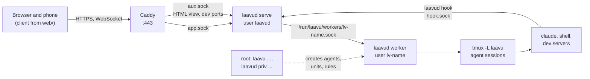

# Architecture

Which processes run on the server, who talks to whom and where state lives. Everything below is already in the code. Plans are not described here.

| Document | About |
|---|---|
| [`arch-daemon.md`](arch-daemon.md) | the `laavud` daemon: HTTP and WebSocket, session statuses, hook socket, sign-in, push, HTML view and dev servers |
| [`arch-worker.md`](arch-worker.md) | the agent worker: protocol with the daemon, tmux sessions, terminal, files, Claude Code hooks |
| [`arch-client.md`](arch-client.md) | the web client: tabs, terminal, editor, phone |
| [`arch-laavu.md`](arch-laavu.md) | the `laavu` tool: installation, creating agents and isolating them, releases, maintenance |
| [`link.md`](link.md) | the optional link to a management console: contract, `laavu link`, the root helper |
| [`dev.md`](dev.md) | build, tests, development mode, test VM |
| [`install.md`](install.md) | installing and running a server, for owners |
| [`stand-claude-code.md`](stand-claude-code.md), [`stand-vm.md`](stand-vm.md) | how Claude Code, tmux and the isolation measures behaved on a test stand before development |

## Processes on the server

There are two binaries, both in Go without cgo:

- **`laavud`** is a single file for all server roles. `serve` is the daemon, `worker` is the agent worker, `hook` is what Claude Code and tmux hooks call, `priv` runs privileged operations as root, plus `reset-auth`, `invite`, `admin`, `call` (a direct request to a worker, for diagnostics), `dev` and `version`. The client is embedded in it (`internal/webui`, `go:embed`).
- **`laavu`** is the administrator tool: it installs the server (locally or from a laptop over ssh), creates agents, updates, checks, and signs releases. It also builds for macOS and Windows so the server can be installed from a laptop.

The daemon runs as its own user `laavud` in a systemd sandbox and opens no ports itself. From the outside it can only be reached through Caddy, over two unix sockets. It can't touch agents' files or tmux, so for anything about an agent it asks that agent's worker.

The worker is the same `laavud` binary, started as the agent user `lv-<name>`. Its socket is created by systemd (`laavud-worker@.socket`), and only `laavud` can connect to it. The worker holds a PTY with `tmux attach` for each open terminal, reads and writes files through `openat2` without letting paths escape the folder, watches folders with inotify, and reads git. The `tmux -L laavu` server runs in the user instance of systemd, so restarting the worker does not touch the sessions.

Claude Code hooks (`deploy/agent/settings.json.tmpl`) and tmux hooks (`deploy/tmux.conf.tmpl`) call `laavud hook`. It gets the session name from tmux via `TMUX_PANE` and sends an event to `hook.sock`. The event carries no conversation text, only the event name, identifiers and, for `PreToolUse`, the tool and path. The daemon tells which agent sent it by `SO_PEERCRED`. Whatever the message says about the sender is not used.

The daemon never gets root and never calls `priv`. The administrator creates agents with `laavu agent create`, as root. Each agent is isolated with its own user and a 0700 home, umask 077, a systemd slice with limits, a port block and an nftables rule by uid. Details are in [`arch-laavu.md`](arch-laavu.md).

## Who talks to whom

| Link | Transport | Format |
|---|---|---|
| client → daemon | HTTPS through Caddy | REST-like API `/api/...`, cookie `__Host-laavu`, `Origin` check |
| client ↔ daemon | one WebSocket per browser tab | JSON events, the terminal uses binary frames with a 2-byte channel number |
| daemon → worker | unix socket, one connection per operation | a JSON line for request and response, then streaming operations continue with `[type][length][data]` frames (`internal/wire`) |
| worker → tmux | `tmux -L laavu` command line | `internal/tmuxctl` |
| hook → daemon | unix socket `hook.sock` | one JSON line, up to 8 KB |
| browser → push service | Web Push, VAPID | only "session X is waiting", no content |

## Three main flows

**Opening a session.** The client sends `open` over WebSocket with the terminal size. The daemon checks access and asks the worker to `ensure`: a sleeping session is brought back from the snapshot after a reboot, `claude` with `--resume`. Then an `attach` stream opens. The worker runs `tmux attach` in a PTY and packs the bytes into frames, and the daemon turns them into binary WebSocket messages. Input goes straight from xterm.js into the same channel. There is one tmux window for all connected clients, and it follows the most recently active one. Every 0.7 s the worker reports the window size, and a client whose window does not currently match hides the terminal and offers "Bring it here".

**Status and push.** Claude Code calls hooks: `UserPromptSubmit` and `PreToolUse` mean "working", `Stop` and `Notification` mean "waiting". The daemon keeps statuses in memory, copies them into tmux options so they survive a restart, and sends them to subscribers. If nothing new arrives within `push_delay` (5 s) after `Stop`, everyone who doesn't have the session on screen gets a push. Every 3 s the daemon polls tmux for agents that have subscribers. That catches sessions created outside the client and resets stuck statuses.

**A file.** The navigator asks for `tree`, the viewer for `read`. HTML, images and PDF open from a separate view origin with a per-folder token. An edit in CodeMirror is saved through `write` along with a version (sha256 of the content). The worker compares the version before writing and again right before the atomic `rename`. On a mismatch the daemon answers `409` and the client shows a comparison. Changes on disk come in through `watch` (inotify) as an `fs` event.

## Where state lives

| What | Where | Owned by | If lost |
|---|---|---|---|
| sessions and processes | the agent's `tmux -L laavu` server | agent | gone after a reboot, restored from the snapshot |
| status, conversation UUID, session author | tmux options `@laavu-*` | agent | the status is recomputed from hooks |
| snapshot for restore | `~/.local/state/laavu/sessions.json` | agent | conversations remain in the Claude Code history |
| users, passkeys, sign-in sessions, access grants, push subscriptions | SQLite in `/var/lib/laavu` | `laavud` | register a passkey again |
| statuses, push timers, last agent action, view and dev-port tokens | daemon memory | `laavud` | restored from tmux or issued again |
| tabs, panel widths, theme, "last visit" | browser localStorage | user | default layout |
| config, agents, templates, release key | `/etc/laavu` | root | reinstall |

There is no input log and no copy of conversations. Laavu passes data between the browser, tmux and the agent and keeps none of it.

## Repository map

| Path | What |
|---|---|
| `cmd/laavud`, `cmd/laavu` | entry points of the two binaries |
| `internal/daemon` | HTTP, WebSocket, statuses, hook socket, view and port proxy |
| `internal/auth`, `internal/store`, `internal/push` | passkeys and sign-in sessions, SQLite, Web Push |
| `internal/worker`, `internal/wire`, `internal/tmuxctl` | worker, protocol with the daemon, tmux control |
| `internal/hook` | `laavud hook`: events to the daemon, the guard for uncommitted changes and context fill, status line |
| `internal/safepath`, `internal/names` | safe paths inside the folder, naming rules and reserved names |
| `internal/install`, `internal/priv`, `internal/release` | installation and maintenance, agent creation and isolation checks, release signing |
| `internal/config`, `internal/webui` | `laavud.toml` and agents, embedded client |
| `pkg/link`, `internal/linkcmd` | console link: protocol, client, root helper and the report type (public, the console imports it); the `laavu link` commands |
| `deploy/` | templates: systemd units, Caddyfile, tmux.conf, agent settings and rules, reserved names |
| `web/` | client in Preact and Vite |
| `test/e2e`, `test/vm`, `test/fakeclaude` | Playwright, test VM scripts, Claude Code stub with hooks |
| `test/installer.sh`, `test/linkstub` | `install.sh` against releases, console gateway stub |
| `install.sh` | the installer script getlaavu.com serves |
| `.github/workflows` | CI (`ci.yml`) and the release draft build (`release.yml`) |
