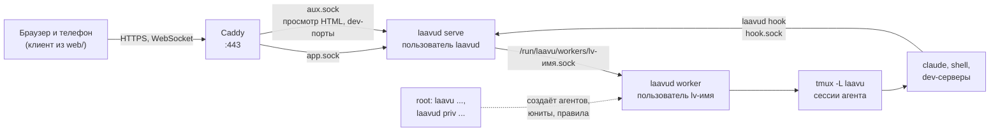

# Архитектура: как устроен код

Обзор того, что реально написано в репозитории: какие процессы работают на сервере, кто с кем говорит, где лежит состояние. Здесь только то, что есть в коде.

| Документ | О чём |
|---|---|
| [`arch-daemon.md`](arch-daemon.md) | демон `laavud`: HTTP и WebSocket, статусы сессий, сокет хуков, вход, пуш, просмотр HTML и dev-серверы |
| [`arch-worker.md`](arch-worker.md) | воркер агента: протокол с демоном, сессии tmux, терминал, файлы, хуки Claude Code |
| [`arch-client.md`](arch-client.md) | веб-клиент: вкладки, терминал, редактор, телефон |
| [`arch-laavu.md`](arch-laavu.md) | утилита `laavu`: установка, создание агентов и их изоляция, релизы, обслуживание |
| [`dev.md`](dev.md) | сборка, тесты, режим разработки, тестовая ВМ |

## Процессы на сервере

Бинарников два, оба на Go без cgo:

- **`laavud`** — один файл на все роли сервера. `serve` — демон, `worker` — воркер агента, `hook` — то, что вызывают хуки Claude Code и tmux, `priv` — привилегированные операции от root, плюс `reset-auth`, `invite`, `admin`, `dev`. Клиент вшит в него (`internal/webui`, `go:embed`).
- **`laavu`** — утилита администратора: ставит сервер (локально или с ноутбука по ssh), заводит агентов, обновляет, проверяет, подписывает релизы. Собирается и под macOS и Windows, чтобы ставить сервер с ноутбука.

**Демон** работает от своего пользователя `laavud` в песочнице systemd и сам портов не открывает: снаружи его видно только через Caddy по двум unix-сокетам. К файлам и tmux агентов доступа у него нет. Всё, что касается агента, он просит у его воркера.

**Воркер** — тот же `laavud`, запущенный от пользователя агента `lv-<имя>`. Сокет создаёт systemd (`laavud-worker@.socket`), подключиться к нему может только `laavud`. Воркер держит PTY с `tmux attach` для каждого открытого терминала, читает и пишет файлы через `openat2` с запретом выхода за рабочую папку, следит за папками через inotify, читает git. Сервер `tmux -L laavu` запускается в пользовательском экземпляре systemd, поэтому перезапуск воркера сессии не трогает.

**Хуки** Claude Code (`deploy/agent/settings.json.tmpl`) и tmux (`deploy/tmux.conf.tmpl`) вызывают `laavud hook`. Он узнаёт имя сессии у tmux по `TMUX_PANE` и шлёт в `hook.sock` событие без текста разговора: имя события, идентификаторы, для `PreToolUse` — инструмент и путь. Демон определяет агента по `SO_PEERCRED`, а не по содержимому сообщения.

**Привилегии.** Демон root не получает и `priv` не вызывает. Агентов заводит администратор командой `laavu agent create` от root. Изоляция агента: свой пользователь и дом 0700, umask 077, слайс systemd с лимитами, блок портов и правило nftables по uid. Подробно — в [`arch-laavu.md`](arch-laavu.md).

## Кто с кем говорит

| Связь | Транспорт | Формат |
|---|---|---|
| клиент → демон | HTTPS через Caddy | REST-подобный API `/api/...`, cookie `__Host-laavu`, проверка `Origin` |
| клиент ↔ демон | один WebSocket на вкладку браузера | JSON-события; терминал — двоичные кадры с 2-байтовым номером канала |
| демон → воркер | unix-сокет, одно соединение на операцию | строка JSON запроса и ответа, у потоковых операций дальше кадры `[тип][длина][данные]` (`internal/wire`) |
| воркер → tmux | командная строка `tmux -L laavu` | `internal/tmuxctl` |
| хук → демон | unix-сокет `hook.sock` | одна строка JSON, до 8 КБ |
| браузер → push-сервис | Web Push, VAPID | только «сессия X ждёт ответа», без содержимого |

## Три главных потока

**Открыть сессию.** Клиент шлёт по WebSocket `open` с размером терминала. Демон проверяет доступ, просит воркер `ensure`: спящая сессия после перезагрузки поднимается из снимка, `claude` — с `--resume`. Потом открывается поток `attach`: воркер запускает `tmux attach` в PTY и перекладывает байты в кадры, демон — в двоичные сообщения WebSocket. Ввод идёт прямо из xterm.js в тот же канал. Окно tmux одно на всех подключённых и следует за последним активным клиентом. Воркер раз в 0,7 с сообщает размер окна, и клиент, чьё окно сейчас не его размера, прячет терминал и предлагает «Вернуть сюда».

**Статус и пуш.** Claude Code вызывает хуки: `UserPromptSubmit` и `PreToolUse` дают «работает», `Stop` и `Notification` — «ждёт ответа». Демон держит статусы в памяти, копирует их в опции tmux (переживают перезапуск) и рассылает подписчикам. Через `push_delay` (5 с) после `Stop`, если нового события не было, уходит пуш тем, у кого сессия не на экране. Раз в 3 с демон опрашивает tmux у агентов с подписчиками, чтобы видеть сессии, заведённые мимо клиента, и сбрасывать зависшие статусы.

**Файл.** Навигатор просит `tree`, просмотрщик — `read`; HTML, картинки и PDF открываются с отдельного origin просмотра по токену на папку. Правка в CodeMirror сохраняется через `write` с версией (sha256 содержимого): воркер сверяет её до записи и ещё раз перед атомарным `rename`, при расхождении демон отвечает `409`, и клиент показывает сравнение. Изменения на диске приходят через `watch` (inotify) событием `fs`.

## Где лежит состояние

| Что | Где | Чьё | Если потерять |
|---|---|---|---|
| сессии и процессы | сервер `tmux -L laavu` агента | агента | пропадают при перезагрузке, поднимаются из снимка |
| статус, UUID разговора, автор сессии | опции tmux `@laavu-*` | агента | статус пересчитается по хукам |
| снимок для восстановления | `~/.local/state/laavu/sessions.json` | агента | разговоры остаются в истории Claude Code |
| пользователи, passkey, сессии входа, доступы, подписки на пуш | SQLite в `/var/lib/laavu` | `laavud` | заново зарегистрировать passkey |
| статусы, таймеры пуша, последнее действие агента, токены просмотра и dev-портов | память демона | `laavud` | восстанавливается из tmux или выдаётся заново |
| вкладки, ширины панелей, тема, «последний заход» | localStorage браузера | пользователя | раскладка по умолчанию |
| конфиг, агенты, шаблоны, ключ релизов | `/etc/laavu` | root | переустановка |

Своего журнала ввода и копии разговоров нет: Laavu — канал к tmux и агенту, а не хранилище поверх них.

## Карта репозитория

| Путь | Что |
|---|---|
| `cmd/laavud`, `cmd/laavu` | точки входа двух бинарников |
| `internal/daemon` | HTTP, WebSocket, статусы, сокет хуков, просмотр и прокси портов |
| `internal/auth`, `internal/store`, `internal/push` | passkey и сессии входа, SQLite, Web Push |
| `internal/worker`, `internal/wire`, `internal/tmuxctl` | воркер, протокол с демоном, управление tmux |
| `internal/hook` | `laavud hook`: события в демон, guard «несохранённое и контекст», строка статуса |
| `internal/safepath`, `internal/names` | безопасные пути внутри рабочей папки, правила имён и зарезервированные имена |
| `internal/install`, `internal/priv`, `internal/release` | установка и обслуживание, создание агентов и проверка изоляции, подпись релизов |
| `internal/config`, `internal/webui` | `laavud.toml` и агенты, вшитый клиент |
| `deploy/` | шаблоны: юниты systemd, Caddyfile, tmux.conf, настройки и правила агента, зарезервированные имена |
| `web/` | клиент на Preact и Vite |
| `test/e2e`, `test/vm`, `test/fakeclaude` | Playwright, скрипты тестовой ВМ, заглушка Claude Code с хуками |
