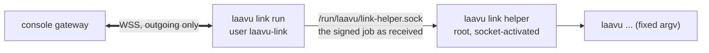

# Console link

A Laavu server can be linked to a management console that keeps it updated and watches its health. The console is optional. Everything it does is a `laavu` command you can run yourself, and the server works the same without it. This document is the contract between the server and the console, version 1. The protocol, the link client and the root helper are in `pkg/link`, so a console in another module can import them. The `laavu link` commands are in `internal/linkcmd`. A gateway stub for tests is in `pkg/link/linktest` and `test/linkstub`.

## What the console can and cannot do

The console can only ask the server to run operations from a fixed list, and only those whose right the owner left on. Rights live on the server in `/etc/laavu/link.toml`, written by root. The console can't change them.

It can never sign in to `laavud`, add users or passkeys, reset admin access, read agents' files, sessions or transcripts, run an arbitrary command, add an ssh key or change the release key. It can't send the server a binary either: `update.laavud` makes the server download a release and check its signature against the project key pinned at install time.

## On the server



- `laavu-link.service` runs `laavu link run` as the system user `laavu-link`, without capabilities, with `ProtectSystem=strict` and no access to agent homes. It holds the connection and never runs anything itself.
- `laavu-link-helper.socket` (`root:laavu-link 0660`) starts `laavu link helper` as root. The helper checks the peer uid, then checks every job itself: the console signature against the key root pinned at binding, that the job names this server, the time window, that the id hasn't run before, and the right. Only then does it build an argv for `laavu` from the typed parameters. It exits after a minute without requests, so the next job after `laavu update laavud` runs the new binary.
- A bug in the network code therefore gives an attacker the `laavu-link` user, which can do no more than the console already can.

| File | Owner | What |
|---|---|---|
| `/etc/laavu/link.toml` | `root:laavu-link 0640` | console URL, console key, server key, rights |
| `/var/lib/laavu-link/link.key` | `laavu-link 0600` | the server's ed25519 key |
| `/var/lib/laavu-helper/link-seen.json` | `root 0600` | job ids already run, until they expire |
| `/run/laavu-link/status.json` | `laavu-link` | connection state for `laavu link status` |

## Commands

```sh
sudo laavu link                                               # prints a code to enter in the console
sudo laavu link --code C                                      # with a code the console gave you
sudo laavu link --console wss://link.example.com/v1           # another console
sudo laavu link status                                        # console, console account, connection, rights
sudo laavu link rights                                        # list
sudo laavu link rights agents=on names=off                    # change
sudo laavu unlink                                             # take control back
```

Without `--console` the server links to the project's console at `wss://link.getlaavu.com/v1` (the web side is `https://console.getlaavu.com`). `laavu link` creates the user, the key (kept across bindings, the console knows the server by it) and the units. The network part of binding runs as `laavu-link` in a child process, and root only reads the console key from its output. `--console-key` pins an expected console key instead of trusting the one that came over TLS. `ws://` is accepted only on loopback, for the stub.

## Connection

The server connects to the console over WebSocket (`wss://`). Messages are JSON text frames up to 256 KiB:

```json
{"type": "hello", "data": {...}}
{"type": "job", "body": "<base64 of the JSON payload>", "sig": "<base64 ed25519 signature>"}
```

Signed messages carry the payload as base64 so both sides sign and check the same bytes. The signature covers `"laavu-link/1 " + type + "\n" + payload`, so a signature made for one message type is useless as another.

The server pings every minute. After a lost connection it reconnects after 2 s, doubling up to 5 minutes, with 20% jitter.

### Handshake

1. Server → `hello` (plain): `contracts` (`[1]`), `server_key`, `nonce`, `laavu` version; while binding, `bind: true` and an optional `code`.
2. Console → `welcome` (signed by the console key): `contract`, `server_key`, `server_nonce` (from hello), `console_key`, `nonce`, `time`. The server checks the signature, that the key equals the pinned one (if any), that `server_key` and `server_nonce` are its own and that `time` is within 5 minutes of its clock.
3. Server → `auth` (signed by the server key): `console_key`, `console_nonce`, `laavud` and `laavu` versions, `rights`.

### Binding

After `auth` in binding mode:

- If the hello carried a code the console had issued, the console answers `bound` right away.
- Otherwise the console sends `pending` (plain: `code`, `expires`), the server shows the code and its key fingerprint, the owner enters the code in the console and compares the fingerprint, and the console sends `bound`.

`bound` is signed by the console: `server_key`, `time` and `account`, the console account the server now belongs to. The server pins the console key in `link.toml` with default rights and starts the service. `laavu link` and `laavu link status` print the account, so if someone else typed the code in first, the owner sees a stranger's account and runs `laavu unlink`. The fingerprint is the first 8 bytes of SHA-256 of the raw public key, hex, in groups of four: `1cbb-8d2c-81a1-745d`.

### Messages after the handshake

| From | Type | Payload |
|---|---|---|
| console | `job` | signed: `id` (up to 64 chars), `server_key`, `op`, `params`, `not_before`, `expires` (unix seconds) |
| server | `result` | `id`, `status`, `code` (exit code), `output` (last 16 KiB) |
| server | `report` | the `laavu check` report, see below; on connect and every hour. A `check` job returns the same report in `result.output` |
| server | `rights` | all rights, when the owner changed them |
| server | `unlink` | the owner ran `laavu unlink`; the server closes the connection |
| server | `dns.set_ip` | signed by the server: `name`, `ip`, `time`. Reserved; the only way a server name moves to a new address |
| either | `error` | `message`, before closing |

Result statuses: `done`, `failed` (the command ran and exited non-zero), `refused` (bad signature, another server, right off, unknown operation, bad parameters, already ran), `expired`. A job is refused if `expires - not_before` is over 7 days or `not_before` is more than 5 minutes ahead. The server runs jobs one at a time, in order. A job that updates `laavud` restarts the link, so its result may not arrive. The console sees the new version in the next `auth`.

## Operations and rights

| Right | Default | Operations |
|---|---|---|
| `updates` | on | `update.laavud`, `update.os`, `update.claude`, `update.templates` |
| `monitoring` | on | `check`; periodic reports |
| `firewall` | on | `firewall.allow`, `firewall.deny` `{"port": 1-65535, "proto": "tcp"\|"udp"}` (`proto` is optional, without it the rule covers both) |
| `maintenance` | on | `restart.laavud`, `cleanup` |
| `domain` | on | none yet (DNS-01 and `dns.set_ip`) |
| `snapshots` | off | none yet |
| `agents` | off | `agent.create {"name", "memory"}`, `agent.delete {"name", "keep_home"}`, `agent.limits {"name", "memory", "tasks", "cpu_weight"}` |
| `diagnostics` | off | `diag` |
| `names` | off | no operations: agent names in reports and output |
| | always | `link.unlink`: the console gives up the server; the binding and key are removed |

Parameters are strict: unknown fields are refused, names follow the agent name rules, memory looks like `512M` or `2G`. Operations without parameters refuse any.

## Report

`laavu check --json`, schema `1`, type `link.Report`: `schema`, `time`, `versions`, `services`, `disk`, `memory_mb`, `certs`, `agents` (`name`, `worker`, `ports`, `claude`), `isolation` (the last `check-isolation`), `os_updates`, `reboot_required`, `tailscale` (`extra`, `only` or empty), `url` (the app address, `public_url` from `laavud.toml`; added without a schema bump, older servers leave it out), `problems`.

Without the `names` right, agents become `agent-1`, `agent-2`…, ports are dropped, and agent names in `problems`, certificate names and job output are replaced with the same aliases. `lv-<name>` and agent home paths in job output are masked too. An agent's name is often a project's name, and that's more than the console needs.

## Versions

A new field in a payload doesn't change the contract version: both sides ignore fields they don't know. Removing a field, changing its meaning, or changing signing does. The server lists the versions it speaks in `hello`, the console picks the highest common one in `welcome`.

## Testing

`go test ./pkg/link/` runs the protocol against the in-process stub: binding both ways, pinned key, jobs by rights and parameters, replay, another server's job, expired, forged and cross-type signatures, redaction, rights updates, unlink from both sides.

`test/vm/e2e-link.sh` does the same on a VM through systemd, with `test/linkstub` as the console. It uses its own VM so the everyday one isn't reset:

```sh
VM_NAME=laavu-link VM_SSH_PORT=2232 VM_FORWARD_PORTS= test/vm/create.sh
VM_NAME=laavu-link VM_SSH_PORT=2232 test/vm/e2e-link.sh
```
